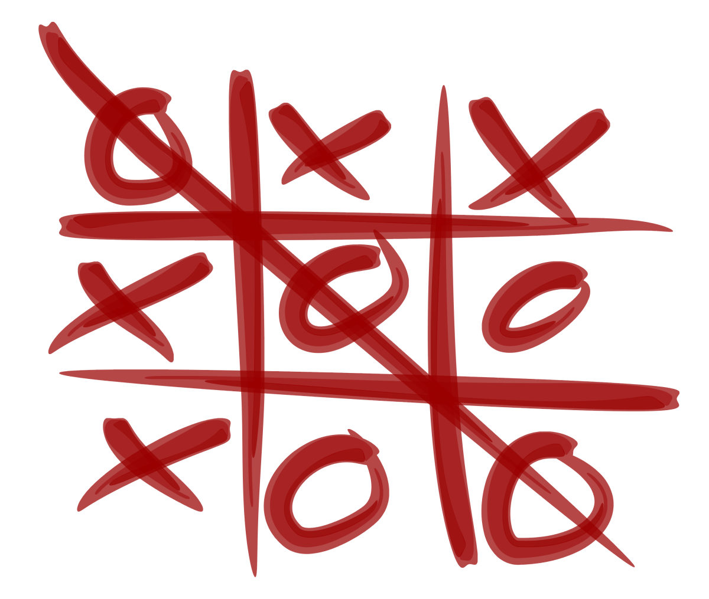
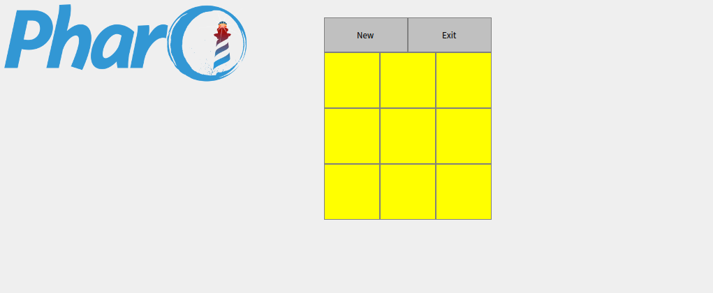
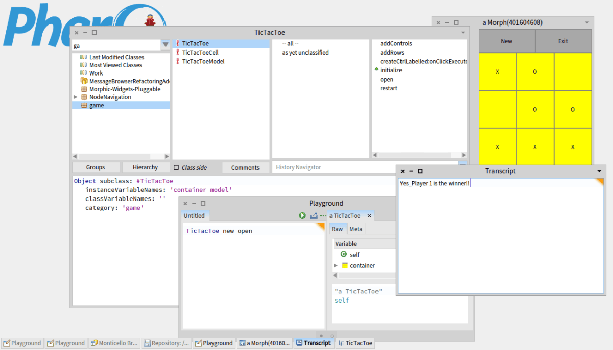

<em><strong>This tutorial has been included as a chapter in  <a href="https://github.com/SquareBracketAssociates/FunWithPharo/tree/master/TicTacToe">Fun With Pharo!</a></strong></em>

<b>Tic-tac-toe</b> (or <b>Noughts and crosses</b>, <b>Xs and Os</b>) is a paper-and-pencil game for two players, <i>X</i> and <i>O</i>, who take turns marking the spaces in a 3×3 grid. The player who succeeds in placing three respective marks in a horizontal, vertical, or diagonal row wins the game.

Because of the simplicity of Tic-tac-toe, it is often used as a pedagogical tool for teaching the concepts of good sportsmanship and the branch of artificial intelligence that deals with the searching of game trees. It is straightforward to write a computer program to play Tic-tac-toe perfectly, to enumerate the 765 essentially different positions (the state space complexity), or the 26,830 possible games up to rotations and reflections (the game tree complexity) on this space.

So , here we make a Pharo version of this well-known game by using Morph. This post provides a step-by-step approach on how to go about building this simple application.

A <strong>game</strong> package will be built having 3 subclasses :

<ul>
<li>TicTacToe</li>
<li>TicTacToeCell</li>
<li>TicTacToeModel</li>
</ul>

Initially , we have created <strong>TicTacToe</strong> a subclass of the <em>Object</em> class. The subclasses we will make will be combined in the package <strong>game</strong> as mentioned in the <em>category:</em> parameter.

<figure>
<blockquote>
<pre><code class="smalltalk">Object subclass: #TicTacToe
instanceVariableNames: 'container model'
classVariableNames: ''
poolDictionaries: ''
category: 'game'</code></pre>
</blockquote><figcaption></figcaption></figure>

A category name is not required in order for the class to work, but you will not be able to access the class to make changes or to look at existing code unless you provide a category name. (The category name used can be a new category name or the name of an existing category.)

The <em>poolDictionaries:</em> parameter is seldom used and will not be discussed here, and the category: parameter specifies the category under which this class will be grouped in the system browser.

As we know, a class encapsulates data values and methods, and every object contains a set of the data values and can receive any of the methods as a message. The data values in each object are specified by providing a set of names of variables whose values will be an object&#8217;s internal data values. Each object has its own set of these values, and the set of data values for an object represents the object&#8217;s state (or value). The variables that contain the data values of an object are called the <em>instance variables</em> for the object, and the <em>instanceVariableNames:</em> parameter is a list of names, separated by blanks, for the instance variables. In the above code snippet , we have declared <strong>container</strong> and <strong>model</strong> as two instanceVariables.

The <em>classVariableNames:</em> parameter lists the identifiers that are the names of variables shared by the class and all of its objects. That is, there is only one set of these, and they are used by the class and all of its objects. Class variables (so called because they belong to the class, of which there is only one, rather than to the objects that are instances of the class) are rarely needed.

An example of a class variable that could be useful is in a case where we wanted a unique &#8220;serial number&#8221; to be assigned to each instance of the class as it is created. The variable containing the next available (or last used) serial number would appropriately be a class variable, and each time a new instance (object) is created the serial number would be recorded as an instance variable value in the object and the serial number in the class variable would be incremented. Thus, each object can be serially numbered as it is created (without using one of those nasty global variables!).

After executing the code above, class <strong>TicTacToe</strong> will exist. However, it will have no methods other than those that are inherited from class Object. To make it useful, we must add the methods that are needed for our implementation.

<strong>Adding methods to classes : </strong>

The subClasses interact by passing messages through objects only.

<figure>
<blockquote>
<pre><code class="smalltalk">TicTacToe&gt;&gt;#initialize 
container := Morph new 
              layoutPolicy: TableLayout new; 
              color: Color transparent.
model := TicTacToeModel new:3.
self addRows.
self addControls.
^self.</code></pre>
</blockquote><figcaption></figcaption></figure>

The notation <em><strong>TicTacToe&gt;&gt;#initialize</strong></em> means that we have a method named <em>initialize</em> in the subclass <em>TicTacToe</em>.

In the <strong>initialize:</strong> method above , we have a container which is the instance of the class Morph (<em>Morphic is the name given to Pharo’s graphical interface. </em>). We define the various attributes of the container such as <em>layoutPolicy: </em> and <em>color:</em>. <em>model</em> is another instance of the class <strong>TicTacToeModel</strong> which we will be creating further in this example.

<strong>self</strong> refers to the receiver of the message. It is usually used within a method to send additional messages to the receiver. self is frequently used when it is desired to pass the sender object (self), as a message argument, to a receiver who requires knowledege of the sender or who will in some way manipulate the sender.

In short, self refers to the object itself that defines the method.

<figure>
<blockquote>
<pre><code class="smalltalk">TicTacToe&gt;&gt;#addRows
| rowMorph aCell rowCol |
1 to:3 do:[ :row |
rowMorph := Morph new layoutPolicy: RowLayout new.
1 to: 3 do: [ :col |
aCell := TicTacToeCell new.
aCell setModel: (model) row: row col: col.
rowMorph addMorph: aCell.
].
container addMorph: rowMorph.
]</code></pre>
</blockquote><figcaption></figcaption></figure>

The method <strong>addRows</strong> (the name is self explanatory) is used to add rows in the Tic Tac Toe grid. It declares temporary (local) variables <strong>rowMorph</strong> , <strong>aCell</strong> and <strong>rowCol</strong> which can&#8217;t be used beyond this method.

<em>1 to:3 do:[ :row |</em>

<em>rowMorph := Morph new layoutPolicy: RowLayout new.</em>

<em>1 to: 3 do: [ :col |</em>

<em>aCell := TicTacToeCell new.</em>

<em>aCell setModel: (model) row: row col: col.</em>

<em>rowMorph addMorph: aCell.</em>

<em>].</em>

The above code snippet works as a nested loop that runs thrice for each three rows to create a 3X3 grid as per requirement.

<figure>
<blockquote>
<pre><code class="smalltalk">TicTacToe&gt;&gt;#addControls
| rowMorph newGameButton exitGameButton |
rowMorph := Morph new 
             layoutPolicy: RowLayout new; 
             color: Color transparent.
newGameButton := self createCtrlLabelled: 'New'    onClickExecutes: [self restart].
exitGameButton := self createCtrlLabelled: 'Exit'  onClickExecutes: [container delete].
rowMorph addMorph: exitGameButton.
rowMorph addMorph: newGameButton.
container addMorph: rowMorph.</code></pre>
</blockquote><figcaption></figcaption></figure>

This method adds controls to the game. The local variables are : <strong>rowMorph</strong> , <strong>newGameButton</strong> and <strong>exitGameButton</strong>.

<em>rowMorph</em> defines an instance of the class Morph which would be the placeholder for the two control buttons located at the top. The two control buttons are defined as <strong>New</strong> using the variable <em>new GameButton</em> which on click would <em>restart</em> the game , and <strong>Exit</strong> using the <em>exitGameButton</em> which on click would close the game. The buttons are created using a method <strong>createCtrlLabelled</strong> which we define next.

<strong>rowMorph addMorph: newGameButton</strong> adds the button to the Morph instance created earlier.

<figure>
<blockquote>
<pre><code class="smalltalk">TicTacToe&gt;&gt;#createCtrlLabelled: aString onClickExecutes: aBlock
| aCtrlButton |
aCtrlButton := SimpleButtonMorph new label: aString.
aCtrlButton color: (Color black alpha: 0.2).
aCtrlButton extent: 120@50.
aCtrlButton on: #click send: #value to: aBlock.
^aCtrlButton.</code></pre>
</blockquote><figcaption></figcaption></figure>

<strong>TicTacToe&gt;&gt;#createCtrlLabelled: aString onClickExecutes: aBlock</strong> method makes a simple button using Morph adds label and control to it.

<figure>
<blockquote>
<pre><code class="smalltalk">TicTacToe&gt;&gt;#open 
container openInWindow.</code></pre>
</blockquote><figcaption></figcaption></figure>

The <strong>open</strong> method defines as to how the game/TicTacToe class would open. Here we have defined it to open in a dialog box.

<figure>
<blockquote>
<pre><code class="smalltalk">TicTacToe&gt;&gt;#restart
container delete.
Smalltalk garbageCollect.
TicTacToe new open.</code></pre>
</blockquote><figcaption></figcaption></figure>

It closes the game and calls for Garbage Collection (Garbage Collection (GC) is a form of automatic memory management. It finds data objects in a program that cannot be accessed in the future and reclaims the resources used by those objects.)

<figure>
<blockquote>
<pre><code class="smalltalk">SimpleButtonMorph subclass: #TicTacToeCell
instanceVariableNames: 'parentModel rowNum colNum'
classVariableNames: ''
poolDictionaries: ''
category: 'game'</code></pre>
</blockquote><figcaption></figcaption></figure>

Here a subclass <strong>TicTacToeCell</strong> is defind in the <em>SimpleButtonMorph</em> class with <strong>parentModel</strong> , <strong>rowNum</strong> and <strong>colNum</strong> as the instance variables. This class defines the button for each cell of the grid.

<figure>
<blockquote>
<pre><code class="smalltalk">TicTacToeCell&gt;&gt;#initialize 
super initialize.
self label: ''.
self extent: 80@80.
self color: Color yellow .
self on: #click send: #value to: (self onClickExecutionBlock).
^self.</code></pre>
</blockquote><figcaption></figcaption></figure>

This <strong>initialize</strong> method initialises the button size as 80X80 and gives it the <em>color:</em> yellow. An &#8216;onClick&#8217; control is given to the button which then calls the <strong>onClickExecutionBlock</strong> method present in the same class.

<figure>
<blockquote>
<pre><code class="smalltalk">TicTacToeCell&gt;&gt;#setModel: ticTacToeModel row: aRow col: aCol
parentModel := ticTacToeModel.
rowNum := aRow.
colNum := aCol.</code></pre>
</blockquote><figcaption></figcaption></figure>

The <strong>setModel: row: col: </strong> takes three arguments <strong>ticTacToeModel</strong> , <strong>aRow</strong> and <strong>aCol</strong>. The <em>parentModel</em> is assigned ticTacToeModel , <em>roNum</em> becomes the value of aRow and similiarly <em>colNum</em> has the value aCol.

<figure>
<blockquote>
<pre><code class="smalltalk">TicTacToeCell&gt;&gt;#onClickExecutionBlock
^[
(self label size) == 0
ifTrue:[
self label: (parentModel updateAtRow: rowNum 
                Col: colNum).
parentModel checkWinCondition.
self extent: 80@80.
].
 ]</code></pre>
</blockquote><figcaption></figcaption></figure>

This method defines what should happen when each cell in the grid is clicked. At every click , the label of the cell is changed to <strong>X</strong> or <strong>O</strong> depending upon whose turn it is , the row numbers and coloumn numbers are updated in the <em>parentModel</em> and <em>win condition</em> is checked by calling the <strong>checkWinCondition</strong> method of the class <strong>TicTacToeModel</strong> defined next.

<figure>
<blockquote>
<pre><code class="smalltalk">Matrix subclass: #TicTacToeModel
instanceVariableNames: 'filledCellCount currentFill winner'
classVariableNames: ''
poolDictionaries: ''
category: 'game'</code></pre>
</blockquote><figcaption></figcaption></figure>

A subclass <strong>TicTacToeModel</strong> is defined in the <em>Matrix</em> class with <strong>filledCellCount</strong> , <strong>currentFill</strong> and <strong>winner</strong> as the instance variables.

<figure>
<blockquote>
<pre><code class="smalltalk">TicTacToeModel&gt;&gt;#initialize 
super initialize.
filledCellCount := 0.
currentFill := nil.
winner := nil.</code></pre>
</blockquote><figcaption></figcaption></figure>

This <strong>initialize</strong> methods defines that initially no cell in the grid is filled and there is no <em>winner</em> as of now.

<figure>
<blockquote>
<pre><code class="smalltalk">TicTacToeModel&gt;&gt;#updateAtRow: r Col: c
currentFill == nil
ifTrue:[ currentFill := 'X'. ]
ifFalse:[
currentFill == 'X'
ifTrue: [ currentFill := 'O'. ]
ifFalse: [ currentFill := 'X'. ]
].
self at: r at: c put: currentFill.
filledCellCount := filledCellCount + 1.
^currentFill.</code></pre>
</blockquote><figcaption></figcaption></figure>

The <strong>updateRowAt: Col: </strong> method takes two arguments <em>r</em> and <em>c</em> used to update the <em>currentFill</em> and <em>filledCellCount</em> variables.

<figure>
<blockquote>
<pre><code class="smalltalk">TicTacToeModel&gt;&gt;#checkWinCondition
filledCellCount &gt;= 5 "for optimization. Win can occur minimum at 5th turn"
ifTrue: [
Transcript show: 'Yes'.
1 to: 3 do: [:idx |
self checkWinConditionInRow: idx.
self checkWinConditionInColumn: idx.
].
self checkWinConditionInDiagonals.
].
checkWinConditionInRow: rowNum
|set|
winner isNil
ifTrue: [
set := (self atRow: rowNum) asSet.
self checkWinConditionInSet: set
].
^winner.</code></pre>
</blockquote><figcaption></figcaption></figure>

The method <strong>checkWinCondition</strong> is self explanatory. It is used to check if we have a winner or not at every move.

<figure>
<blockquote>
<pre><code class="smalltalk">TicTacToeModel&gt;&gt;#checkWinConditionInColumn: colNum
|set|
winner isNil
ifTrue: [
set := (self atColumn: colNum) asSet.
self checkWinConditionInSet: set.
].
^winner.</code></pre>
</blockquote><figcaption></figcaption></figure>
<figure>
<blockquote>
<pre><code class="smalltalk">TicTacToeModel&gt;&gt;#checkWinConditionInDiagonals
|set1 set2 |
winner isNil
ifTrue: [
set1 := (self diagonal) asSet.
set2 := Set newFrom: {(self at: 1 at: 3). (self at: 2 at: 2). (self at: 3 at: 1)} asOrderedCollection.
self checkWinConditionInSet: set1.
self checkWinConditionInSet: set2.
].
^winner.</code></pre>
</blockquote><figcaption></figcaption></figure>
<figure>
<blockquote>
<pre><code class="smalltalk">TicTacToeModel&gt;&gt;#checkWinConditionInSet: aSet
aSet size == 1
ifTrue: [
(aSet includes: 'X')
ifTrue: [
        winner := 'P1'. 
        Transcript open. 
        Transcript show: 'Player 1 is the winner!!'.
    ].

(aSet includes: 'O')

ifTrue: [
        winner := 'P2'.  
        Transcript open. 
        Transcript show: 'Player 2 is the winner!!'.
    ].
].</code></pre>
</blockquote>
</figure>

.

Now , we have made the game. To open the game , simply execute the following in the playground/workspace.

<figure>
<blockquote>
<pre><code>TicTacToe new open.</code></pre>
</blockquote><figcaption></figcaption></figure>

The messages : &#8216;Yes&#8217; , &#8216;Player <strong>x</strong> is the winner&#8217; will be displayed in the <em>Transcript</em>.

<em>PS &#8211; This was just the basic implementation. I plan to improvise it further with graphics and other functionality/features.</em>

<strong>Do like the post if it was helpful. 
For any queries/suggestions please comment below.</strong>

<strong>Thank You</strong>

