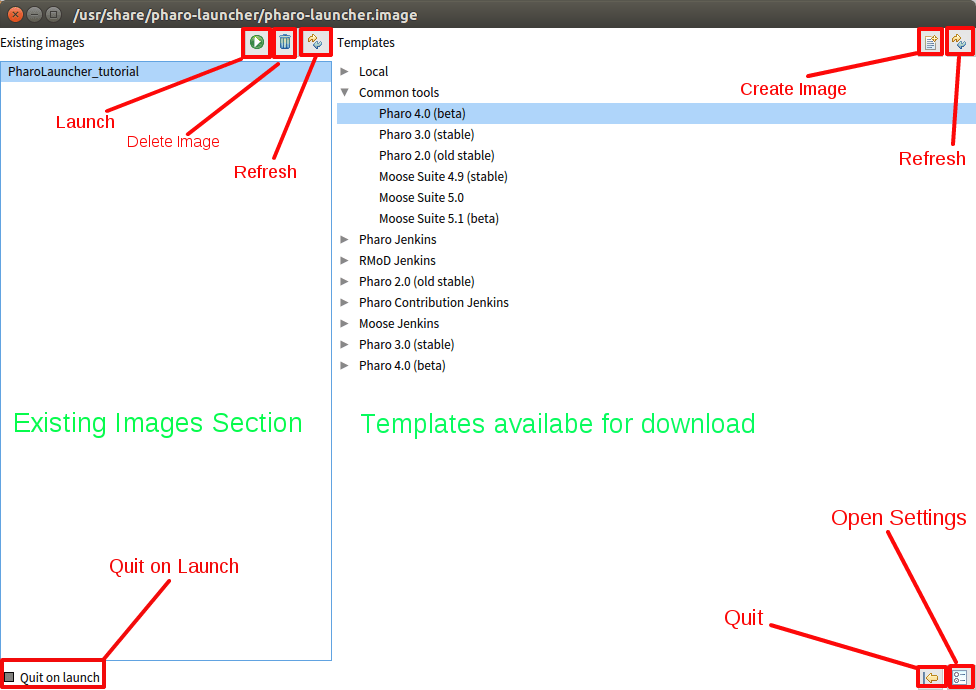
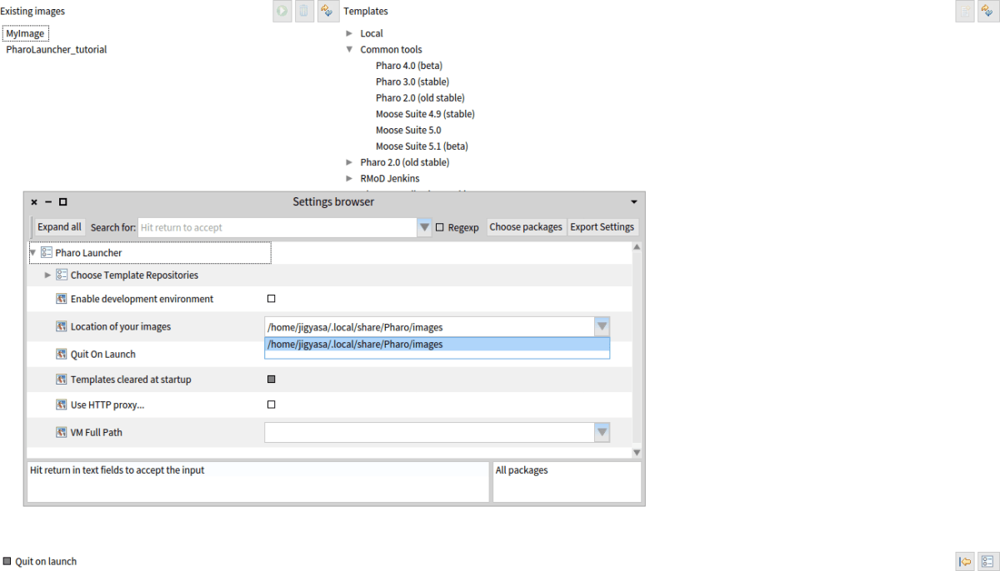
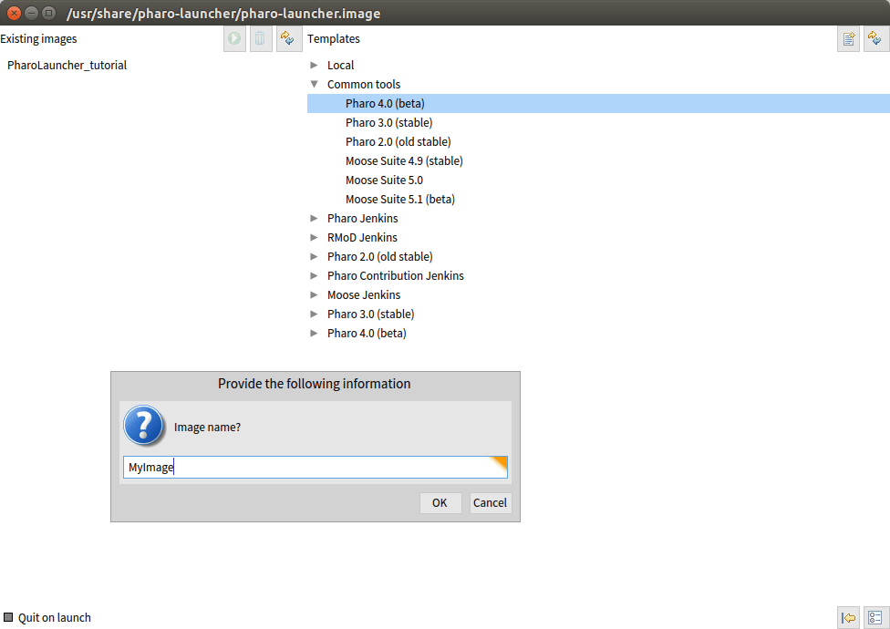
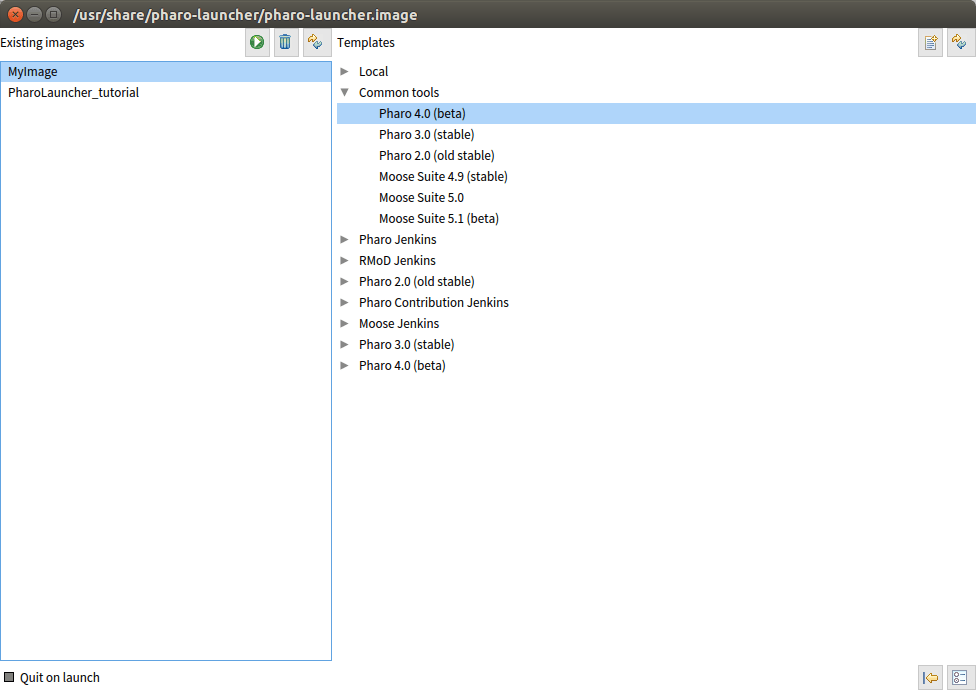
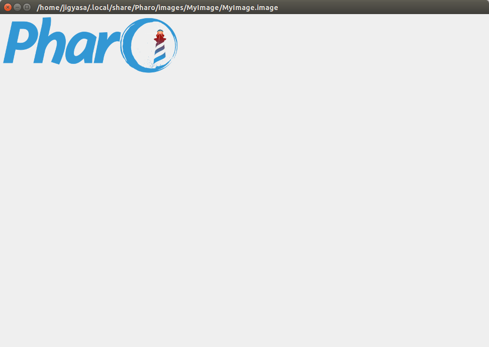

<em><strong>This tutorial has been included as a chapter in  <a href="https://github.com/SquareBracketAssociates/PharoInProgress/tree/master/PharoLauncherTutorial">Pharo In Progress</a>.</strong></em>

This post aims to provide a basic overview of what PharoLauncher is and give a step-by-step approach on how to use this application of great advantage.

<h3><strong>Overview</strong></h3>

Pharo is an open source implementation of the programming language and environment Smalltalk. Pharo is not Smalltalk. Pharo is Smalltalk-inspired.

Pharo offers strong live programming features such as immediate object manipulation, live update, and hot recompilation. Live programming environment is in the heart of the system. Pharo also supports advanced web development with frameworks such as Seaside and more recently Tide.

The official Pharo website defines it as: <em>&#8221;Pharo is a pure object-oriented programming language and a powerful environment, focused on simplicity and immediate feedback (think IDE and OS rolled into one). &#8221;</em>

Pharo relies on a virtual machine that is written almost entirely in Smalltalk itself. Pharo environment is its own little world, designed around a conception of a computer with a minimal operating system and populated with living objects. A Smalltalk implementation is composed of an image (binary code), a major source file and a ‘changes’ file. The image is called Virtual Image (VI) because is independent of the platform you use for running Smalltalk. Smalltalk systems store the entire program state (including both Class and non-Class objects) in an image file. The image can then be loaded by the Smalltalk virtual machine to restore a Smalltalk-like system to a prior state.

As Pharo is open source, it growing rapidly owing to the contributions of people all around the world. Each day we have a new update of the image of Pharo which makes it cumbersome to keep track of updates. It becomes quite a task when one has to download a new image seperately each he/she plans to work on something having the latest issues fixed, new features added etc. That&#8217;s where the PharoLauncher comes in the picture. Pharo Launcher, a cross-platform application that

<ul>
<li>lets you manage your Pharo images (launch, rename, copy and delete);</li>
<li>lets you download image templates (i.e., zip archives) from many different sources (Jenkins, files.pharo.org, and your local cache) and create new images from any template.</li>
</ul>

The idea behind the Pharo Launcher is that you should be able to access it very rapidly from your OS application launcher. As a result launching any image is never more than 3 clicks away. &#8220;PharoLauncher&#8221; is useful to a user who develops and needs to constantly switch between images. PharoLauncher is also a very handy tool to download specific image update versions if you want to reproduce or fix Pharo bugs.Pharo Launcher is a Pharo-based application allowing you to manage a list of images (download, rename, delete) and switch between them without aditional tools.

<h3><strong>Downloading/Installing PharoLauncher</strong></h3>

As discussed earlier about the rapid evolvement of Pharo , kindly check out <a href="http://www.pharo.org/download">http://www.pharo.org/download</a> to get the latest download/install instructions for Pharo Launcher.

<h4>Linux Ubuntu:</h4>

(<a href="http://pharo.org/download#ubuntu">http://pharo.org/download#ubuntu</a>) Ubuntu users can use the dedicated ppa to install Pharo

<figure>
<blockquote>
<pre><code class="smalltalk">sudo add-apt-repository ppa:pharo/stable
sudo dpkg --add-architecture i386
sudo apt-get update
sudo apt-get install pharo-launcher</code></pre>
</blockquote><figcaption></figcaption></figure>

If you don&#8217;t have the add-apt-repository command, install the software-properties-common package and try again. If you are on a server (no GUI), you can get a Pharo Virtual Machine by installing pharo-vm-core.

On Ubuntu, the Launcher is installed as <em>/usr/bin/pharo</em>, so you can type the following command on the terminal to start the Pharo Launcher.

<figure>
<blockquote>
<pre><code>pharo </code></pre>
</blockquote><figcaption></figcaption></figure>
<h4>ArchLinux :</h4>

(<a href="http://lists.pharo.org/pipermail/pharo-users_lists.pharo.org/2014-March/010932.html">http://lists.pharo.org/pipermail/pharo-users_lists.pharo.org/2014-March/010932.html</a>)

<figure>
<blockquote>
<pre><code class="smalltalk">$ yaourt pharo-vm-latest
$ pharo /path/to/your/image</code></pre>
</blockquote><figcaption></figcaption></figure>

There&#8217;s also a pharo-launcher package that depends on pharo-vm:

<figure>
<blockquote>
<pre><code class="smalltalk">$ yaourt pharo-launcher
$ pharo-launcher</code></pre>
</blockquote><figcaption></figcaption></figure>
<h4>Windows:</h4>

Download and install the executable from the link provided <a href="http://files.pharo.org/platform/launcher/latest.exe" target="_blank">here</a>.

<h4>MacOS:</h4>

Use the link (<a href="//files.pharo.org/platform/launcher/latest.dmg">http://files.pharo.org/platform/launcher/latest.dmg</a>)to install Pharo Launcher on Mac system. After installation , you&#8217;ll observe that the Launcher is installed in <em>/Applications.</em>

<h3><strong>Using PharoLauncher</strong></h3>

Launch the Pharo launcher image using the platform-specific VM. The image below depicts how a PharoLauncher looks like when it is opened.

The screen displayed initially has been divided into two parts.

The left part &#8216;Existing Images&#8217; displays the images already created by the user. Initially after the installation the left side with local images is empty. Whereas the the right side is the &#8216;Templates&#8217; section which displays the image templates from various resources available for download from the internet. The &#8216;Existing Images&#8217; section has 3 buttons : Launch, Delete and Refresh. The &#8216;Templates&#8217; section has 2 buttons : Create Image and Refresh.

At the bottom of the launcher we have the buttons for quit and settings.

Select the image you wish to work on from the list and the sources provided in the &#8216;Templates&#8217; section and download it. For instance you can download &#8220;Pharo4.0 (beta)” from the options provided which is the latest image as of today. By clicking on the &#8216;Create Image&#8217; button at the top right corner.

Note that also the images from contribution CI are available. So you can easily download &#8220;Artefact&#8221;, &#8220;Moose&#8221;, &#8230; images according to your choice.

It will download the image into a specific directory somewhere in your users home directory. Each image gets an own folder. Use the &#8220;Show in folder&#8221; menu item to open this location.

The location of the images can be changed through the &#8216;Settings Browser&#8217; option located at the bottom-right corner. Go to the &#8216;Open Settings&#8217; &gt; &#8216;Location of your images&#8217;. Now enter the desired path in the place provided as shown in the figure.

After &#8216;Creating an image&#8217; , a dialog box appears which asks you to give a name to the image as shown in figure below.

After entering the suitable name , the image is displayed in the &#8216;Existing Images&#8217; section.

To launch the image, simply select your option and click on the &#8216;Launch&#8217; button located at the top right corner of the &#8216;Existing Images&#8217; section and voila ! You have the pharo image of your choice running with the name of your choice.

You could watch this video on Pharo Launcher by Kilon Alios to get a clearer view (<a href="https://www.youtube.com/watch?v=fNim2Yxs320">https://www.youtube.com/watch?v=fNim2Yxs320</a>) Resources to explore further:

<ul>
<li>Official Pharo Website (<a href="http://pharo.org/">pharo.org</a>)</li>
<li>Pharo Launcher project on SmalltalkHub (<a href="http://www.smalltalkhub.com/#%21/%7EPharo/PharoLauncher">smalltalkhub.com/Pharo/PharoLauncher</a>)</li>
<li>Pharo Launcher at Continuous Integration, Inria Platform (<a href="https://ci.inria.fr/pharo-contribution/job/PharoProjectCatalog/HTML_Report/PharoLauncher.html">ci.inria.fr/PharoLauncher.html</a>)</li>
<li>Pharo Mailing List discussion on Pharo Launcher (<a href="http://lists.pharo.org/pipermail/pharo-dev_lists.pharo.org/">lists.pharo.org/pharo-dev_lists.pharo.org</a>)</li>
</ul>

<strong>Do like the post if it was helpful. 
</strong><strong>For any queries/suggestions please comment below.

</strong><strong>Thank You  🙂</strong>

