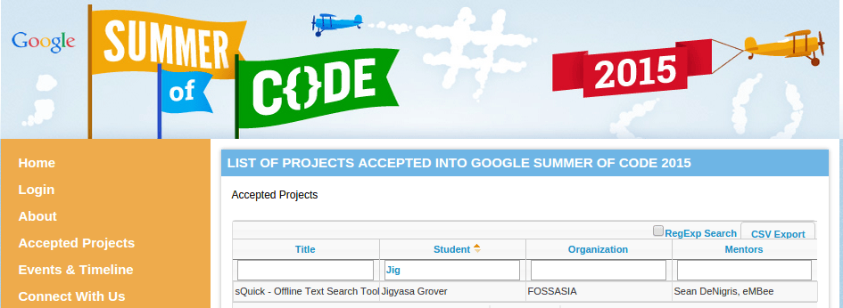
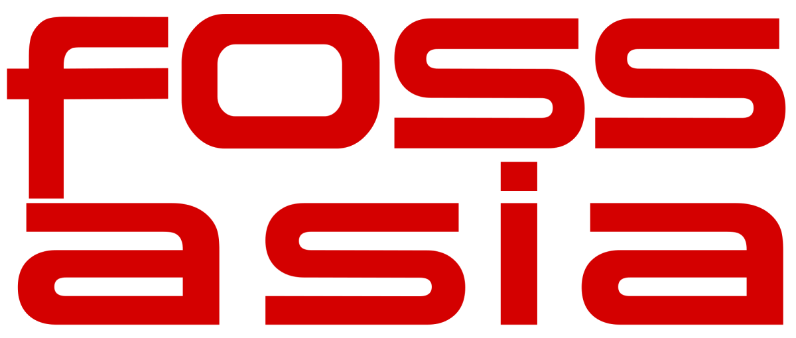

I could actually feel the blood rushing and the increased heart rate when I read my name alongside my submitted proposal in the list of the accepted projects for<em><strong> Google Summer of Code 2015</strong></em>.

I have never felt so accomplished in my 19 years ( soon-to-be-20 ). It instills in hope that hard work does pay. <em>&#8221; It might not be a great thing for many, but it is certainly a confidence-booster for me !</em> &#8221;

The first thing I did was call my sister &amp; parents at 1 am, who have been my support throughout which was followed by thanking my mentors , the organization administrators and fellow students.

I feel so privileged to be selected among the thousands for this coveted summer program of Google.

I owe my sincerest gratitude to <strong>FOSSASIA</strong> mentors : <em>Martin Bahr</em> and <em>Sean P. DeNigris</em>,  for providing me with an opportunity so great.

<blockquote>

&#8221; With great power (<em>read success</em>) comes great responsibility &#8220;

</blockquote>

With the name/proposal being accepted , I have to work hard this summer. Toiling hard, reading documentations, exploring pre-existing packages, there is a lot I need to work upon to build a worthy application. 
Looking forward to an amazing learning experience and a fruitful summer ahead. 
Ciao !

<blockquote>
Code the summer away &#8230;..
</blockquote>
