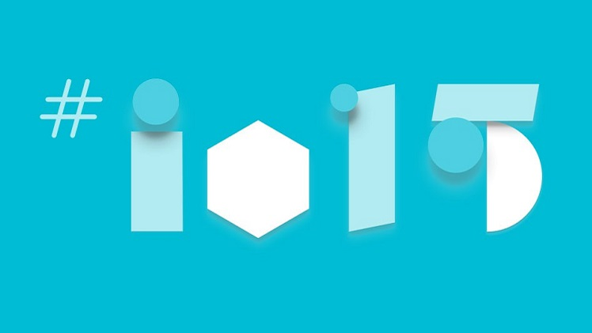
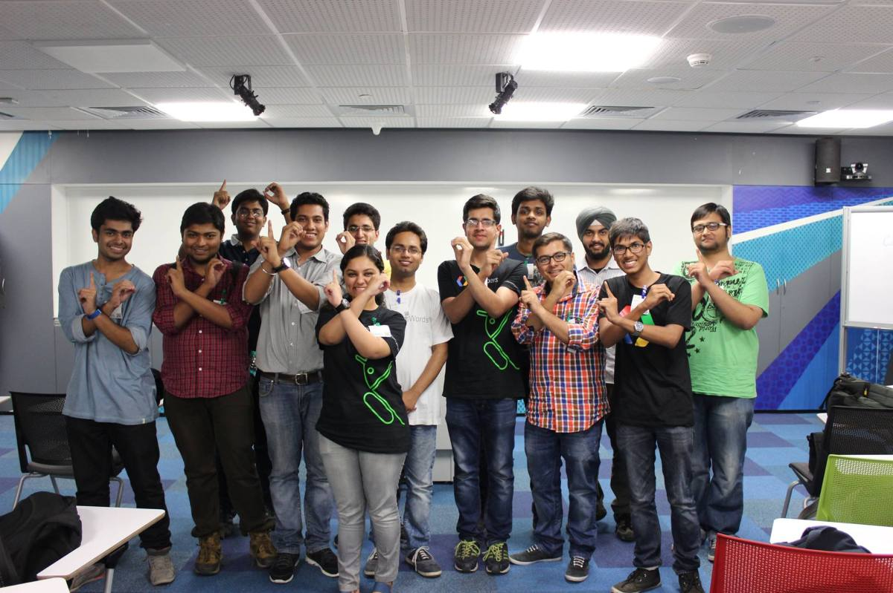

Every year, Google hosts developers around world to showcase innovations in areas like Android mobile development, Modern front-end tools, infrastructure &amp; DevOps, wearables, phones etc. This year, Google hosted the coveted I/O event in San Francisco on <strong>28th &#8211; 29th May, 2015</strong> (<a href="https://events.google.com/io2015">Google I/O 2015</a>).

As interesting as it sounds, many developers around the world feel left out as they are unable to attend the Google I/O event every year. Students and Industry Experts are always vying to get a glimpse of this much awaited event, but in vain.

To overcome this, Google has created an initiative which helps extending this conference through various communities like the Google Developer Groups, Google Business Groups etc, titled as ‘<strong>Google I/O Extended</strong>’ to different locations through interested organizers for the benefit of developers, students, start-up junkies around the world.

We, at <a title="GDG New Delhi" href="https://plus.google.com/u/0/114576537688641864561/posts">GDG New Delhi</a> hosted the live streaming of the event at Google India office which started after a Pizza Party on the Google Office premises and the initial introduction and ice-breaker activities around 9 pm on 28th May 2015 and went on till early morning on 29th may 2015.

The main agenda of the event had keynotes live streamed from select sessions. In addition to that, we had presentations on Android, Polymer, Trivia games and so on. Furthermore it included local interactive speaker sessions, hangout sessions and entertainment and some fun activities like the maximum tweet contest, tech quiz , selfie sessions etc.

All in all it was a fun event to organize and I hope everyone enjoyed the night to their full !

<strong>The GDG New Delhi Team.</strong>

