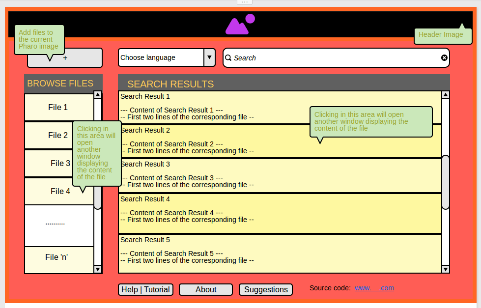

The intended <strong>“searchQuick” (sQuick)</strong> is an application to enable a user to search a set of books or texts, like an encyclopedia, or some other topical book collection offline built in the open source platform Pharo 4.0.

In the inceptive coding period of this project development the tasks achieved are as:

<ul>
<ul>
<li>Designing the basic graphical user interface using Morphs in Pharo 4.0. The morphs elements utilized to make the interface elements included: 
<em>&#8211; TextMorph for labels etc. 
&#8211; PluggableTextMorph to display the contents of the file 
&#8211; ImageMorph for background, header GIFs etc. 
&#8211; TextMorphForEditView to enter the search string. 
&#8211; SimpleButtonMorphs for creating buttons whose click will perform the desired action. 
&#8211; MenuMorph , MenuItemMorph to make the list of files available as &#8216;Browse&#8217; menu. 
&#8211; DropListMorph to make a drop down list menu for the selection of languages.</em></li>
</ul>
</ul>
<ul>
<ul>
<li>Loading the files in the current Pharo image and making methods/classes that would directly access those files from the image and display their names as a menu list</li>
</ul>
</ul>
<ul>
<ul>
<li>Making a Metacello Configuration of the project for easy project loading in Pharo.</li>
</ul>
</ul>
<ul>
<ul>
<li>For further ease, the project configuration was directly added to the Meta Repo of Pharo 4.0 at SmalltalkHub.com and now the project can be directly loaded through Configuration Browser in Pharo 4.0</li>
</ul>
</ul>
<blockquote>
                  <em><strong>World &gt; Tools &gt; Configuration Browser &gt; sQuick(jigyasa)</strong></em>
</blockquote>
<ul>
<ul>
<li>Removing the cache of the instance of the <em>MainInterface</em> so as to allow the users to open up many search/content windows simultaneously</li>
</ul>
</ul>
<ul>
<ul>
<li>Making of a content window that would display the file name and the file content when the file name is clicked from the &#8216;B<em>rowse Files</em>&#8216; menu</li>
</ul>
</ul>
<ul>
<ul>
<li>Designing mock-ups for the UI for an enhanced user interface which include the latest search engine feel</li>
</ul>
</ul>

<strong>UPCOMING:</strong>

<ul>
<li>Augmenting the UI for a pleasant user experience</li>
<li>Initiate working on the search tool / indexer build.</li>
</ul>

<em>Stay tuned for more&#8230;</em> 
<em>Post any queries , will be happy to help 🙂</em>

