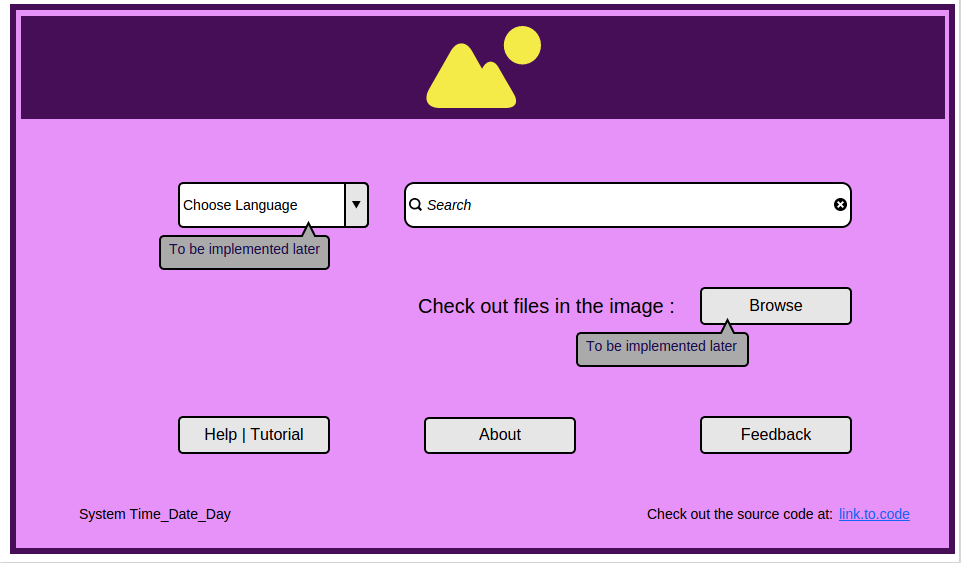

The intended <strong>“searchQuick” (sQuick)</strong> is an application to enable a user to search a set of books or texts, like an encyclopedia, or some other topical book collection offline built in the open source platform Pharo 4.0.

After building various mock-ups for a user friendly graphical interface for the application, the rudimentary features which would be present in the first release were finalized.

<em>The chief features would include :</em>

<ul>
<li><em>Search for word(s)</em></li>
<li><em>Browse files in the current image</em></li>
<li><em>Help or Tutorial</em></li>
<li><em>About section</em></li>
<li><em>Feedback or Suggestion Aid</em></li>
<li><em>Explore the code ( Cardinally Open Source 😉 )</em></li>
</ul>

<em><strong>LATEST MOCK UP OF GUI FOR sQuick</strong></em>

At this moment, the most viable options available (apart from the use of <em><a href="http://gt.moosetechnology.org/">GTSpotter</a>,</em> <em>Rubric</em> or <em>Bloc</em> suggested by developers on the forum and #pharo IRC) include:

<ul>
<li>The use of <a href="http://spec.st/">Spec</a> to build the UI which provides a comparatively easier option to implement Button Click Actions, User Input Search String Retrieval etc. But the graphical interface designed by placing the widgets is not a very fancy one and dependent on the current theme of the image.</li>
<li>The <a href="http://magaloma.seasidehosting.st/Morphic">Morphic</a> GUI gives the application a very pretty look in comparison, however the user input search string retrieval method is not a straight-forward one and is under construction.</li>
</ul>

After considering various pros and cons, the suitable alternative is considered to be the one made with Morph as it gives a refreshing look to the application.

<strong>UPCOMING:</strong>

<ul>
<li>Completion of GUI development</li>
<li>Commencement of Index build</li>
</ul>

<em>Stay tuned for more&#8230;</em> 
<em>Post any queries , will be happy to help 🙂</em>

