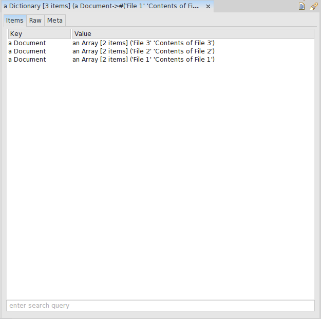

The intended <strong>“searchQuick” (sQuick)</strong> is an application to enable a user to search a set of books or texts, like an encyclopedia, or some other topical book collection offline built in the open source platform Pharo 4.0.

After the GUI was designed with minimal features, the next task was to develop the cardinal <strong><em>search function.</em></strong>

Indubitably, a well-run search application/engine requires <em><strong>indexing</strong></em>.

<em>Search Application/Engine Indexing</em> basically collects, parses and stores data to facilitate fast and accurate information retrieval.

That being, the index for <em>sQuick</em> was built using the <em><strong>Dictionary</strong></em> data structure in Pharo which works like <em><strong>HashTable</strong></em> of other programming languages/platforms.

index := Dictionary new.

Pharo describes a Dictionary as: <em>&#8220;I represent a set of elements that can be viewed from one of the two perspectives: a set of associations, or a container of values that are extremely named where the name can be any object that responds to <strong>=</strong>. The external name is referred to as the <strong>key</strong>. I inherit many operations from the <strong>Set</strong>. &#8220;</em>

The contents of the text files present in the current Pharo image were split at whitespaces and added to the <em>index</em> along with the corresponding file title.

<blockquote>

tokens := &#8216; &#8216; split: aDocument contents.

</blockquote>

The method <em>#indexFiles</em> was used to iterate over all the text files in the current Pharo image to index all the files before the searching begins.

<em><strong>Dictionary Entries after File Content Indexing</strong></em>

The <em>#queryString</em> method has been temporarily build using #includesSubstring which matches the user input string with all the entries of the <em>index </em>and gives the result in an array form with #tally output as the number of search results.

Various test methods are now built to inspect the functioning of the methods designed. Continuous debugging is being done to check out and remove errors, if any 😉

<em><strong>UPCOMING:</strong></em>

<ul>
<li>Improve the indexing technique</li>
<li>Explore methods to quicken the search functionality</li>
<li>Integrate the search routine with the GUI already built</li>
<li>Design more test cases to develop a bug-free application</li>
</ul>

<em>Stay tuned for more&#8230;</em> 
<em>Post any queries , will be happy to help 🙂</em>

