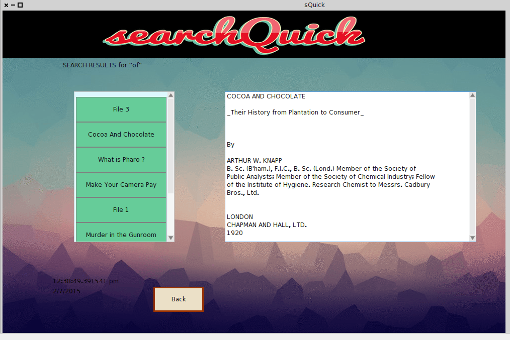

The intended <strong>“searchQuick” (sQuick)</strong> is an application to enable a user to search a set of books or texts, like an encyclopedia, or some other topical book collection offline built in the open source platform Pharo 4.0.

After indexing the content and the next task that was covered was searching for the user input string. The #queryString: does a fantastic job as of now. 
The search results were printed in a scroll-able pane by iterating through a loop so as to cover each and every existence of the desired string. The search results window also enables the user to view the content of the chosen file.

<strong>Search Results Display</strong>

Acting on the suggestion of my mentor, I have also loaded the Pharo image with text versions of large books (Thank You <a href="https://www.gutenberg.org/">Project Gutenberg</a> 🙂 )  to test the working of the search function.

<strong>UPCOMING</strong>

<ul>
<li>GUI Modification</li>
<li>Integrated Exhaustive Testing</li>
<li>Addition of help/tutorial</li>
</ul>

<em><strong>PS</strong>: The GUI of the application is under constant evolvement, Kindly ignore the poorly structured window 😛</em>

<em>Stay tuned for more…</em> 
<em>Post any queries , will be happy to help 🙂</em>

