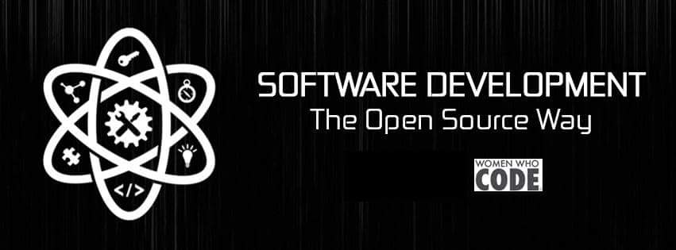
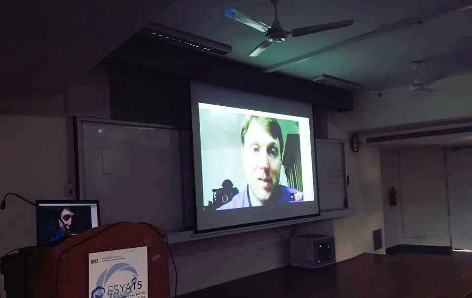
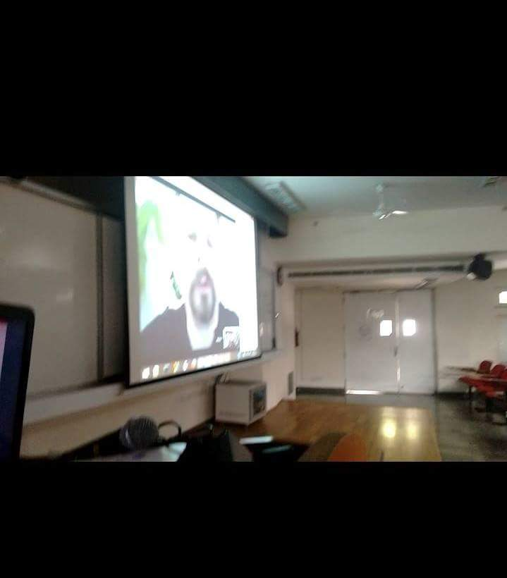
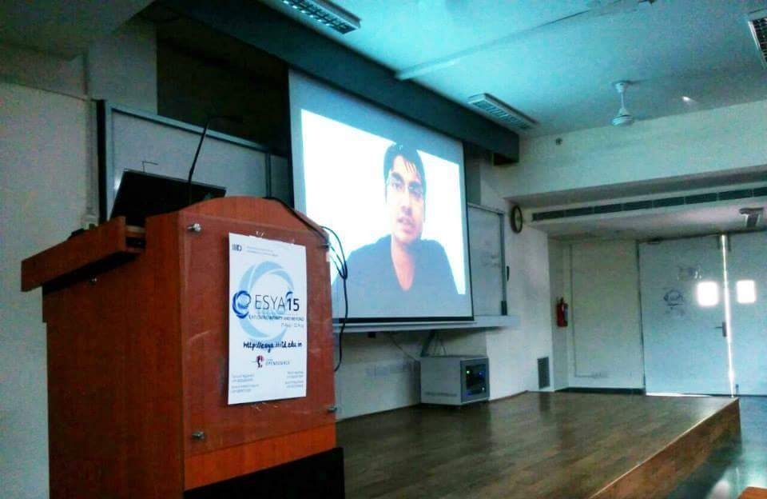
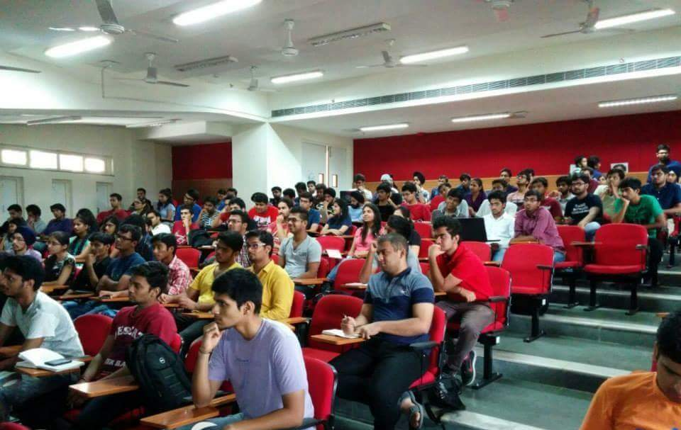
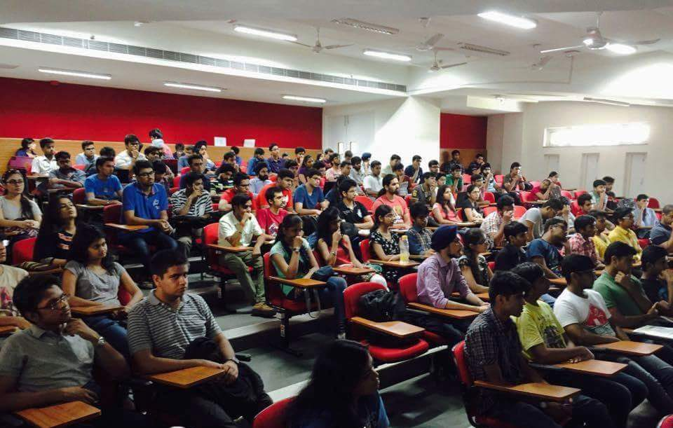
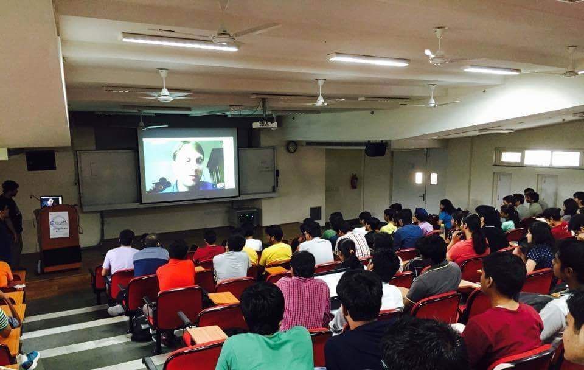

<em>Hello All !</em>

A series of talks by a handful of<strong> <a href="http://www.google-melange.com">Google Summer of Code 2015</a></strong> participating students covering software development, especially viewed from the lens of the Open Source movement was conducted in collaboration with<strong> <a href="http://www.womenwhocode.com">Women Who Code</a></strong> and <strong>Esya</strong> .

The agenda of the session was to learning how to use and develop open source software, and contribute to huge existing open source projects.

The salient themes covered were as :-

<strong>#</strong> Open Source: What it means and what it stands for.

<strong>#</strong> Why, and how, one should develop and maintain open source software ?

<strong>#</strong> Clearing up some myths about open source development.

<strong>#</strong> Examples of some huge and long running open source projects like; Linux, Mozilla Firefox, Android, Chromium, WordPress, VLC

<strong>#</strong> How to get involved with an open source project : 
Using, testing, participating in the community 
Building it yourself, fixing bugs 
Contributing your own features 
Making your own fork, giving direction to an open source project

<strong>#</strong> The Google Summer of Code Project : How to participate, Tips and Advice.

<strong># </strong>GSoC 2015: Experiences of the speakers till now, and details about their projects.

<strong>SPEAKERS:-</strong>

<em>Jigyasa Grover </em> 
<em>        </em>Organiser, Women Who Code Delhi 
Contributor Pharo 4.0 
GSoC developer at FOSSASIA

<em>Arnav Gupta</em> 
<em>        </em>CyanogenMod maintainer 
Xperia AOKP maintainer 
GSoC developer at FOSSASIA

<em>Manan Wason</em> 
GSoC developer at FOSSASIA

<em>Yask Srivastava</em> 
<em>        GSoC developer at PSF</em>

A special *<em>live</em>* interaction was organised with a few mentors from the <em>FOSSASIA</em> organisation.

<strong>Mario Behling</strong> from Berlin, Germany discussed about <em>FOSSASIA</em> , <em>OpenKnit</em> and also cleared participants queries. Mario is the founder of FOSSASIA and Lubuntu and a keen blogger at freifunk.

<strong>Hangouts with Mario Behling</strong>

<strong>Martin Bahr</strong> from Beijing, China came on hangouts to tell about his tech cruise and his love for foss despite being on a family vacation. Martin popularly known as <em>eMBee </em>in the internet world is an avid Pike contributor and is the secretary of BLUG. He is the General Manager of RealsoftService , a Linux service firm in Beijing and the CTO at eKita , a start-up in Bangkok. Martin is also mentoring a Google Summer of Code 2015 project for the FOSSASIA organisation.

<strong>Hangouts with Martin Bahr</strong>

Video messages from other open source contributors from different countries recorded specially for this event were shown.

<strong>Sean DeNigris</strong> , a firefighter and a Smalltalk programmer from USA discussed about programming in open source emphasising on Alan Kay&#8217;s dream. Sean is also mentoring a Google Summer of Code 2015 project for the FOSSASIA organisation.

<strong>Dimitris Chloupis</strong>, Pharo-er, 3D Artist , Music Lover and a Lawyer by profession from Greece also showed around few of his 3D artworks developed using FOSS.

<strong>Mohit Kanwal</strong> a software developer from India now living in Singapore sent his video message with a word of encouragement for the budding developers.

<strong>Mohit Kanwal encouraging budding developers</strong>

A enthusiastic feedback was received from the attendees with a request for more such interesting and specific events pertaining to open source.

The event attracted a record turnout for a program of high quality , informative and entertaining session focused on <strong>Free and Open Source Software. </strong>On the whole, &#8216;<em>Software Development : The open source way</em>&#8216;  was a memorable happening for all.

