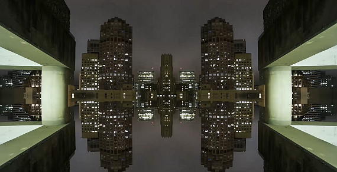

 
Howdy Fellas 🙂

<a href="http://www.jigyasagrover.wordpress.com">jigyasagrover.wordpress.com</a> had been giving me headache for a past couple of weeks. The &#8216;New Post&#8217; page kept on loading for eternity and the style-sheets did not load. Troubleshooting, reading out forums and all the obligatory check-ups pointed out no problem from my side.

Hence, after copious hours on one fine day (8th July 2015, to be very precise) I shifted my entire blog to <a href="http://www.jigyasagrover.blogspot.com">jigyasagrover.blogspot.com</a> (Google always has a solution 😉 ).

Now, that <em>wordpress</em> has finally worked after so many harrowing days, I plan to keep it as a mirror image afterall the affection for &#8216;first&#8217; thing never dies 😛

Ergo, <strong>BEING CURIOUS</strong> now has twin. Kindly +1 it to get the latest updates (if I am not able to replicate the same here :/ )

Mirrored Successfully ! Oh Yeah !

<em><strong>BEING CURIOUS</strong></em>

<ul>
<li><a href="http://www.jigyasagrover.wordpress.com">jigyasagrover.wordpress.com</a></li>
<li><a href="http://www.jigyasagrover.blogspot.com">jigyasagrover.blogspot.com

</a></li>
</ul>
