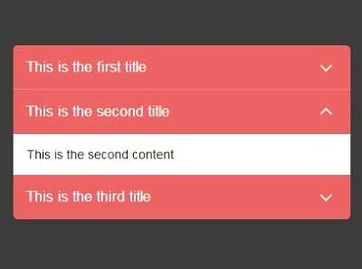

The intended <strong>“</strong><strong>searchQuick” (sQuick)</strong> is an application to enable a user to search a set of books or texts, like an encyclopedia, or some other topical book collection offline built in the open source platform Pharo 4.0.

As the rudimentary structure of the application is sewn up, embellishment of GUI and rigorous testing are the major part of course of action.

On eMBee&#8217;s ( <a href="https://www.blogger.com/null" target="_blank">+Martin Bähr</a> ) suggestion to build up an <a href="https://jqueryui.com/accordion/" target="_blank">accordion widget</a> to display the search results, various trials were conducted to design a similar one in Pharo.

The task of developing the accordion widget in Pharo was achieved using <i>Expander Morphs. </i>Looping through the search results array, a <i>#newExpander:</i> was added in each <i>#newRow:</i> of the modal built.

A challenging chore was to add a scroll-able content on the click of the desired search result expander. Sundry experiments with <i>#newLabel:</i> and <i>#newText:</i> in <i>#newScrollPaneFor:</i> {i.e. adding text model and labels in scroll pane} had no effect. Eventually, <i>#newTextEditorFor:</i> did the trick and the desired look was created.

Next on the cards is putting up <b>sQuick</b> for automated build on the CI Server, as suggested by <a href="https://plus.google.com/114851489196992826758" target="_blank">+Sean DeNigris</a> for its various advantages which include:

<ul>
<li>

Improvement of product quality

</li>
<li>

Acceleration of compile and link processing

</li>
<li>

Elimination of redundant tasks

</li>
<li>

Minimization of &#8216;bad builds&#8217;

</li>
<li>

Have history of builds and releases in order to investigate issues

</li>
<li>

Save time and money &#8211; because of above listed reasons.

</li>
</ul>

For simplicity, <b>Build automation</b> is the act of scripting or automating a wide variety of tasks that software developers do in their day-to-day activities including things like:

<ul>
<li>

compiling computer source code into binary code

</li>
<li>

packaging binary code

</li>
<li>

running automated tests

</li>
<li>

deploying to production systems

</li>
<li>

creating documentation and/or release notes

</li>
</ul>

<b><u>UPCOMING:</u></b>

To achieve Build Automation for sQuick, I have already registered on CI and configured sQuick. 
Next endeavor is to look into the red signal in the build evaluation.

<i> </i>

<i> 
</i><i>Stay tuned for more&#8230;.</i><i>Post any queries, will be happy to help 🙂</i>

