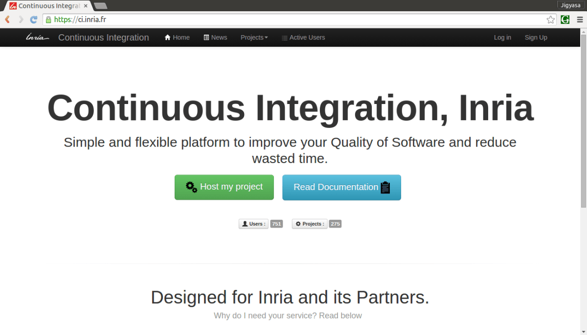
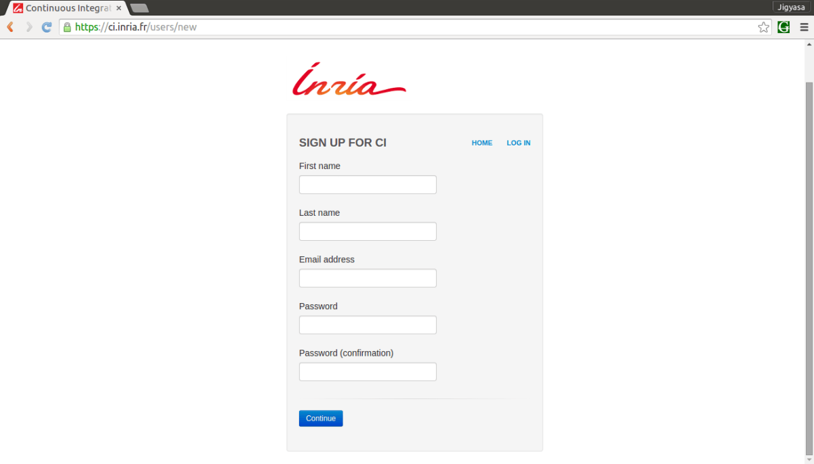
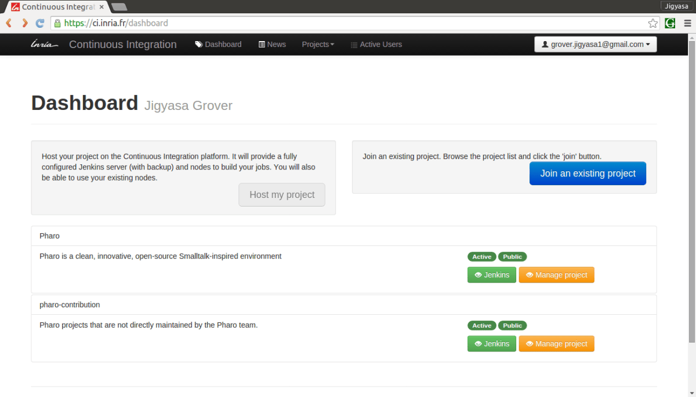
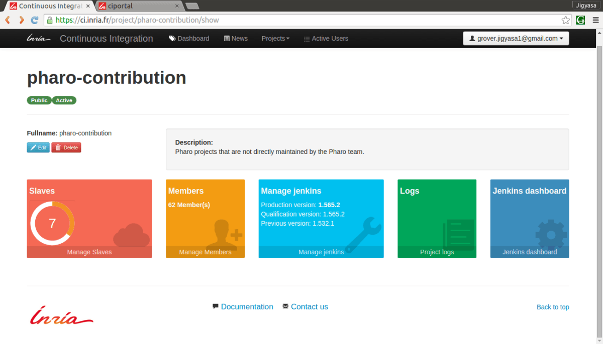
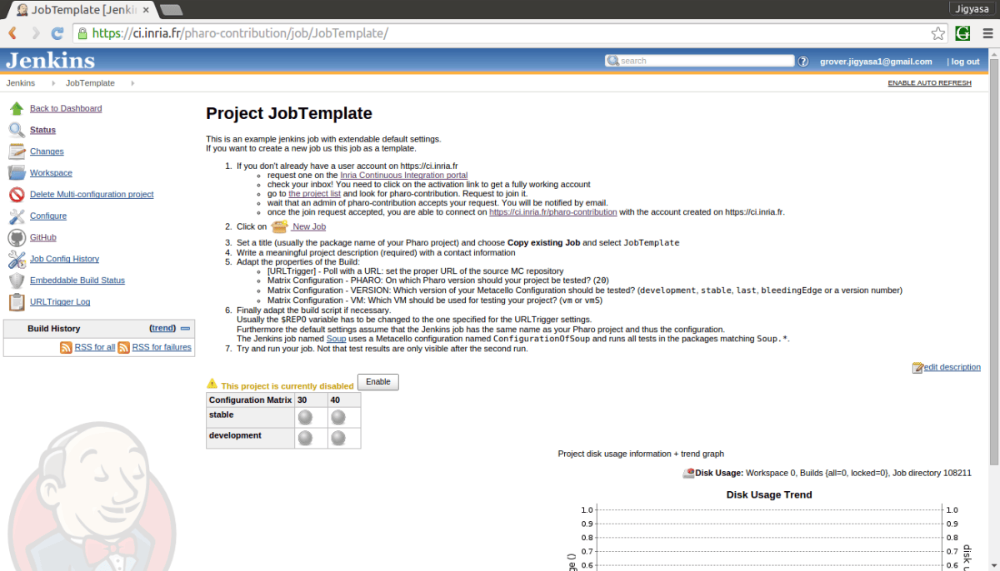
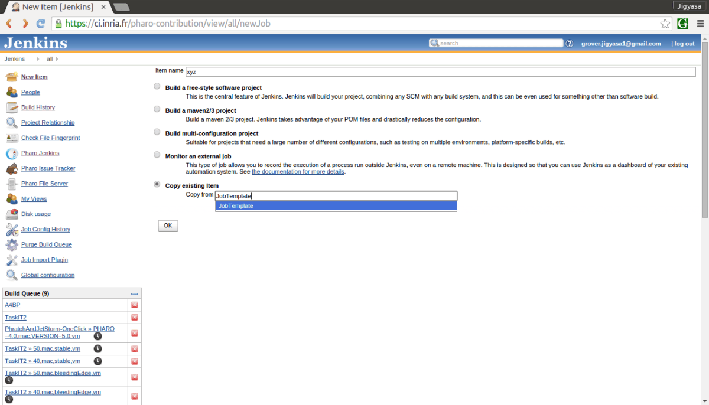
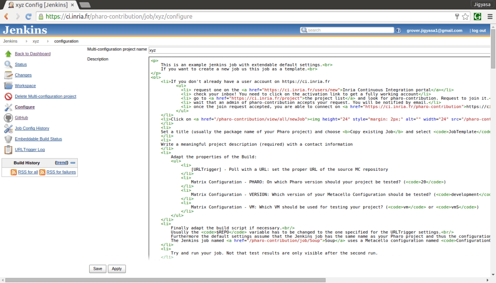
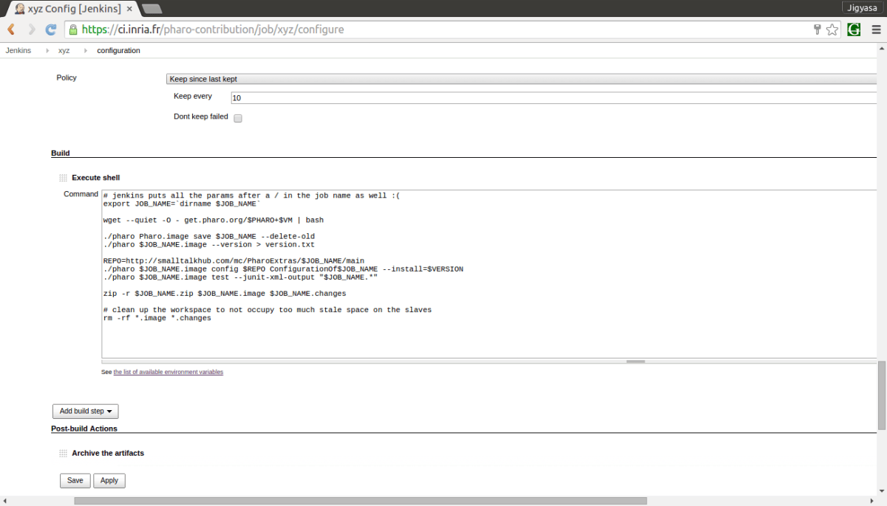
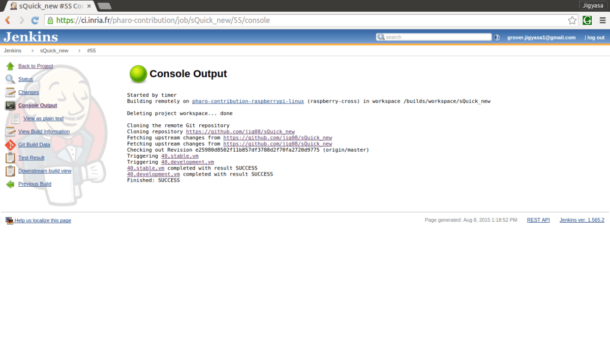

Hello Fellas !

This post aims to put forward the basics of <strong><em>Build Automation</em></strong> and also brief the steps required to put up a <em>Pharo</em> application on <a href="https://ci.inria.fr/">Continuous Integration, Inria</a> which is a platform for Scheduled Automated Build.

For simplicity, <b>Build automation</b> is the act of scripting or automating a wide variety of tasks that software developers do in their day-to-day activities including things like:

<ul>
<li>

compiling computer source code into binary code

</li>
<li>

packaging binary code

</li>
<li>

running automated tests

</li>
<li>

deploying to production systems

</li>
<li>

creating documentation and/or release notes

</li>
</ul>

Various types of automation are as:

<ul>
<li><b>On-Demand automation</b> such as a user running a script at the command line</li>
<li><b>Scheduled automation</b> such as a continuous integration server running a nightly build</li>
<li><b>Triggered automation</b> such as a continuous integration server running a build on every commit to a version control system.</li>
</ul>

In recent years, build management tools have provided relief when it comes to automating the build process.

<strong>The dominant benefits of continuous integration include:</strong>

<ul>
<li>

Improvement of product quality

</li>
<li>

Acceleration of compile and link processing

</li>
<li>

Elimination of redundant tasks

</li>
<li>

Minimization of ‘bad builds’

</li>
<li>

Have history of builds and releases in order to investigate issues

</li>
<li>

Save time and money – because of above listed reasons.

</li>
</ul>

A build system should fulfill certain requirements.

<strong>Basic requirements:</strong>

<ol>
<li>Frequent or overnight builds to catch problems early.</li>
<li>Support for Source Code Dependency Management</li>
<li>Incremental build processing</li>
<li>Reporting that traces source to binary matching</li>
<li>Build acceleration</li>
<li>Extraction and reporting on build compile and link usage</li>
</ol>

<strong>Optional requirements:</strong>

<ol>
<li>Generate release notes and other documentation such as help pages</li>
<li>Build status reporting</li>
<li>Test pass or fail reporting</li>
<li>Summary of the features added/modified/deleted with each new build</li>
</ol>

Considering the above mentioned advantages of automated build, the below enlisted steps will help to put up your own Pharo application hosted on github on the CI server for continuous integration/scheduled build.

1. Log on to <strong>Continuous Integration, Inria </strong>website (<a href="https://ci.inria.fr/" rel="nofollow">https://ci.inria.fr/</a>).

<a href="/assets/images/wp-archive/2015/screenshot-from-2015-08-08-155349-e846a0e9.png"> 
</a>2. Click on &#8216;<strong>Sign Up</strong>&#8216; at the top-right corner, enter the required details and register for CI.

<a href="/assets/images/wp-archive/2015/screenshot-from-2015-08-08-155402-46445b82.png"> 
</a>3. From the &#8216;<strong>Dashboard</strong>&#8216; option located at the top most of the screen click on &#8216;<strong>Join an existing project</strong>&#8216; blue button as shown .

<a href="/assets/images/wp-archive/2015/screenshot-from-2015-08-08-155922-c566ed44.png"> 
</a>4. Search &#8216;<strong>pharo-contribution</strong>&#8216; in the enlisted public projects and click on &#8216;<strong>Join</strong>&#8216;

<ol>
<li>On clicking the &#8216;<strong>Join</strong>&#8216; button, a message stating: &#8220;<strong>Request to join the project &#8216;pharo-contribution&#8217; sent</strong>.&#8221; appears.</li>
<li>It might take a day or two for the request approval mail to deliver at your registered Email ID.</li>
</ol>

The E-Mail content is as follows: 
<strong><em>        Your request to join pharo-contribution has been accepted</em></strong> 
<strong><em><strong><em>        </em></strong>Hi _ _ _, </em></strong> 
<strong><em><strong><em>        </em></strong>Your request to join the project pharo-contribution has been accepted !</em></strong> 
<strong><em><strong><em>        </em></strong>Regards,</em></strong> 
<strong><em>        </em></strong><strong><strong><em>Support team.</em></strong></strong>

<ol>
<li>Click on &#8216;<strong>My Account</strong>&#8216; option and under &#8216;<strong>My Projects</strong>&#8216; check the status of pharo-contribution project. It should state &#8216;<em>member</em>&#8216;.</li>
</ol>

<a href="/assets/images/wp-archive/2015/screenshot-from-2015-08-08-161755-f219703b.png"> 
</a>8. Now, visit the LINK: <a href="https://ci.inria.fr/pharo-contribution/job/JobTemplate/">https://ci.inria.fr/pharo-contribution/job/JobTemplate/ </a> to create a &#8216;<strong>New Job</strong>&#8216;

<a href="/assets/images/wp-archive/2015/screenshot-from-2015-08-08-162106-9273d2db.png"> 
</a>9. Read all the steps mentioned carefully. After going through all the points, click on the &#8216;<strong>New Job</strong>&#8216; mentioned in point 2 on the <em>Project Job Template</em> web page.

<ol>
<li>Enter the &#8216;<strong>Project Name</strong>&#8216; in the &#8216;<strong>Item Name:</strong> &#8216; box and choose &#8216;<strong>Copy from existing item</strong>&#8216; option and fill &#8216;<strong>JobTemplate</strong>&#8216;</li>
</ol>

<a href="/assets/images/wp-archive/2015/screenshot-from-2015-08-08-163001-f7817d79.png"> 
</a>11. After clicking <strong>OK</strong>, You will be directed to your project configuration.

<ol>
<li>Fill in the description of the project in the desired box.</li>
</ol>

<a href="/assets/images/wp-archive/2015/screenshot-from-2015-08-08-163231-8370d435.png"> 
</a>13. Fill int the configuration details of your project like:

<em>* Maximum number of builds</em> 
<em>*  Link to GitHub Project</em> 
<em>*  Source Code Manager</em> 
<em>* Build Triggers</em> 
<em>*  Schedule of build (@hourly, @daily, @weekly, @fortnightly, @monthly, @yearly etc.)</em> 
<em>*  Configuration Matrix (User Defined Axis: Name &amp;&amp; Version Values- stable, development etc.)</em> 
<em>* Build environment options</em> 
<em>* Post-build actions</em> 
<em><em>*  Report regressed tests</em></em>

<ol>
<li>The main task is to carefully write the commands in the &#8216;<strong>Execute Shell</strong>&#8216; 
The default commands are as:</li>
</ol>

<a href="/assets/images/wp-archive/2015/screenshot-from-2015-08-08-163906-13196ca9.png"> 
</a>15. After saving and applying the changes, the application is all set for automated build.

<ol>
<li>Each build&#8217;s &#8216;<strong>Console Output</strong>&#8216; can be used to analyse the steps and highlight the weak areas of the project. 
For instance: The below output is of a project whose stable version build was successful.</li>
</ol>

<strong>TIP</strong>: Keep a regular tab on the build results and analyze each line of the Console Output with utmost care.

Hope this post was able to help you start with the automation build process of Pharo Application.

<em>Do like if it was worth a read !</em> 
<em>Post queries/suggestions as comments 🙂 Looking forward to them.</em>

<strong>UPCOMING</strong>: Next, I plan to share experience of putting up my Pharo application <a href="https://ci.inria.fr/pharo-contribution/job/sQuick_new/">searchQuick</a> on CI Inria for automated build. I intend to detail about the various configuration settings applied along with the <em>Execute Shell</em> commands utilized for a GitHub project 🙂

<strong>Introduction Accredits: <a href="https://en.wikipedia.org/wiki/Main_Page">Wikipedia </a></strong> 
<strong> Resources:  <a href="https://en.wikipedia.org/wiki/Build_automation">Build Automation</a> and <a href="https://en.wikipedia.org/wiki/Continuous_integration">Continuous Integration </a>.</strong>

