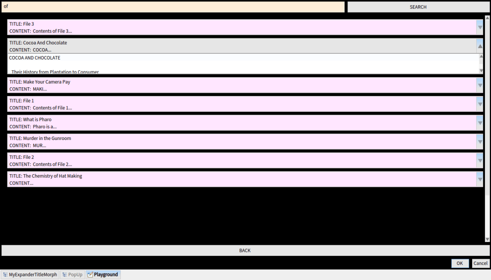

The intended <strong>“</strong><strong>searchQuick” (sQuick)</strong> is an application to enable a user to search a set of books or texts, like an encyclopedia, or some other topical book collection offline built in the open source platform Pharo 4.0.

After the chief tasks of search functionality and automated build were done with, the next undertaking included working on finer details and embellishments.

<ul>
<li>Embedding Jenkins automated build status icon in GitHub markdown file</li>
<li>Relative widget re-sizing by using &#8216;<strong><em>World extent x</em></strong>&#8216; and &#8216;<strong><em>World extent y</em></strong>&#8216; co-ordinates instead of hard coded co-ordinates</li>
<li>Modifying the Accordion Widget by addition of &#8216;<strong>Search Bar</strong>&#8216; at the top</li>
<li>Checking for duplicates in the &#8216;<strong>Browse Files</strong>&#8216; menu, thus reducing the CPU consumption</li>
<li>Equalizing the sizes of all the windows to bring uniformity</li>
<li>Addition of &#8216;<strong>Scroll Pane</strong>&#8216; in accordion search result display list</li>
<li>Multi-line search result display by extending the <strong>Expander Title Morph </strong>and use of new line character in labels (otherwise not supported by default)</li>
<li>Truncating file content to first <em>n</em> characters for neater look in <em>Expander Title</em></li>
</ul>

<em>Latest Screenshot of Accordion Widget:</em> 
<a href="/assets/images/wp-archive/2015/screenshot-from-2015-08-18-183806-1a6a0c57.png"> 
</a><strong>UPCOMING:</strong>

<ul>
<li>Removal of <strong>OK</strong> &amp; <strong>CANCEL</strong> buttons (present by default in <em>Pluggable Dialog Window</em>) from Accordion Widget</li>
<li>Implementing of <em>Search</em> via the result window as well</li>
<li>Relative re-sizing of background images (Image Morphs)</li>
</ul>

