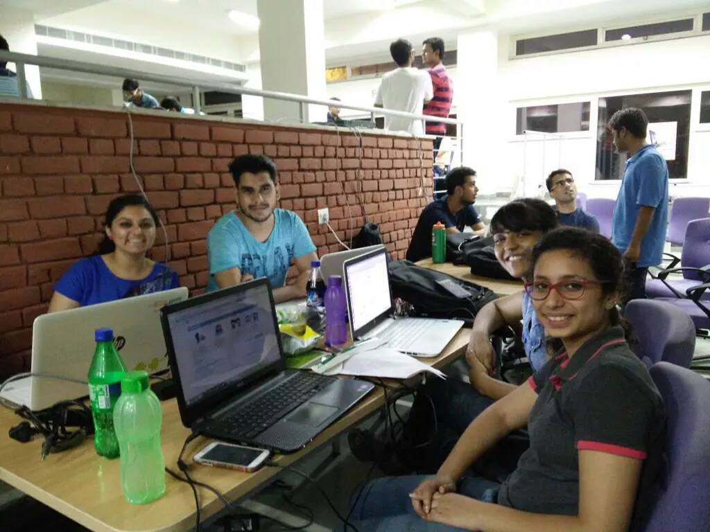
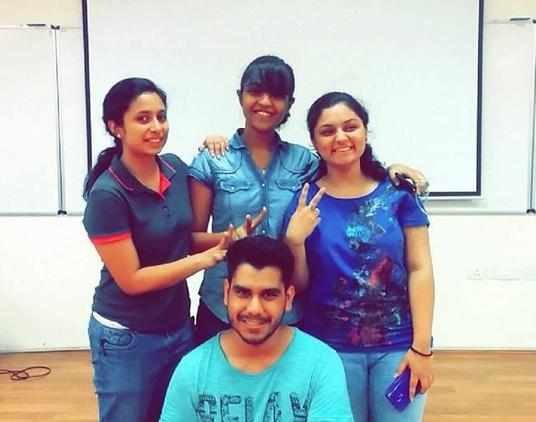
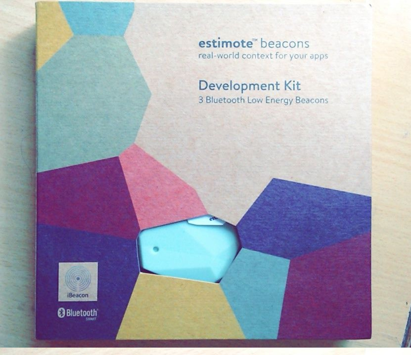
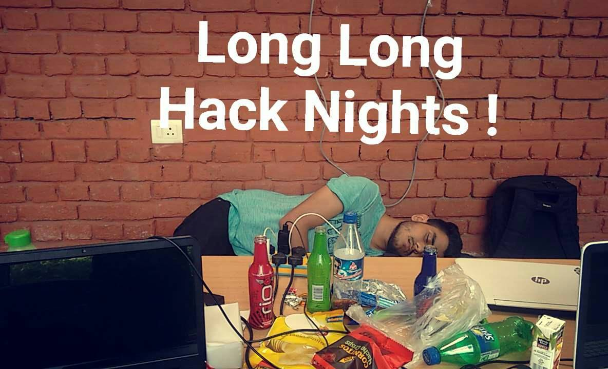
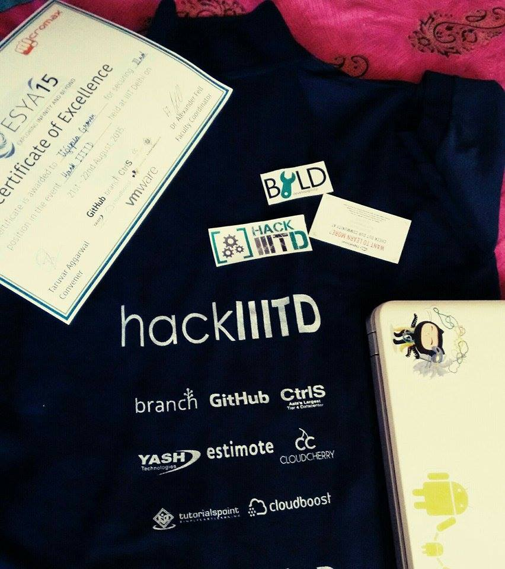

Hola !

After wrapping up (almost 😛 ) with my <em>Google Summer of Code 2015 FOSSASIA</em> project, I participated in <strong>hackIIITD</strong> at Esya 2015. We, I along with three of my classmates formed <strong>Team Neophytes</strong> <em>(noun: beginners or </em><em>novices)</em> reached the IIITD Campus in Okhla, New Delhi on Friday evening with little preparation but loads of enthusiasm.

After the theme declaration of Delhi Tourism (Heritage Walks, Audio Visual Tours, Radio Autos/Taxis Ratings, Delhi Event Management etc.) and Delhi Government (Political Party Manifesto, Law Ministry etc) we decided to build an android application on the political party manifesto idea.

The brainstorming session led to our app being named &#8216;<strong>Poll Khol</strong>&#8216; (meaning revealing the mystery of elections , in a broad sense 😛 ). The android app aimed at building a social interactive form of a political party&#8217;s manifestos which would be helpful in building a responsible government and eventually a better country for all the citizens.

The work kick-started with appetizing dinner and an optimistic team. Designing logos, managing content, UI etc. with heavy eye-lids, junk food munching loads of coffee and background music to keep us awake for straight 20 hours was an achievement in itself.  The cupidity for schwags from <a href="https://branch.io/">Branch Metrics</a> made us work on integrating <em>branchSDK</em> in our app for deep-linking and being appreciated for our idea from Branch Metrics itself left us animated. Catching power naps (read: 20-40 mins) turn by turn we were ( almost ) done with our app by Saturday 12 noon. Then began the task of integrating all the modules, beautifying the UI and testing.

At last, Poll Khol was implemented via mixed SDK/Libraries integration including: Branch SDK, Sugar ORM, Neokree Material Design navigation drawer, Astuetz Pager Sliding Tab Strips etc.

It encompassed the following features:

<ul>
<li>Provides information about a party’s manifesto, detailing each point/agenda and the facility to up-vote/down-vote it, add comments and share.</li>
<li>Also lists the name of various candidates contesting the upcoming elections from different wards from various political parties.</li>
<li>Provides a platform for users to mention the issues faced in their locality and up-vote the same</li>
</ul>

Our presentation went very well, though the prize came quite unexpectedly. The judges seemed to be quite interested in our idea, questioned about future aspects and also encouraged us to enhance the app by adding more features to it.

Poll Khol App Screencast: <a href="https://goo.gl/xa1SbW">https://goo.gl/xa1SbW</a>

Winning the hackathon was never our grail, having a good time and learning definitely was. The prize included <em>15k INR</em> along with <em>Estimote Bluetooth Beacon Development kit</em>, <em>GitHub coupons</em>, <em>hackIIITD T-Shirts</em>, <em>Laptop stickers</em>, <em>Digital Ocean discount coupons</em> etc.

We aim to expand it by adding more functionalities like online vote surveys, directly sharing issues in app via twitter, live tweets and location specific contacts of concerned politicians/MLAs etc.

Thanks to <strong>EsyaIIITD</strong> for a providing a platform to budding developers. 
Kudos <strong>hackIIITD</strong> for a very well organized event, great food and drinks, entertainment, T-Shirts, schwags and prize money (of course 😉 )

<strong>Glimpses from the memorable happening :</strong>

Neophytes at work 🙂

Victory 🙂

Prize: Estimote Bluetooth Beacon Development Kit

Schwags 🙂

