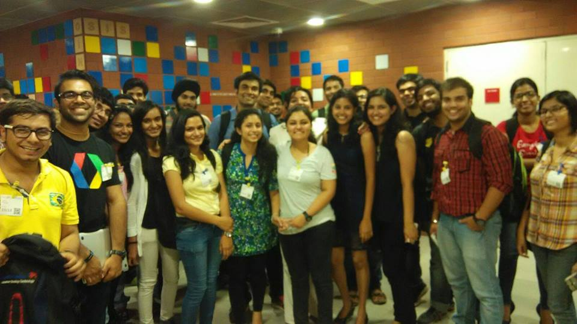
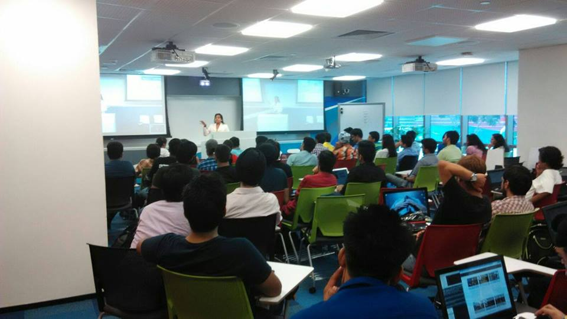
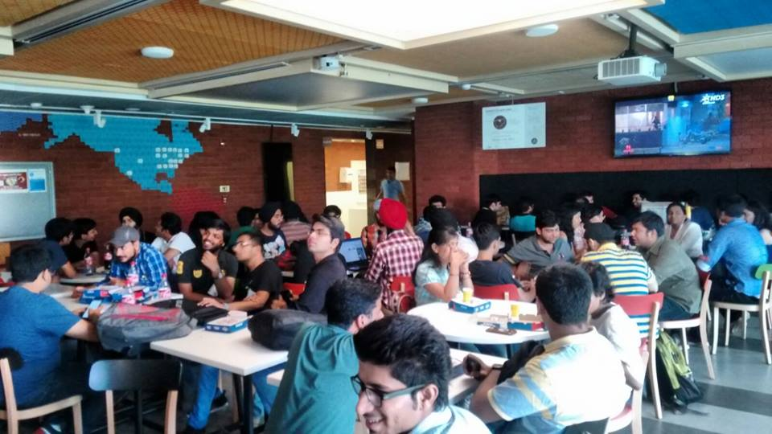
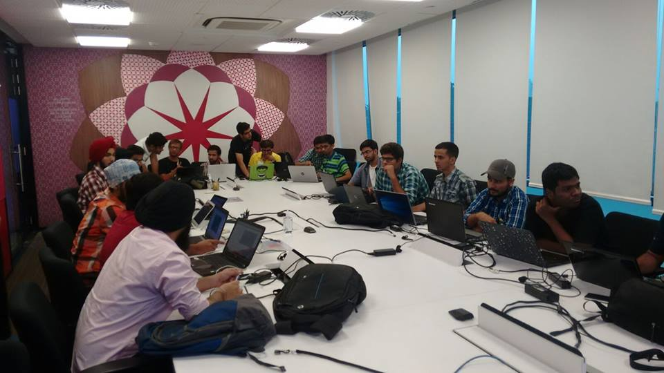
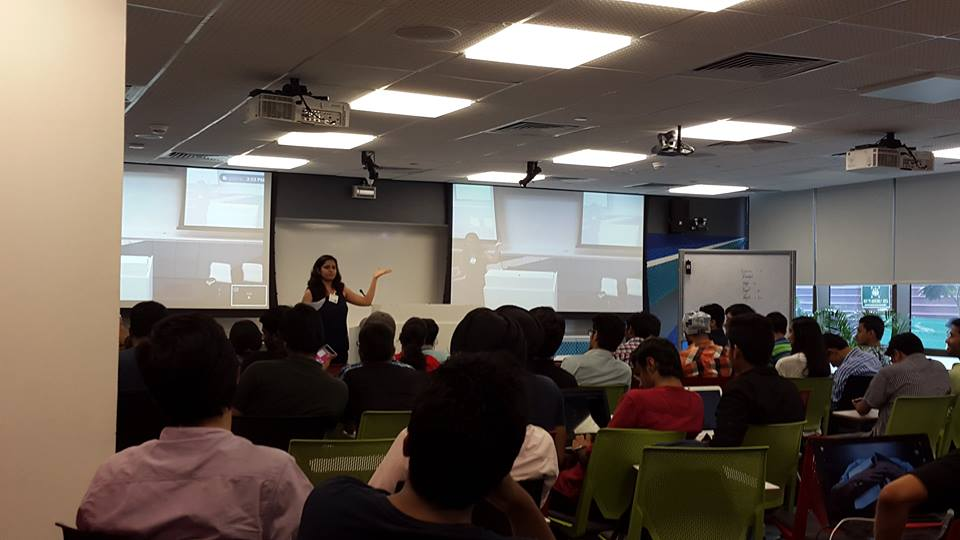
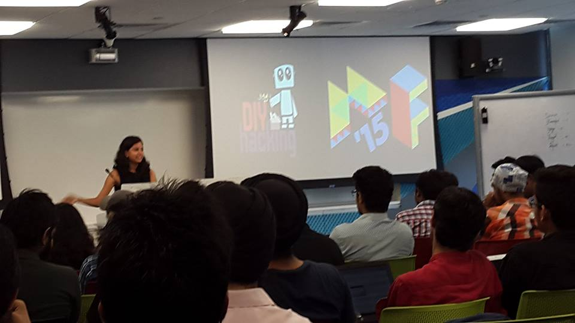
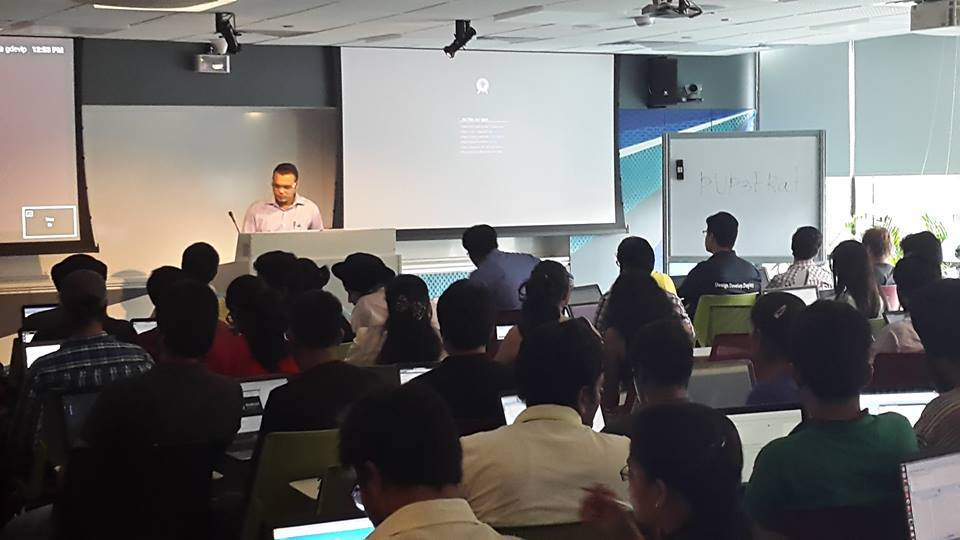
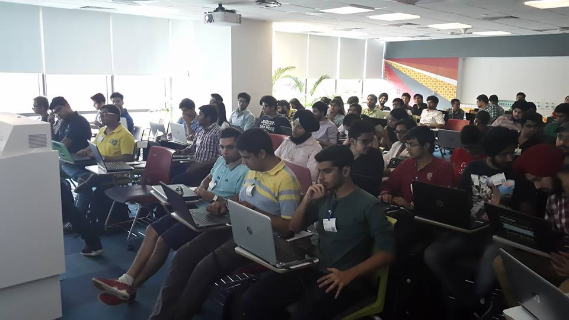

Google Developers Group DevFests are large, community-run events that can offer speaker sessions across multiple product areas, all-day hack-a-thons, code labs, and more.

We, at <a title="GDG New Delhi" href="https://plus.google.com/u/0/114576537688641864561/posts">GDG New Delhi</a> hosted the <strong>DevFest 2015</strong> at Google India office on 18th October 2015. After the initial introduction and ice-breaker activities around 9am, the audience was allowed to choose between the <strong>Starting with Android</strong> and <strong>Firebase &amp; Web</strong> tracks. The <strong>Firebase &amp; Web</strong> session had a re-run owing to huge demand 🙂 After the tea and cookie break, the developers meet started off with a very informative session on <strong>Android Performance. </strong>

The networking session organized in the Google cafeteria which also served as a Pizza break enabled people from different universities interact with each other and share amazing ideas.

The after lunch session was a dedicated <strong>Google Women Techmakers</strong> track ( handled by me 😉 ). Apart from a dedicated women in technology quiz, whose winners were provided with cool GDG T-Shirts we had talks and presentations by a couple of women who had a made a mark in this ineffable world of technology.

All in all it was a fun event to organize and I hope everyone enjoyed the day to their full !

 

 

 

 

