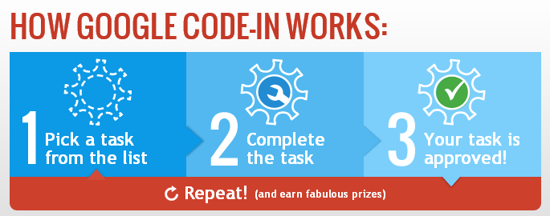

The new season of <em>Google Code-In</em> has been announced (<a href="http://google-opensource.blogspot.in/">Google Open Source blog</a>), and what better to be a prime segment of this cool initiative.

It feels great to have been invited by <strong>FOSSASIA</strong> to work as a <strong>Mentor</strong> for <strong>Google Code-In 2015</strong> 🙂

I am all set for the contest that kicks-off on December 7, 2015 to provide support and guidance to all the enthusiastic pre-university budding developers across the globe.

Looking forward to an exciting experience ahead !

Google Code-In is a contest to introduce pre-university students (ages 13-17) to the world of open source software development. With a wide variety of bite-sized tasks, it’s easy for beginners to jump in and get started no matter what skills one possesses.

Do check out the <a href="https://developers.google.com/open-source/gci/resources/downloads/2015-GCI-Flyer.pdf">Google Code-In 2015 flyer</a> for latest information. 
Visit <a href="https://developers.google.com/open-source/gci/">Developers/OpenSource/GoogleCodeIn</a> for further details.

Stay tuned for updates and ping for queries !

