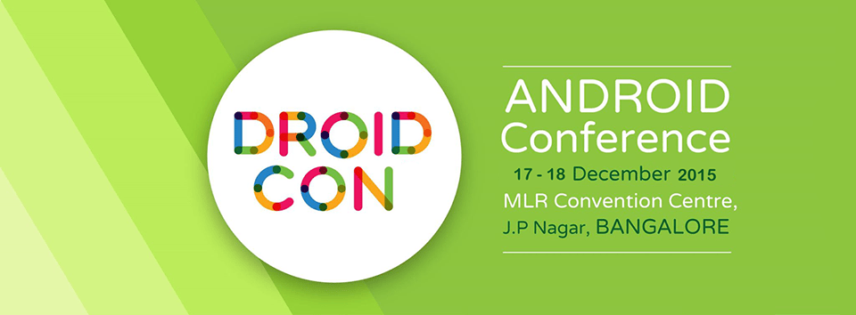
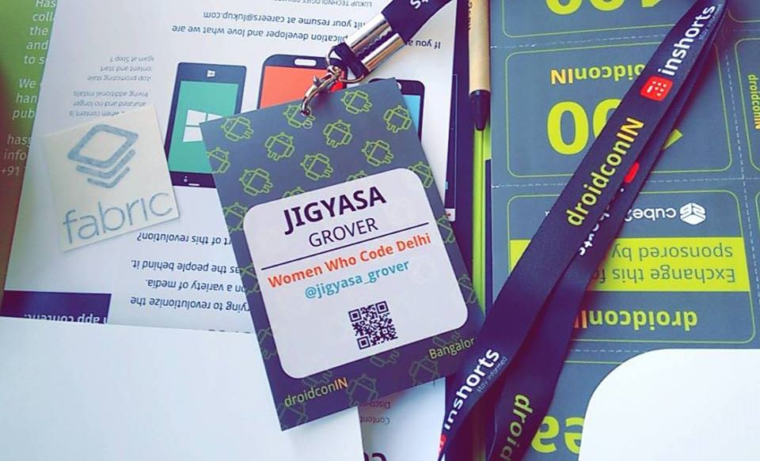

Android is the buzz word these days, spanning across almost every device. For mobile tech enthusiasts, <em>DroidCon</em> is the place to be !

Representing Women Who Code Delhi at the DroidCon was one of the most enriching experience I had.

Gratitude to <em>DroidCon Germany</em> and <em>Intel Sofware</em> for <strong>Female Developer  </strong><b>Sponsorship </b>to attend <a href="https://droidcon.in/2015/">DroidCon India 2015</a> held in December.

It is not everyday one gets an opportunity to interact with so many people, technology enthusiasts, startup junkies and student developers not only from within the country but also across the globe.

The schedule spanned a lot of interactive talks and workshops encompassing interesting themes like Memory Dumps, Android Data Binding, Material Design, Android Studio Plug Ins Development, React Native, Virtual Reality, Dependency Injections in Android, Smarter User Data Analytics, Continuous Integration of Android OS projects, App Demos and Flash Talks.

The program itself was rich and interesting, and sometimes there was a problem deciding which talk to attend. Unfortunately, some potentially interesting talks were missed owing to <em>probem of plenty</em> 😉

But talks and workshops were not the only things happening at the DroidCon India 2015. The main hall had an aura of recruitment and interaction arena where startup founders, tech professionals were seen interacting with budding developers and offering internships on the spot.

<em>Uber</em>, <em>Cube26</em>, Epson, <em>Microsoft</em>, <em>BranchMetrics</em> had their stalls set up and were not behind attracting crowds by means of live product demos and interactive games. Goodies and Schwags offered whether Cube26 T-Shirts, Branch Hoodies, Uber&#8217;s fancy tech-y key chains etc. were the center of attraction.

Thanks to <strong>hasGeek, inShorts, cube26, branchMetrics </strong>and<strong> Uber</strong> for coming together and providing a platform to budding developers to interact with real world professionals.

Kudos <strong>hasGeek</strong> for a very well organized event, great food and drinks, entertainment, T-Shirts and Schwags (of course 😉 )

&nbsp;

&nbsp;

