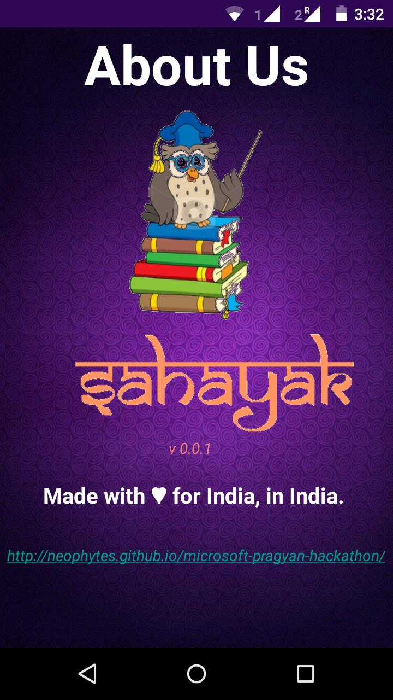
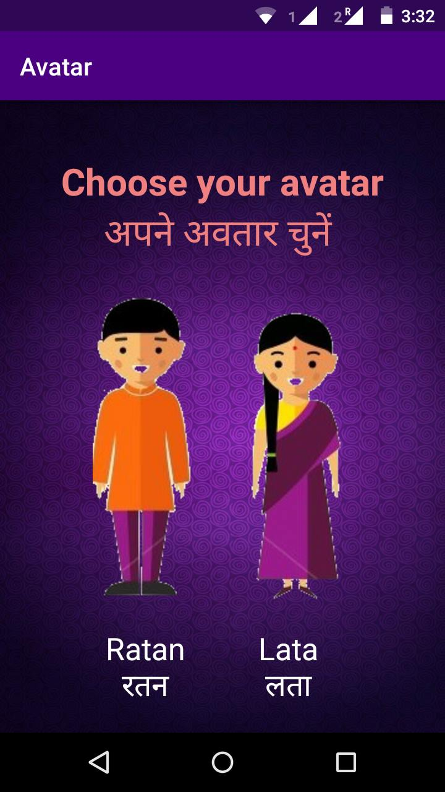
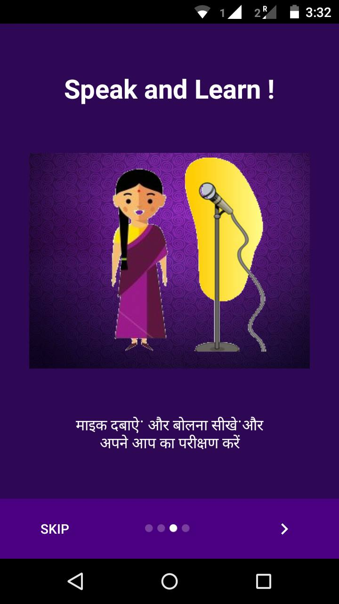
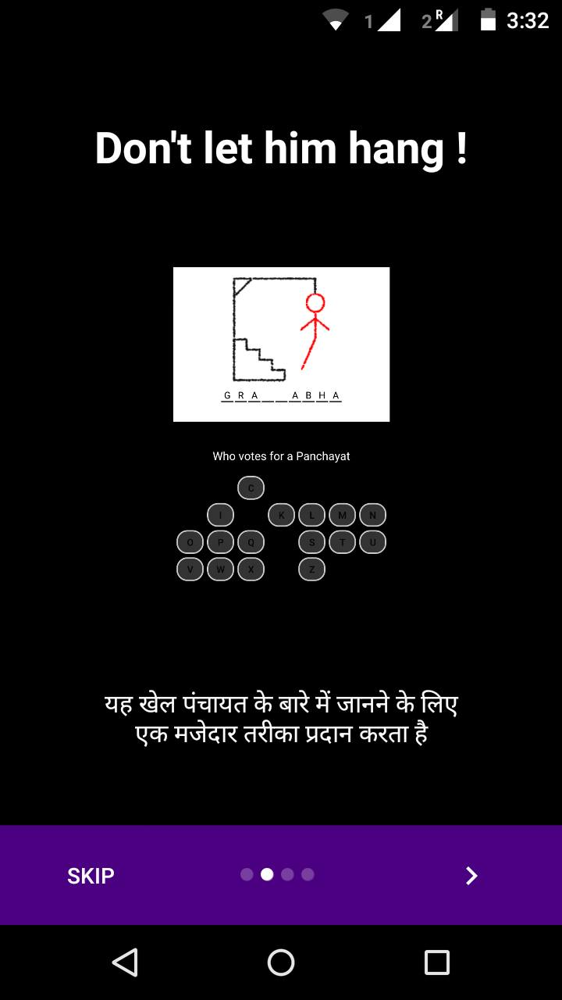
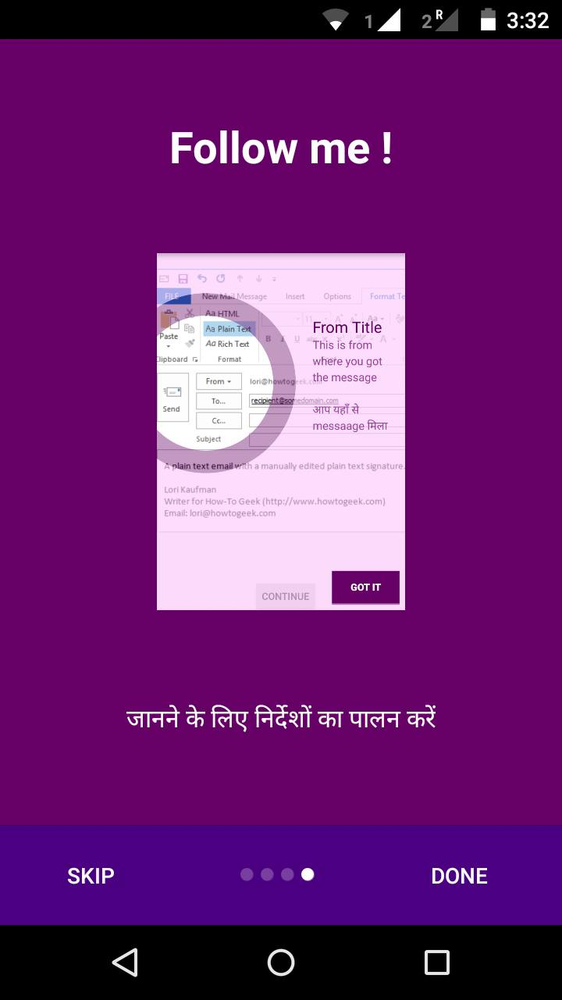
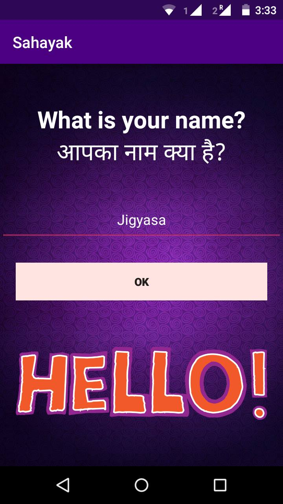
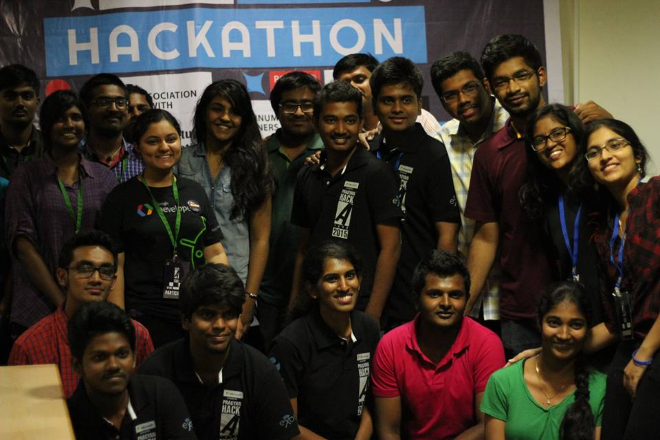
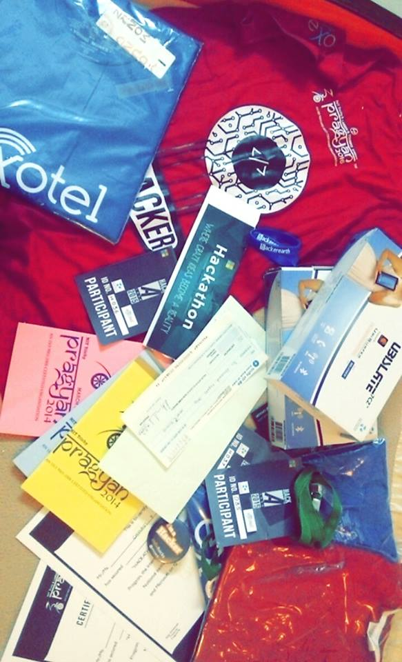
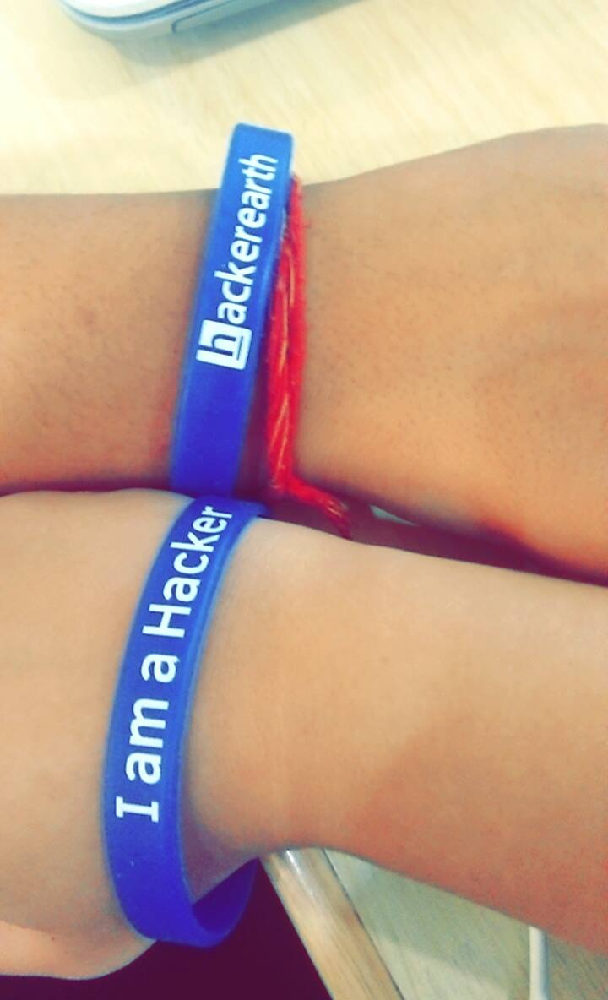
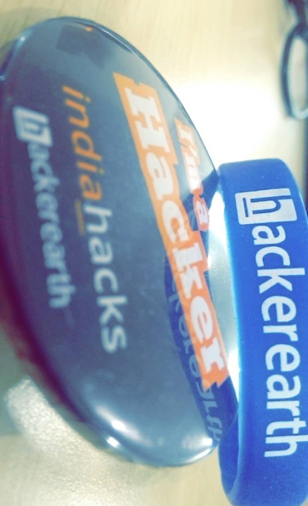

Heyy !

Winter Vacations 2015 had a fun beginning with trip to Bangalore and participating in <strong>Microsoft Pragyan Hackathon</strong> powered by <em>Datawind</em>, <em>Exotel</em> and <em>Codechef</em> organized by <em>NIT</em> <em>Trichy</em>.

Even after a tiring travel to the city&#8217;s corner, the enthusiasm was stead fast. With nil preparation, the idea pertaining to the theme <strong><a href="http://www.digitalindia.gov.in/content/vision-and-vision-areas">Digital India </a></strong>was thought right there after the coding period had begun. Bored of seeing various kinds of e-portals around, we thought of making something different this time.

Surfing the internet turned fruitless and the 15-20 min brainstorming session led to the foundation of <strong>Sahayak </strong>(meaning <em>helper</em>/<em>aide</em> in Hindi).

The android app aimed at building an interactive tool for rural digital literacy which shall be helpful in progressing towards a stronger Digital India and bridge the technological gap between Modern and Rural India.

The work kick-started with appetizing breakfast and an optimistic duo of girls. Designing logos, managing content, UI etc. with heavy eye-lids, popcorn munching (Sponsors 😛 ) and coffee to keep us awake for straight 30 hours was an achievement in itself.

Being appreciated for our idea from Microsoft Tech Evangelist itself left us animated and encouraged us to work harder to deliver our promises. 
Catching power nap which extended till an hour 😛 we were ( almost ) done with our app by Sunday morning. Then began the task of integrating all the modules, beautifying the UI and testing.

At last, Sahayak was implemented via mixed SDK/Libraries integration including: Google API for Speech to Text and Text to Speech in particular, Amlcurran Show Case View Library, Sugar ORM, Paolorotolo App Intro for Tutorial Fragments etc.

It is a tool for educating rural India and making them feel part of the digital revolution our country is going through. It has an interactive interface in the form of mini-games and sessions to hold the user&#8217;s attention. Through our application people from any age group (especially children) can learn about the world, about their country, have a basic knowledge about the usage of internet, be familiar with basic reading and writing in English and know about their local governing system. We aim to build a stronger, digital India.

The options currently available are as:

<ul>
<li>Know our World (दुनिया को पता)</li>
<li>Our India (हमारा भारत)</li>
<li>Internet (इंटरनेट)</li>
<li>Learn English (अंग्रेजी सीखिये)</li>
<li>Our Government (हमारी सरकार )</li>
<li>About Us (हमारे बारे में)</li>
</ul>

Our preliminary interaction was really nice. The official from Datawind was impressed by our concept and also wished to release our app for public use via their tablets. After the first round, only 10 mins were provided to make our presentation. The second round presentation went good. The judges seemed to be quite interested in our idea, questioned about future aspects and also encouraged us to enhance the app by adding more features to it for instance, providing more languages support to it apart from Hindi (which we had already implemented).

Sahayak App .apk can be found <a href="https://drive.google.com/open?id=0B4ZhibK97rv0eVM3MnFlX1ZTbWs">here</a>.

Winning the hackathon was never our grail, having a good time and learning definitely was. The prize included <em>10k INR</em> along with <em>Datawind UBSlate 7 inch Dual Sim Tablet</em>, Microsoft <em>Pragyan and Exotel T-Shirts</em>, <em>Laptop stickers</em>, <em>Hackerearth &#8216;I am a Hacker&#8217; Wristbands</em>, <em>India Hacks Badges</em> etc.

We aim to expand it by adding more interactive games and include more topics for learning.

The event was organised very well with the organizers being extremely helpful and painstaking attention was paid to our needs. We had a good experience interacting with the mentors and judges. Considering the scale of the event, little was left wanting. Some more coffee and a session to break the ice with other participants would have proved to be the cherry on top of the cake.

<strong>App Screenshots</strong>

&nbsp;

&nbsp;

&nbsp;

&nbsp;

&nbsp;

&nbsp;

&nbsp;

&nbsp;

&nbsp;

&nbsp;

&nbsp;

&nbsp;

&nbsp;

&nbsp;

&nbsp;

&nbsp;

&nbsp;

&nbsp;

&nbsp;

&nbsp;

&nbsp;

&nbsp;

&nbsp;

&nbsp;

&nbsp;

&nbsp;

&nbsp;

&nbsp;

&nbsp;

&nbsp;

Hackathon Winners with Organizing Team

&nbsp;

