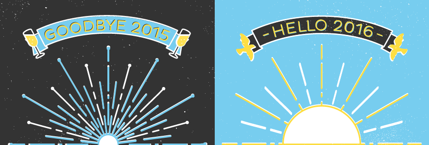

<i> 
</i>

<i>Hello  !</i>

This comes way too late, credits &#8216;<em>procrastination</em>&#8216;.

I had posted this on the thread <em>&#8220;Lean In Moments 2015&#8221;</em> on the <em>&#8220;Grace Hopper Celebration of Computing 2015 India Scholars&#8221;</em> group and I think it shall be nice to have it here on my own blog as well.

<blockquote>

Its so nice to hear (read: read) about your victories in life which inspires fellows to strive for the best.

This thread sent me to a flashback and certainly 2015 was a roller coaster ride.

 

I am proud of how my year went by.

<ul>
<li>The highlight of my year was successfully completing <i>Google Summer of Code 2015</i> under FOSSASIA organization.</li>
<li>I am delightful to have been promoted as the Director of <i><i>Women Who Code Delhi.</i></i> </li>
<li>I had lots of fun in participating and also winning a couple of hackathons including <i>hackIIIT-Delhi 2015</i> and <i>Microsoft Pragyan 2015</i>.</li>
<li>I was inducted into <i>Google Developers Group New Delhi Alpha Team</i> and have been leading <i>Google Women Techmakers Delhi</i> since.</li>
<li>I bagged the <i>Diversity Scholarship</i> from Linux Foundation and also got a chance to attend the <i>Grace Hopper Celebration of Women in Computing India 2015</i> via the coveted Student Scholarship by Anita Borg Institute (unfortunately had to cancel my tickets owing to end semester examination)</li>
<li>I also feel privileged to have been awarded the <i>Female Developer Sponsorship</i> by DroidCon.de and Intel® Software and attending <i>DroidCon India 2015</i> was an enriching experience indeed.</li>
<li>Also I got a chance to help pre-university students step into FOSS by mentoring <i>Google Code In 2015</i> under FOSSASIA.</li>
<li>I was also appointed as the Technical Head (Software) in <i>The Institute of Engineering and Technology DTU</i>.</li>
<li>I started my own blog (yes, this 🙂 ) and I like maintaining it though I might not be regular in my posts but there are at-least a couple of &#8217;em each month.</li>
<li>Apart from these, I also took classes on C/C++ and Android in my university in collaboration with university bred startups and societies. I also got the chance to give talks on open source software development.</li>
</ul>

 

2015 also brought me in contact with so many talented girls out there and am happy to have extended my circle beyond the geographical reach.

 

Hopefully, 2016 unfolds with loads of happiness and success for all !

</blockquote>

<strong> 
Ciao 2015 ! Thank You for being one of the best. 
Let 2016 roll in with swag 😀</strong>

