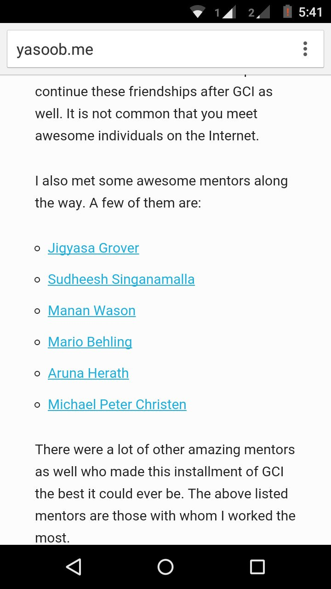
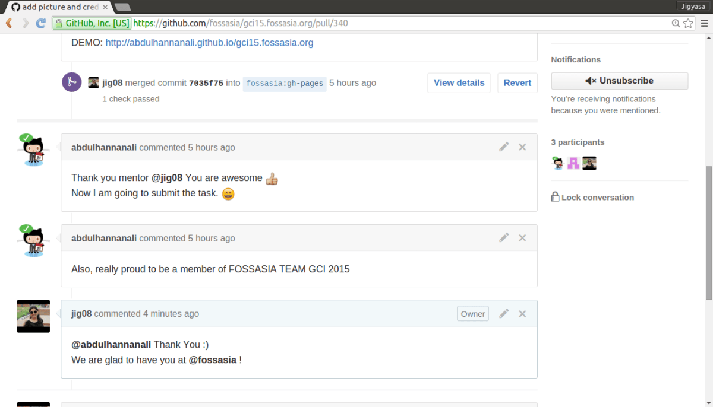
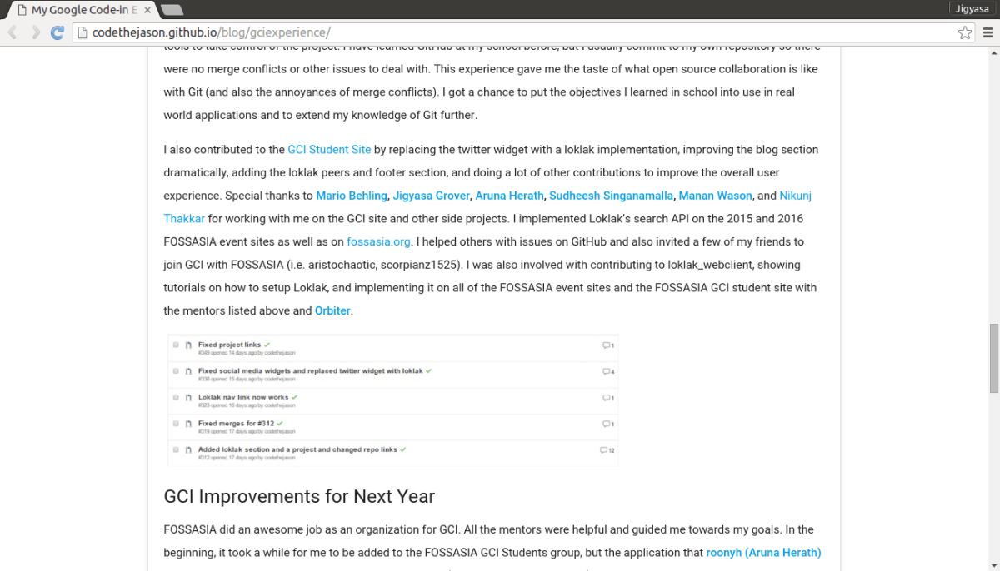

Since the day I have stepped into this ineffable world of computing, I have realized the dearth of female technologists. I have thus associated myself with inspirational communities like Women Who Code serving as the Director of WWC Delhi and leading Google Women Techmakers.

Coming across <i><a href="https://www.learnitgirl.com/organisers">Learn IT, Girl !</a> </i>A noble mentor-mentee program to help women begin their journey in this male dominated field of technology motivated me to contribute to this initiative by helping fellow budding girl developers.

I strongly believe that helping people steer their careers in the right direction is a key element in developing. The esteemed task of mentoring is an essential leadership skill. In addition to managing and motivating people, it&#8217;s also important that one can help others learn, grow and become more effective in their lives.

 My past experience with mentoring <em><a href="https://codein.withgoogle.com/">Google Code-In</a></em> tells me that mentoring is a rewarding experience, both personally and professionally. It not only aids in improving communication skills but also brings about a a great sense of personal satisfaction. One gains a new perspective of thinking and gets to advance technical skills by learning together with the mentee.

The previous mentor-ship experience was a surreal one. I never knew my answers and feedback to simple questions could be the cause of someone&#8217;s high spirits. It made me realize the impact one&#8217;s guidance could have on a budding developer. My feeling of immense contentment was augmented by the innocent tweets and blog posts of the mentees expressing their gratitude and happiness. (refer a few screenshots attached 😀 )

&nbsp;

 
The journey in this field will urge to shed all inhibitions, keep pride aside and dive into this worthy mission of building a powerful community. The small interesting conversations and tasks will sometimes leave a deep impact on the mentor as a person, after-all not everyday one comes across a student submitting <a href="https://href.li/?https://damp-ridge-2114.herokuapp.com">&#8220;Peace Pledge: No ! To war and distrust&#8221;</a> to his/her mentor where both belong to two countries supposedly at &#8216;cold war&#8217; 😉

I am also of the view that by being a mentor to a newbie, we pay our regards to the entire computing sphere and its fraternity. Helping the mentee have a smooth transition into the tech world helps make long lasting associations and ensure a better future.

I am really looking forward to an exciting journey ahead with my mentee and the entire <em>Learn IT, Girl !</em> team 🙂

