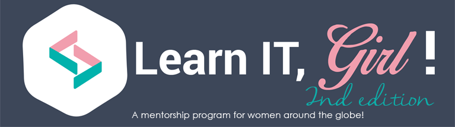

<blockquote>

Thank You <strong><a href="https://www.learnitgirl.com/about_us">Learn IT, Girl !</a></strong> for the kind mention 🙂 
I am really looking forward to an exciting journey ahead !

</blockquote>

<a href="https://learnitgirl.wordpress.com/2016/02/14/welcome-mentors-let-past-mentors-inspire-you">Learn IT, Girl!</a>

Tomorrow “Learn IT, Girl” will finally start its second edition. After months of hard volunteering work, we are both moved and excited about this achievement. More than 150 pairs of mentors and mentees will start a wonderful journey into coding and creating. And for some, this may be their first mentoring experience. We want to let you know you are not alone. In November 2014, when the first edition of “Learn IT, Girl” started, a group of mentors started a similar journey being as excited as you are now. Here are some of their experiences, along with others from Google Code-In or Google Summer of Code. We hope their advice guides you and inspires you through the journey you will start tomorrow.

<strong>Katerina Trajchevska</strong> is a Software Engineer and web-enthusiast who co-founded <a href="https://adevait.com/">Adeva IT</a>. She was a PHP mentor during the first edition of “Learn IT, Girl”.

<em>Have to say, mentoring…</em>

<a href="https://learnitgirl.wordpress.com/2016/02/14/welcome-mentors-let-past-mentors-inspire-you">View original post</a> 1,010 more words

