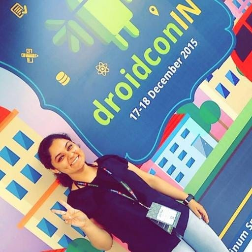
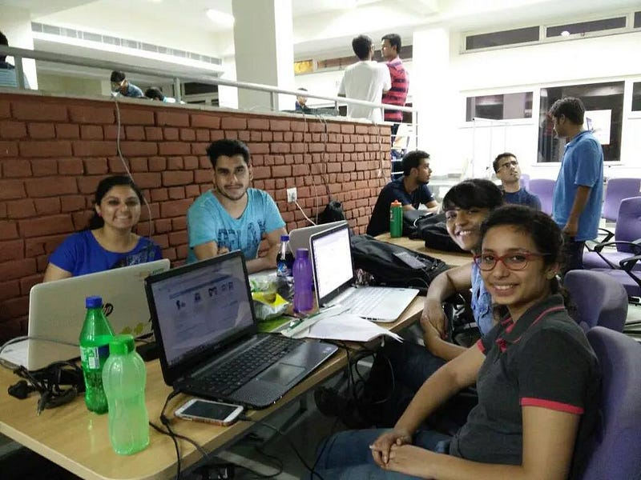

<section class=" section--body section--first section--last">

Thank You <strong><a href="http://hellomeets.com/">HelloMeets</a></strong> for the feature ! 

You can read the <a href="https://medium.com/@hellomeets/more-power-to-hackers-jigyasa-grover-643ca836f30#.ncblnzb8h">original post </a>on <strong><a href="https://medium.com/@hellomeets/more-power-to-hackers-jigyasa-grover-643ca836f30#.ncblnzb8h">medium.com/@hellomeets/more-power-to-hackers-jigyasa-grover</a></strong> 🙂

<em>My story — How I started coding and my mission of building a powerful bunch of girls and boys alike in coding.</em>

I consider myself fortunate to have a life so far infused with varied experiences as vibrant and tangy as the lemons which fall from the tree in the backyard of my home. In quest to achieve something that can provide satisfaction to me as well as my well-wishers, my emphasis has been on to explore and exploit my strengths in life. I spent my growing years in cosmopolitan city of Chandigarh at the foothills of Shivalik range of Himalayas having serene ambience but lively lifestyle. Studying in an all-girls Sacred heart convent school, where discipline was other name of oxygen, was sheer fun as well as an opening to full of opportunities to dabble in host of extra-curriculum activities other than studies. 

Academically I usually ranked amongst the top students of my class throughout my schooling. Achieving 614th rank in the Joint Entrance Examination was sufficient to secure me seats in prominent engineering institutes of India. Till that stage I was oblivion of selection of courses but aiming for best institute. As a typical Indian student, I was ecstatic when I got the ticket to the abode of Indian Engineering, <a class="markup--anchor markup--p-anchor" href="https://en.wikipedia.org/wiki/Indian_Institutes_of_Technology" rel="nofollow">Indian Institute of Technology ‘IIT’</a> as they say but in Biotechnology. Difficult it was since I had to make a choice between Institute and my interest area that would shape my destiny.

I have been always been fascinated with the mystic of tame machines that act like pets. During my early time in school introduction to computer fundamentals and rudimentary programming was enough to infect me with the ‘tech’ bug. This made the choice somewhat easier and finally I opted for Bachelor of Technology in Computer Engineering at <a class="markup--anchor markup--p-anchor" href="http://dtu.ac.in/" rel="nofollow">Delhi Technological University (formerly known as Delhi Engineering College)</a>, one of top ten engineering institutes in India.

Entering university with a skewed sex ratio, especially for a girl from an all-girls convent was undoubtedly baffling. More perplexing than communicating and interacting was the thought of grasping the expansive skills in the arena of technology which others seem to possess but she. Looking at the enormous interesting possibilities in open source world, in the first year itself, I jumped into the bandwagon by learning C/C++, HTML/CSS, Java, Android Applications development and also dabbled in PHP and PostgreSQL. Over the past two-three years in the university, I have tried to enhance my knowledge by trying hands at new tools and technologies (<a class="markup--anchor markup--p-anchor" href="https://twitter.com/jigyasa_grover" rel="nofollow">GitHub</a>).

Slowly and steadily, the efforts that were put in which seemingly were insignificant to begin with for many as baby steps have resulted in the shape of a nice journey towards my goal of being a professional.

I have successfully completed <a class="markup--anchor markup--p-anchor" href="https://www.google-melange.com/gsoc/project/details/google/gsoc2015/jigyasa/5685265389584384" rel="nofollow">Google Summer of Code 2015</a> under<a class="markup--anchor markup--p-anchor" href="http://fossasia.org/" rel="nofollow">FOSSASIA</a> by developing an offline text search utility namely <a class="markup--anchor markup--p-anchor" href="https://github.com/jig08/sQuick_new" rel="nofollow">searchQuick</a> in Pharo Smalltalk. Just recently, I have been invited to speak at the <a class="markup--anchor markup--p-anchor" href="http://2016.fossasia.org/" rel="nofollow">FOSSASIA Summit 2016</a> being held in Singapore about my summer project and also take a workshop for teenagers on Android App development.

<figure id="aa09" class="graf--figure graf-after--p">

</figure>

My name has been listed in the select contributors’ list of the <a class="markup--anchor markup--p-anchor" href="http://pharo.org/news/pharo-4.0-released" rel="nofollow">Pharo 4.0 recent release in April 2015</a> in which I actively contributed via Pharo Issue Tracker, reviewing bugs and opening issues for faulty features etc. I have also contributed to the official documentation of Pharo by writing two chapters for the books Fun With Pharo and Pharo In Progress as the content contributor of Square Bracket Associates.

I am a recipient of the Student Scholarship by Anita Borg Institute and the coveted Grace Hopper Celebration of Women in Computing India 2015 and have also received Female Developer Sponsorship by DroidCon and Intel® Software to attend DroidCon India 2015 held in Bangalore. I have also been awarded with the Diversity Scholarship from the Linux Foundation to attend MesosCon Europe 2015 held in Dublin, Ireland in October.

The realm of Android application development has attracted me observing massive explosion in mobile technologies. Apart from developing Android Apps for a couple of start-ups, events like Hackathons which aim at dispensing a rostrum to meet fellow developers and help connect with talented and motivated proffessionals have caught my fancy in recent times. I have participated ina couple of hackathons like <a class="markup--anchor markup--p-anchor" href="http://esya.iiitd.edu.in/m/events/hackiiitd" rel="nofollow">hackIIITD-2015</a> held in Delhi and <a class="markup--anchor markup--p-anchor" href="https://www.pragyan.org/hackathon" rel="nofollow">Microsoft Pragyan 2015</a> held in Bangalore and have developed prize winning applications in the restricted 18–24 hours of immense learning and sheer fun.

Since the day I have stepped into this ineffable world of technology, I have realized the dearth of female technologists. I am a feminist by heart, but this must not be mistaken as belittling the contributions of males which I regard. I have thus associated myself with inspirational communities like Women Who Code, Google Developers Group, Google Women Techmakers to pursue the mission of building a powerful bunch of girls and boys alike. The holy grail to connect amazing people from technology, with a special emphasis on women with other like minded people around the globe and unite under one simple notion — the world of technology is much better with women in it is thought-provoking.

<figure id="9154" class="graf--figure graf-after--p">

</figure>

My journey with Women Who Code started as a simple community organizer where I used to help by arranging for events, looking after logistics and helping spread the word. Observing my inclination towards administrative tasks with responsibility, I was recently promoted as the<a class="markup--anchor markup--p-anchor" href="https://www.womenwhocode.com/delhi" rel="nofollow">Director of Women Who Code Delhi Network</a> which is a huge accomplishment for me. I am grateful to WWC for acknowledging my contributions and achievements in the sphere of technology, and by featuring me in the <em class="markup--em markup--p-em">Applaud Her</em> section of WWC in the issues of May 2015, October 2015 and November 2015.

I may not have reached that level where I could openly boast about my technical skills, but whatever I have achieved so far has surely not been a short way out. The capacity for diligent work and academic credentials has aided me throughout. From resolving bugs and issues to reviewing pull requests, it has been a learning experience at each tiny step.

These experiences have also paid back me with improved my interpersonal skills and enabled me to appreciate the value of my possessions as well as inculcating a feeling of sharing. To propagate the missive of open source, I am already doing my bit in sharing my experiences with the community via my <a class="markup--anchor markup--p-anchor" href="https://jigyasagrover.wordpress.com/" rel="nofollow">blog</a> which I try to regularly update.

Conquering another challenge was successfully mentoring <a class="markup--anchor markup--p-anchor" href="https://codein.withgoogle.com/" rel="nofollow">Google Code In</a> , an open source development program for teenagers which made me realize the impact of dissemination of elementary enlightenment amongst juniors and in turn helped me gain a new perspective of life.

It has been furthered with my inclination towards addressing the misconception of fair sex about being second fiddle in computing arena by joining another global program for women <a class="markup--anchor markup--p-anchor" href="https://www.learnitgirl.com/" rel="nofollow">Learn IT, Girl !</a> as a platform developer, program organizer and a mentor to an aspiring girl developer.

All this has required facing many challenges, balancing academics, extra-curricular activities (I am a social work aficionado working with <a class="markup--anchor markup--p-anchor" href="http://enactus.org/" rel="nofollow">Enactus</a>, a semi-classical dancer and an ex-NCC Cadet) and I can humbly say that I have been fairly able to juggle them all.

As they say, everything comes with a price and so does this. There have been times when I have come across not-so encouraging remarks. The opinions formed of girls progressing owing to gender specific opportunities especially holding inspirational communities responsible for providing short cuts clearly highlights their complexes. One should let these ossify one’s determination and move ahead always for only the ones ahead are talked about.

The ultimate goal in my career is to make a commendable contribution to the computing world either by starting an innovative venture or contributing in R&amp;D which would change the dimensions of future computing and the way we perceive the computers. Now I have determined that a dedicated study on Computer Science will enable me to aggregate all my previous knowledge &amp; experience on the field and encourage in achieving my career goal.

Continuous progress is the key to life. And for progress, knowledge and proper guidance are essentials. I am sure, the quality knowledge and impeccable guidance by everyone around me will put me in learning mode all my life opening way for growth as a professional and as a good human-being.

<em>Thank you so much to our community member <a class="markup--anchor markup--p-anchor" href="https://www.linkedin.com/in/jigyasagrover?authType=NAME_SEARCH&amp;authToken=4Oer&amp;locale=en_US&amp;trk=tyah&amp;trkInfo=clickedVertical%3Amynetwork%2CclickedEntityId%3A348776520%2CauthType%3ANAME_SEARCH%2Cidx%3A1-1-1%2CtarId%3A1455732257422%2Ctas%3AJigyasa%20Grover" rel="nofollow">Jigyasa Grover</a> for writing her story for HelloMeets blog. </em><em>Jigyasa is currently a <a class="markup--anchor markup--p-anchor" title="Learn more about this title" href="https://www.linkedin.com/title/mentor.-developer.-organizer?trk=mprofile_title" rel="nofollow">Mentor. Developer &amp; Organizer</a> @ <a class="markup--anchor markup--p-anchor" title="Find others who have worked at this company" href="https://www.linkedin.com/vsearch/p?company=Learn+IT%2C+Girl+%21&amp;trk=prof-exp-company-name" rel="nofollow">Learn IT, Girl !</a>, </em><em><a class="markup--anchor markup--p-anchor" title="Learn more about this title" href="https://www.linkedin.com/title/director?trk=mprofile_title" rel="nofollow">Director</a> @ <a class="markup--anchor markup--p-anchor" href="https://www.linkedin.com/company/3233332?trk=prof-exp-company-name" rel="nofollow">Women Who Code</a> and <a class="markup--anchor markup--p-anchor" title="Learn more about this title" href="https://www.linkedin.com/title/delhi-network-lead?trk=mprofile_title" rel="nofollow">Delhi Network Lead</a>, Contributing in bridging the gender gap in IT.</em>

</section>

