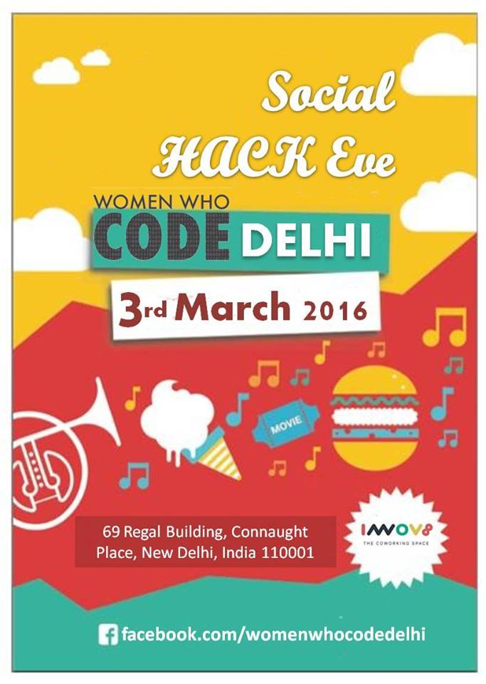

<blockquote>

“Behold, the number five is at hand. Grab it and shake and harness the power of networking.”

</blockquote>

<a href="https://www.facebook.com/womenwhocodedelhi/?fref=ts"><em>Women Who Code Delhi</em> </a>organized <strong>Social Hack Eve</strong>, a networking session to bridge the gap between women and technology, on the <em>3rd of March, 2016</em>. With an interesting lineup of talks, discussing everything from women in technology to headlining news in tech, Social Hack Eve was surely a successful event.

This time, <em><a href="https://twitter.com/WWCode_Delhi">WWC Delhi </a> </em>brought the amazing team who believes to unite the globe under one simple notion – the world of technology is much better with women in it: the leaders behind Women Who Code at the beautiful <a href="http://www.innov8.work/">Innov8 Coworking space</a> !

Alaina Percival : The Chief Executive Officer of Women Who Code, with a vision to inspire women to excel in technology. 
Joey Rosenberg: The Global Leadership Director with Women Who Code, inspires girls and women to achieve their fullest potential and drive towards sustainable change! 
Jennifer Tacheff : The Vice President of Business Development at Women Who Code who has proven her expertise in executing and optimizing campaigns, driving innovation, and generating revenue.

3rd March 2016, Women Who Code Delhi hopefully increased its impact, expanded the reach, and took an oath to continue to push women to the forefront in the technology space!

<em>QUICK LINKS</em> 
Facebook: <a href="https://facebook.com/womenwhocodedelhi">facebook.com/womenwhocodedelhi</a> 
Twitter: <a href="http://twitter.com/WWCode_Delhi" target="_blank">twitter.com/WWCode_Delhi</a> 
Meetups: <a href="http://meetup.com/Women-Who-Code-Delhi" target="_blank">meetup.com/Women-Who-Code-Delhi</a> 
Registration: <a href="http://goo.gl/forms/zYvzQfQ8TG" target="_blank">goo.gl/forms/zYvzQfQ8TG</a> 
EMail: jigyasa@womenwhocode.com or delhi@womenwhocode.com 
Queries: womenwhocode.delhi@gmail.com

<strong><em>Here is an interesting event apprise by a team member of Women  Who Code Delhi  🙂</em></strong>

<strong><a href="https://chhavip.wordpress.com/2016/03/24/enlightened-encounters-social-hack-eve/">[reblogged] Enlightened Encounters : Social Hack Eve</a></strong>

Social Hack Eve, Women Who Code, Delhi: 3rd March, 2016.

This is going to be a short entry because that’s how long the event was. Very short. But the impact it had – now that was everlasting. This may seem like a promotional gig for a cause I support dearly and maybe it even is, but I can promote this cause without any qualms or feeling of self interest. Because what are we promoting? Hope? Opportunity? Guidance? Women Who Code is an amalgam of all these that resulted in a beautiful experience.

Let us go over the events of the day, being an organizer I was partially aware of how the day was going to proceed but what even I hadn’t anticipated were the joy and experience the people brought to the event. 30 odd women(men were very much welcome but only a handful souls showed up), students and professionals alike gathered in a welcoming aboard to discuss – well no one had any idea what.

The stars of the day were Women Who Code Leaders – <strong>Alaina Percival</strong>, <strong><em>Chief Executive Officer</em></strong>, <strong>J</strong><strong>oey</strong> <strong>Rosenberg,  <em>Global Leadership Director</em></strong>  and  
<strong>Jennifer Tacheff</strong>, <em><strong>Vice President of Business Development</strong></em>  who were so engraved in the fabric of the meeting, it was hard for anyone of us to feel we were meeting them for the first time. What followed next had nothing to do with promoting a name. It had everything to do with having intelligent and enlightened conversations. Empowerment at its zenith. I saw as people recalled their stories of not being afraid to want what they wanted and believe me that is an experience many of those in our educated youth are still shy of having.

All the people gathered there were united by a common passion for their own progress and because of a belief in community bonding and building. 
 An unique experience of the day was #Applaud section which entailed attendees coming up and speaking and being once again proud of anything and everything they had achieved. There was a seamless connection of people with ideas and people with means – job opportunities, mentorship, guidance or just some others to share your experience with. It was gratifying to watch the will to help was as strong as the will to learn.

I could preach about the outcomes and ideology behind organizations like Women Who Code all day but what I experienced that if you remove the name, the mystique, all it does is provide a platform for like minded people to come up and share their life stories under a safe banner where they know they will be appreciated. And what could ever be wrong with that?

All inspiration apart came the end. And what an end it was, all the attendees and organizers put their feet together and moved to the beats. A memory that will bring a smile to my face every time it is reminisced.

Enjoy the <a href="https://www.youtube.com/watch?v=XlHeWzOKG1Y&amp;feature=youtu.be">video recap </a> and follow us on <a href="https://www.facebook.com/womenwhocodedelhi/">Facebook</a> and/or <a href="https://twitter.com/WWCode_Delhi">Twitter</a> for updates and future events!

&nbsp;

