
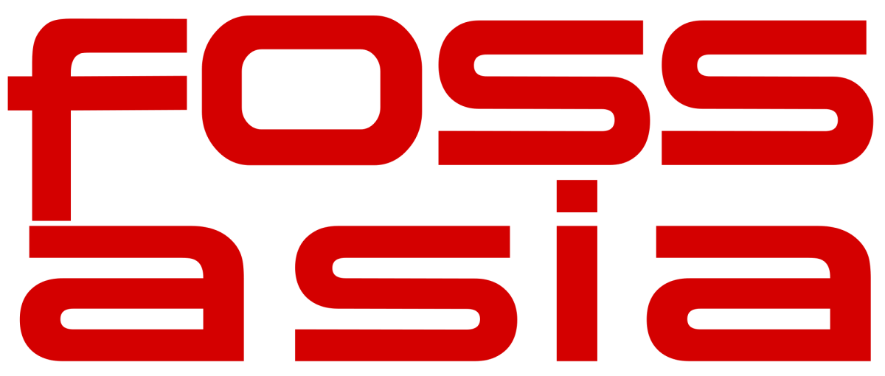

<blockquote>
<a href="http://fossasia.org/">FOSSASIA</a> started in 2009 in Vietnam and has been a huge success since then, providing a platform to exhibit sundry FOSS technologies. For <a href="http://2016.fossasia.org/">FOSSASIA 2016</a>, the theme for the event was <em>Internet of Things</em>. It was held in the Singapore Science Center from March 18th to 20th.
</blockquote>

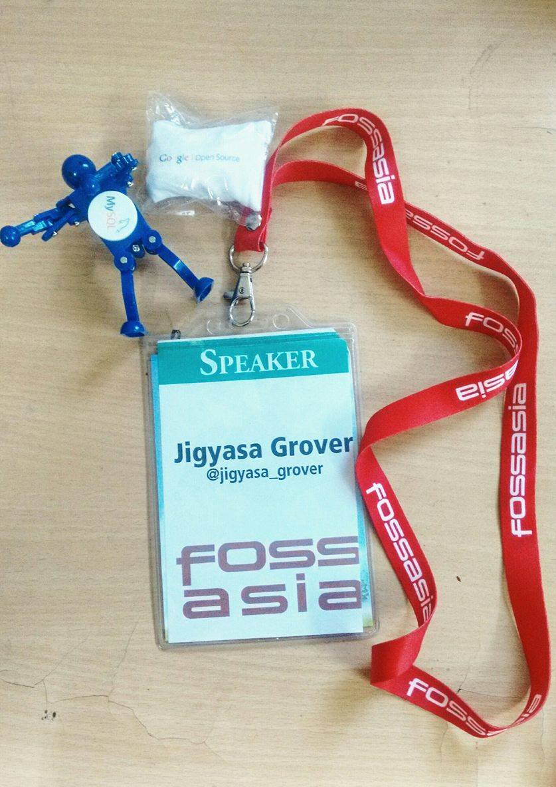 
 So after quickly wrapping up with my mid-terms in university, I packed my bags and was off to <em>Singapore</em> to attend the much awaited <strong>FOSSASIA OpenTech Summit 2016</strong>.

With excitement rumbling inside to meet all the amazing developers and organization admins * in person * after more than a year of interacting and working together online, the tiring journey and the overnight flight from India to Singapore could not dampen the spirits.

Gratitude to <strong>Google Open Source Program</strong> for providing sponsorship to attend the coveted conference of the year 🙂

It is not everyday one gets an opportunity to network with so many technology celebs from renowned organizations like Google, RedHat, Fedora, Python, KDE, Github, MySQL, Coala, OpenMRS, OpenTech, Loklak, Yacy etc etc (the list is too long .. )

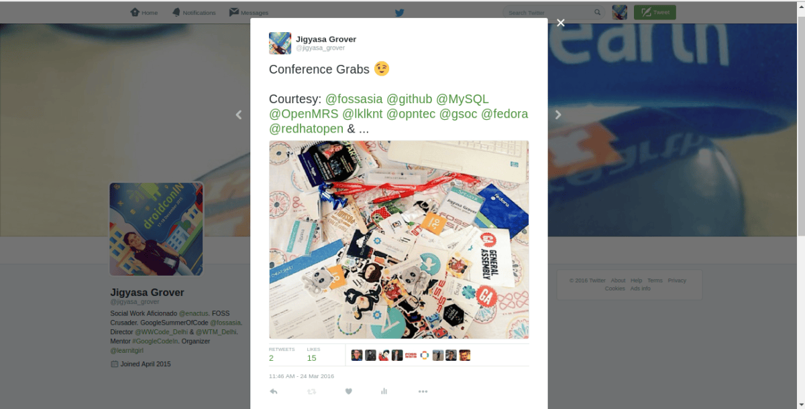

&nbsp;

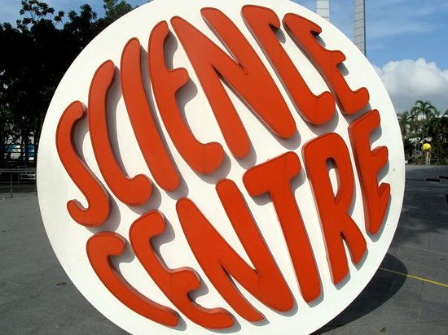
 Science Centre, Singapore

The event venue was <strong>The Science Centre Singapore </strong>a scientific institution specializing in the promotion of scientific and technological education for the general public. It was fun being a kid again, lost in the endless wonders of science experiments the place had to offer. From measuring stress levels to playing games and making patterns with water droplets and electric shock chairs, the venue truly made up the essence of the conference.

The conference had varied tracks serving all types of Open Source enthusiasts right from <em>OpenTech</em>, <em>Hardware &amp; IoT</em>, <em>Design</em>, to <em>BigData/OpenData</em>, <em>DevOps</em>, <em>Internet &amp; Security</em>. It also had a separate technology track for teenagers <em>TechKids</em> having workshops spanning sundry open tools and technologies with hands-on sessions.

<strong>Day 1 <strong> (18th March 2016, Friday) 
</strong> 
</strong>Followed by the <em>Grand Opening</em>, we had keynotes by <em>Mario Behling &amp; Hong Phuc Dang</em> (the org admins) , <em>Harish Pillai from RedHat</em> and <em>Bunnie Huang from Burning Man.</em> 
 The highlight of the day was having lunch and tech chit-chatting the entire afternoon with my mentor, <em>Martin Bahr</em> with whom I had worked in Summer 2015. 
 It was lovely speaking to many people Mario introduced me to, like <em>Oren Golan</em> and <em>Carsten Haitzler</em> who were too good at inspiring and made me feel proud of myself. 
 The rest of the day went in interacting with <em>Stephanie Taylor</em> and <em>Cat Allman</em> from Google talking about Google Summer of Code &amp; Google Code-In. 
 I also went around spreading the word about about Women Who Code and distributing stickers , which everyone loved 😉

<strong>Day 2 (19th March 2016, Saturday) 
 
</strong>This was a busy day for me as all my talks and workshops were scheduled on Saturday. The morning started with my workshop <em><a href="https://github.com/jig08/Conferences-Seminars-Talks/blob/master/FOSSASIA_2016/AndroidApp101/Making_your_first_android_app.pdf">&#8220;Making your first Android App&#8221;</a></em> for the <em>TechKids</em> track. The 2 hour session was more than satisfactory explaining the basics of the much popular Mobile OS and seeing the glowing faces of the amateurs having made their first Android App. 
 Next I had a workshop with <em>eMBee</em> on Pharo Smalltalk talking about the not widely known programming platform and teaching newbies to code a simple <a href="/tictactoe-tutorial-funwithpharo/">TicTacToe Game</a> . 
 After wrapping up with all my workshops, I hurried for my lightning talk on <em>&#8220;My journey in FOSS: With Pharo &amp; FOSSASIA&#8221; </em>which walked through the start of my journey in the world of Open Source and the learning experiences I had working with Pharo and FOSSASIA<em>. </em>The busy day was wrapped up with a lovely night river cruise at Clark Quay.

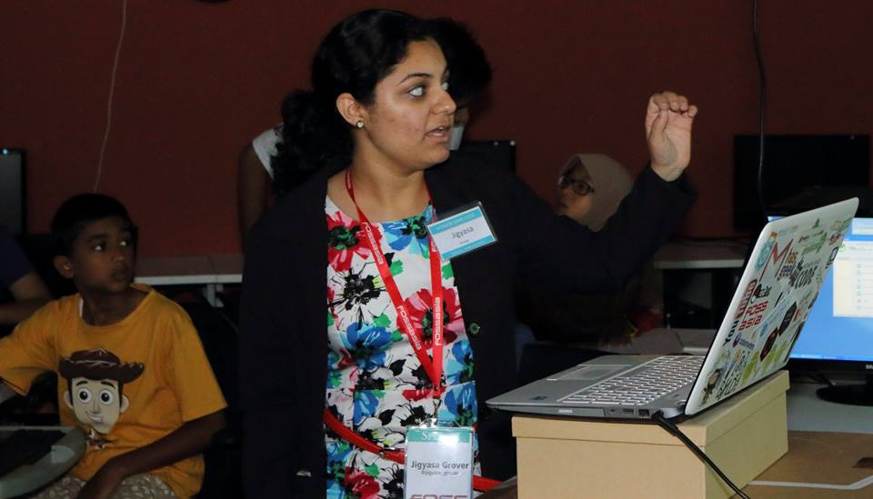
Explaining the basics of Android

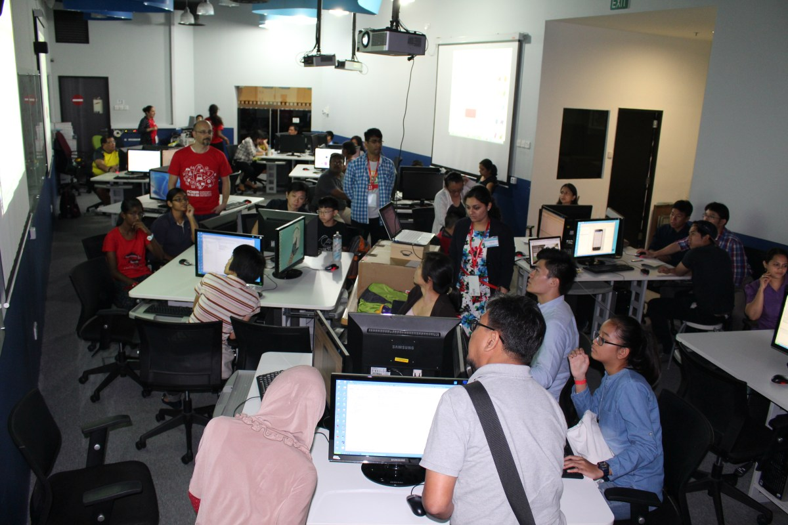
 Workshop in progress

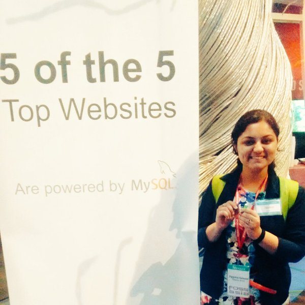
With the &#8216;dancing mechanical #MYSQL toy&#8217;

&nbsp;

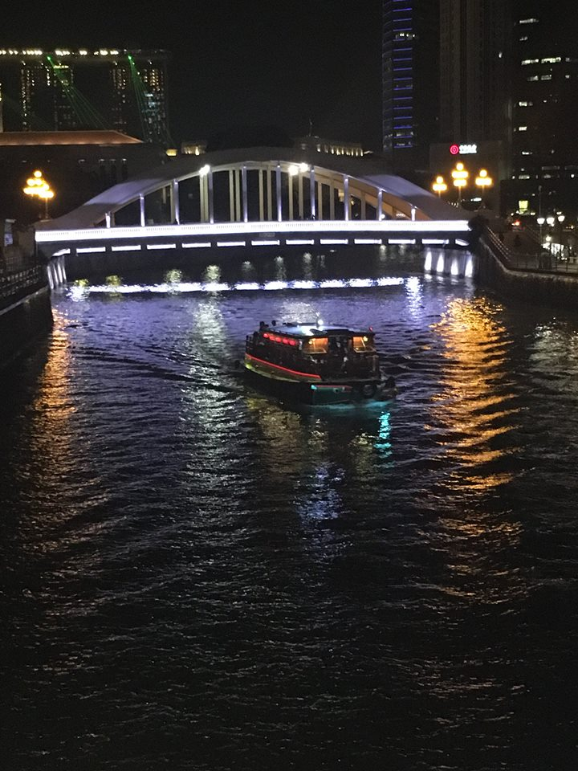
City Lights, Saturday Night &amp; River Cruise at Clark Quay

&nbsp;

<strong>Day 3 (20th March 2016, Sunday)</strong>

Believing it to be a comparatively lighter day, I went all cool-ly in the morning stopping by the <em>Kinetic Garden</em> (physics and shizz) before I reached the venue. I was attending an interesting talk on &#8216;Aware UIs&#8217; when I was frantically contacted by Hong Phuc &amp; Justin Lee to report immediately in the speakers&#8217; room. On reaching there hurriedly, I was given a laptop and made to enter the computer lab to teach mobile application development to kids waiting there since a few minutes as the trainer could not make it to his workshop on time. Thankfully, I was able to manage it and that session too ended on a happy note.

The post-lunch time was spent mostly in the exhibition area, looking through fascinating projects up there, collecting goodies/T-Shirts, playing confidence booster activities and trying out VR glasses. The day ended with a photo shoot with the org admins, tech celebs from different organizations and saying goodbyes.

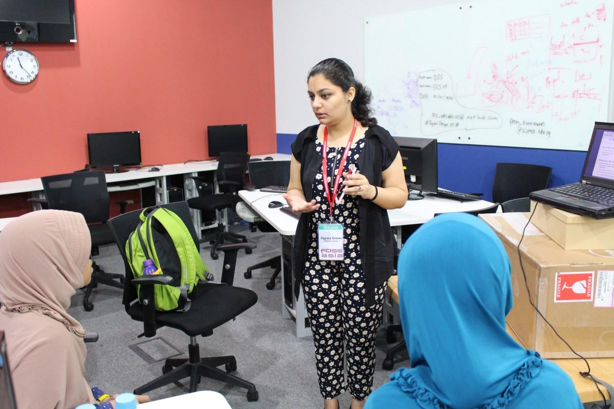
 Talking tech stuff with kids

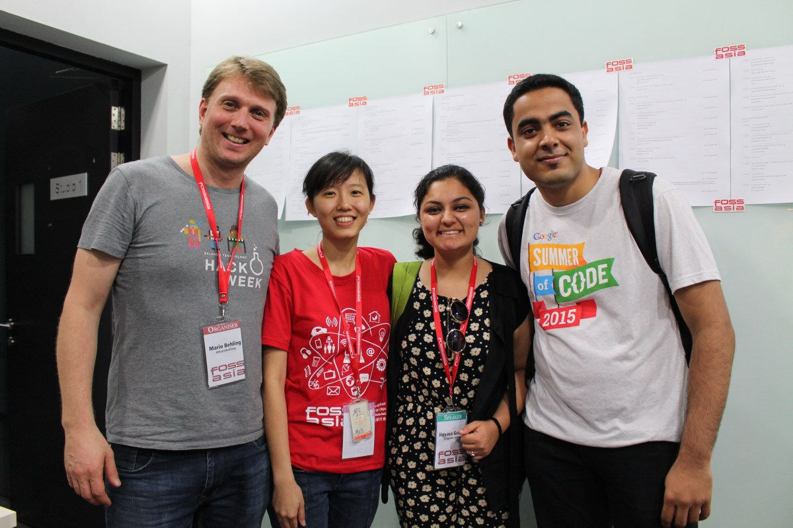
 With the FOSSASIA organization admins: Mario Behling &amp; Hong Phuc Dang

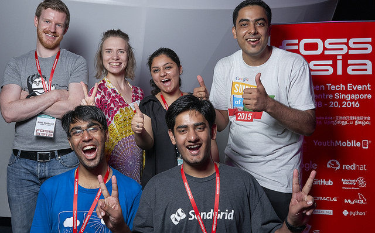
 The one with <em>Mike McQuaid</em> from <em>Github</em> 

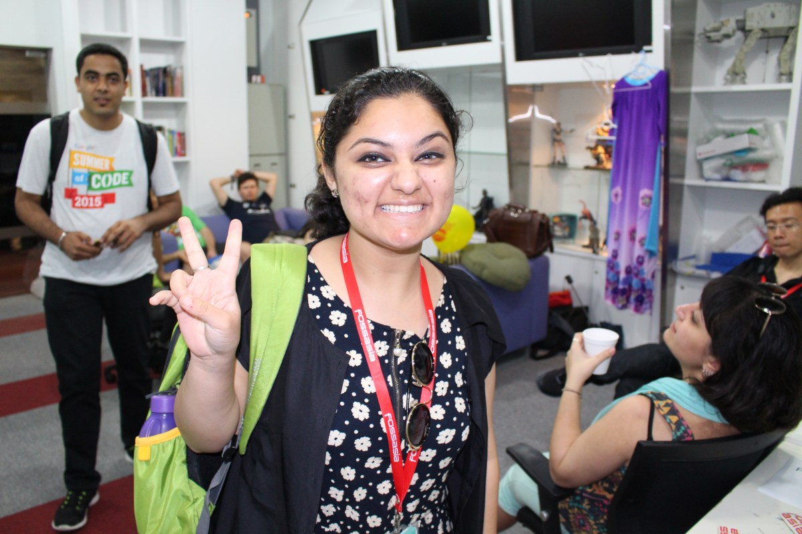
 Excited Times

The next two days were spent exploring Singapore and celebrating life in <em>Universal Studios</em> and <em>Sentosa Island</em> which were worth the effort and time put in 😉

<em>FOSSASIA OpenTech Summit 2016</em> was an amazing experience , I loved meeting so many new people from around the globe working in this ineffable world of open technology. Kudos to the team for organizing such a brilliant event.

Hope to be there next year too, till then CIAO 🙂

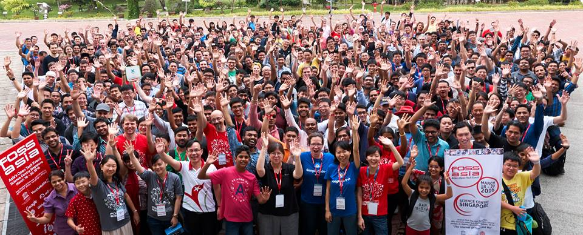

&nbsp;

&nbsp;

