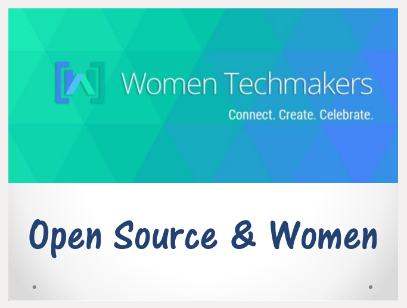
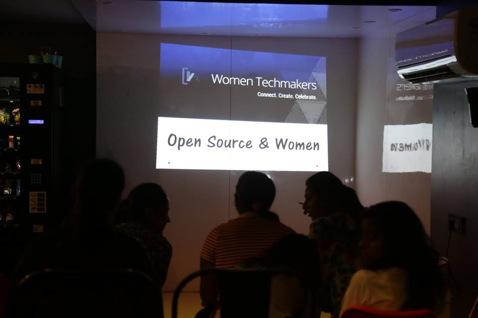
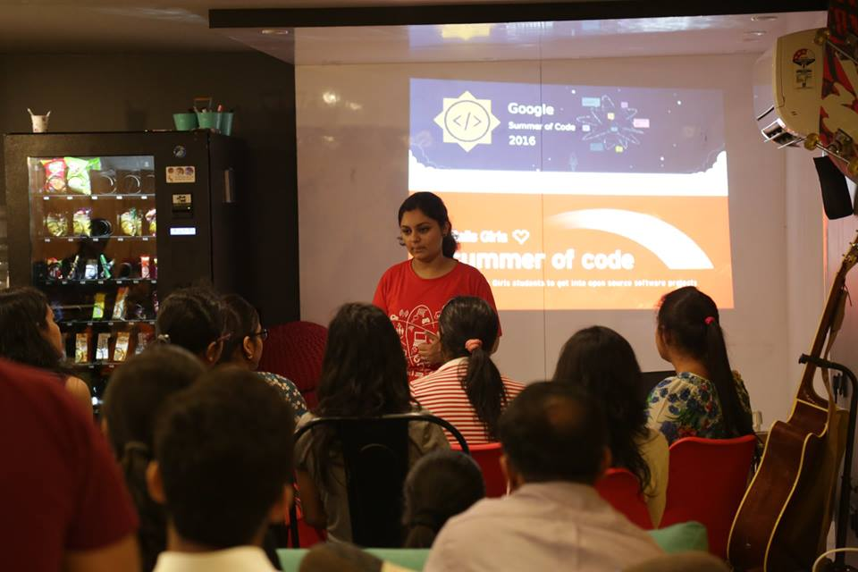
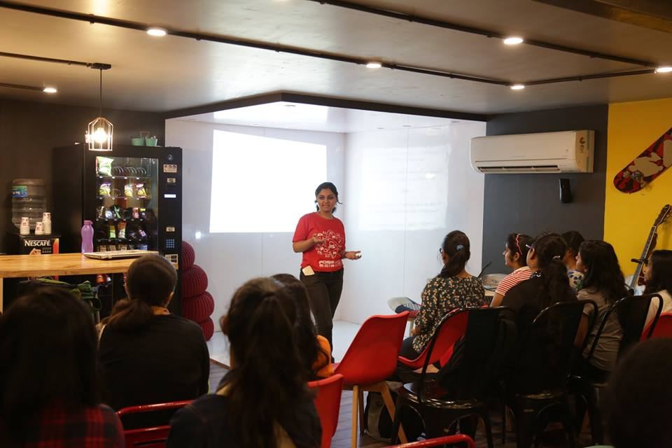
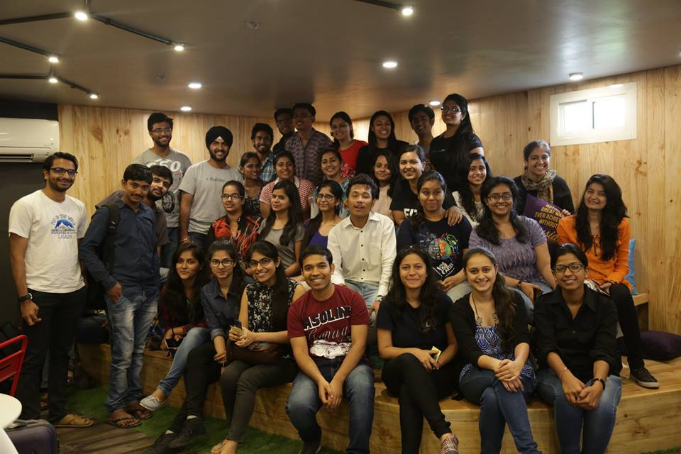

<em>According to a survey, only 11% of open source participants are women. </em> 
<em>People find it intimidating to get started with contributing to open source. Why?</em>

As the lead of <strong>Women Techmakers Delhi</strong>, I organized the event <strong><a href="https://www.facebook.com/events/899816380165161/">Open Source &amp; Women</a> </strong>at the beautiful <em>Innov8 Coworking Space</em> to back them up by answering questions related to the ineffable world of Open Source, throwing light on the issues that they usually have and helping answer simple queries.

It was lovely talking about the two themes I love: <em>Open Source</em> and <em>Women </em>and discussing the amalgamation of the two, Open Source &amp; Women was all the more interesting.

Starting off with explaining the basic terminologies and the major difference between Open Source Software, Free Software and Freeware, my talk elaborated the vast range of opportunities ranging from coding to documentation, design, outreach and research.

I also shared my involvement and experience in FOSS and its impact it has had on my tech career which has just just begun :p Also various programs, competitions pertaining to Open Source Software, Open Hardware , OpenData etc. were conversed about.

  <figure></figure>
  <figure></figure>

With all the participants in the full-house startup cafe, we put our heads together about the reasons for dearth of women in technology especially open source. Studying (appalling) facts and figures available, it was concluded that women made up just 1/20th of Open Source contributors and we all have a long way to go to bridge this gender-gap in tech.

To help the girls kick-off with contributing to open source development, a hands-on session on Git/Github was taken by Harshita Chadar and Susmita Haroow, the two lovely ladies working in Open Source since many years. The session was indeed enlightning for the newbies  which encompassed teaching Markdown style, creating issues, sending Pull requests and other nuances of this wonderful tool we possess without which Open Source development won&#8217;t have been

We had guest speakers including males come up from organizations like <a href="http://www.innov8.work/about-us/">Innov8 India</a>, <a href="http://madresistor.com/">MadResistor</a>, <a href="http://www.nexusindialtd.com/">Nexus India Ltd</a>,  <a href="https://thelocaltribe.com/">The Local Tribe</a> and talk about their work culture and how they wish to encourage more women in tech.

It was followed by a creative <em>Design Sprint, </em>a product prototyping activity in teams on the themes of problems faced by women in and around our vicinity like sexual assault. The on-the-spot competition was judged by working professionals from Google India, Innov8 India and JoshTalks Delhi. The fun-filled activity not only helped address female issues but also stirred up team spirit, interaction and networking within the room full of budding techies.

The much loved event was followed up by a scrumptious pizza party and photo-shoot.

Kudos to <em>Google India</em> for providing support in terms of Schwags &amp; refreshments and <em>Innov8 Co-working</em> for providing with such a beautiful place to hold the event. 
A special mention to <em>Women Who Code Delhi</em> as our Outreach Partner.

&nbsp;

&nbsp;

