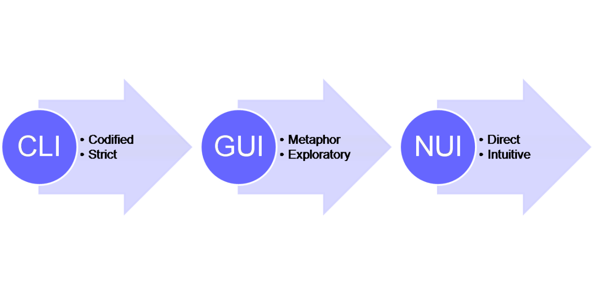
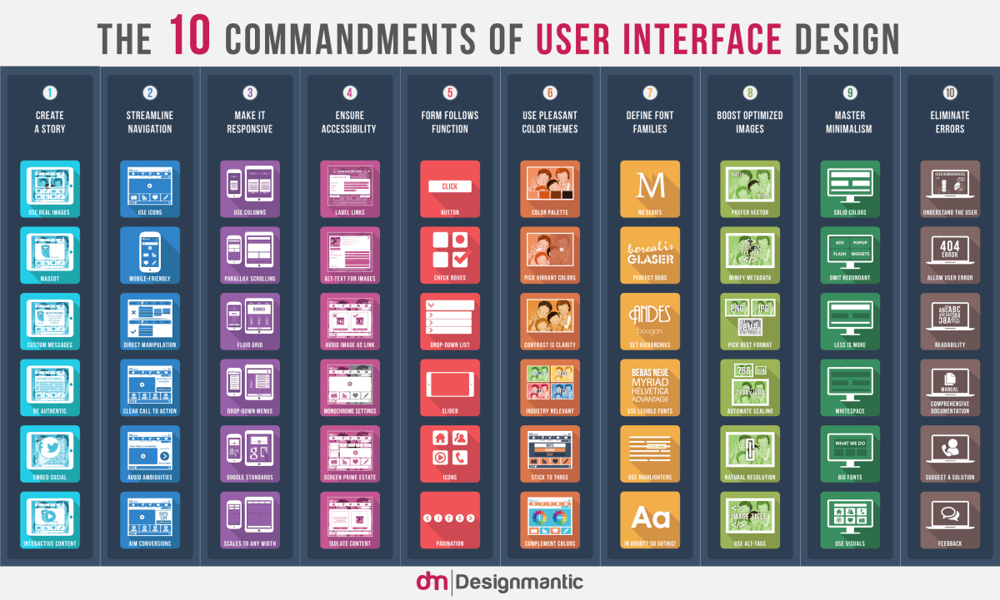
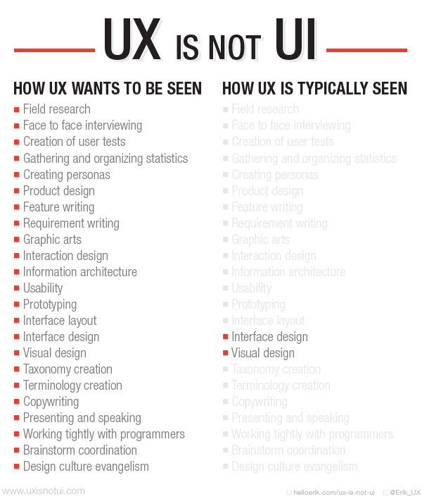

<blockquote>
Last summer, I had started working on a project to develop an Offline Text Search Utility in Pharo. I was successful in building an application which retrieved correct search results from a collection of plain texts, a need for a good GUI of the application was felt. Hence, I along with my mentor <em>eMBee</em> have decided to work on enhancing the user interface of the desktop application <em><a href="https://github.com/jig08/sQuick_new">sQuick</a>. </em>But before I start to work on it, I am reading more about (G)UI design and UX which I believe shall help me have a better perspective and assist in learning good design principles.
</blockquote>

Simply put, in industrial design field of human–machine interaction, the <strong>user interface (UI) </strong>is the <em>space where interactions between humans and machines occur</em>.

The goal is to produce a UI which makes it easy (self-explanatory), efficient, and enjoyable (user-friendly) to operate a machine/application in the way which produces the desired result.

The design considerations applicable when creating UIs involve disciplines such as ergonomics and psychology.

With the increased use of personal computers the term UI is generally assumed to mean the Graphical UI, but it is not correct. User Interfaces may or may not be graphical. It could be: 
<strong>            Command Line Interface </strong>(Here the user provides the input by typing a command string with the computer keyboard and the system provides output by printing text on the computer monitor) 
<strong>            Graphical User Interface </strong>(It allows users to interact with programs in more ways than typing such as computers, hand-held devices, household appliances and office equipment with images rather than text commands) 
<strong>            Natural User Interface </strong>(It is effectively invisible, and remains invisible as the user continuously learns increasingly complex interactions) 
<strong>            </strong>or many other types like Hardware User Interface, Touch User Interface, Motion Tracking User Interface, Intelligent User Interface etc.

&nbsp;

Upon further reading, I found that all great interfaces share majorly <strong>Eight Qualities/Characteristics:</strong>

<strong><em>          Clarity</em></strong>: The interface avoids ambiguity by making everything clear through language, flow, hierarchy and metaphors for visual elements.

<strong><em><strong><em>          </em></strong>Concision</em></strong>: It’s easy to make the interface clear by over-clarifying and labeling everything, but this leads to interface bloat, where there is just too much stuff on the screen at the same time. If too many things are on the screen, finding what you’re looking for is difficult, and so the interface becomes tedious to use. The real challenge in making a great interface is to make it concise and clear at the same time.

<strong><em><strong><em>          </em></strong>Familiarity</em></strong>: Even if someone uses an interface for the first time, certain elements can still be familiar. Real-life metaphors can be used to communicate meaning.

<em><strong><em>          </em>Responsiveness</strong></em>: A good interface should not feel sluggish. This means that the interface should provide good feedback to the user about what’s happening and whether the user’s input is being successfully processed.

<strong><em><strong><em>          </em></strong>Consistency</em></strong>: Keeping your interface consistent across your application is important because it allows users to recognize usage patterns.

<strong><em><strong><em>          </em></strong>Aesthetics</em></strong>: While you don’t need to make an interface attractive for it to do its job, making something look good will make the time your users spend using your application more enjoyable; and happier users can only be a good thing.

<strong><em><strong><em>          </em></strong>Efficiency</em></strong>: Time is money, and a great interface should make the user more productive through shortcuts and good design.

<strong><em><strong><em>          </em></strong>Forgiveness</em></strong>: A good interface should not punish users for their mistakes but should instead provide the means to remedy them.

The fact that human beings can only pay full attention to one thing at one time seems pretty obvious, but the formal name given to it<strong> Principle of least astonishment (POLA) </strong>and it to be considered an important  design principle for all kinds of interfaces was fascinating. This leads to the conclusion that novelty should be minimized.

I found a very interesting and a useful image by <a href="http://www.designmantic.com/">DesignMantic</a> titled <strong>&#8220;The 10 commandments of UI Design&#8221;</strong> and it truly encompasses the much important essence of UI design.

&nbsp;

Generally UI is thought of as the beauty of an application in computing world. Rather it focuses more on usefulness in delivering the product to the user. The purpose of UI is to get the user to the product as efficiently and quickly as possible.

<strong>Good UI</strong> 
An effective UI design is intuitive, both in how it interacts with the user and how the user interacts with the site. 
Good UI design has threads of familiarity. Even if I’m visiting your page or app for the first time, I should understand how it works–and quickly. 
A good user interface holds my hand and takes me where I should go. Mostly, users like hand-holding.(at least I like it the first time I use an application 😛 ) And, that’s not an insult to the users.

<strong>Bad UI 
</strong>Bad UI drops you off in the middle of the desert and expects you to make it on your own to the rain forest. It does not lead you where you need to go. 
Bad UI design is sluggish, complicated, and generic. And, surprisingly, there’s little gray area. Either you have a thoughtful UI design, or you have a generic blob that doesn’t meet the requirements of your users.

Another interesting misconception is <em><strong>UX == UI</strong>.</em>

To begin with, UX is an acronym <em>User Experience</em> and UI is for <em>User Interface</em>. 
UX is the intangible design of a strategy that brings us to a solution.

As Erik Flowers puts it: <em>&#8220;UI design is a <strong>huge part of UX</strong>. I would say that in a good majority of cases the UX designer does in fact design the interface. But UX is not UI. This is where the education of others comes in. Helping people understand just what UX is and the invaluable role it plays is illustrated beautifully with the UX Umbrella.&#8221;</em>

&nbsp;

UI implementation is generally thought of as an easier task . But in most scenarios there is a complex interaction with real back-end code and front-end script and it requires utmost professionalism.

Erik Flowers in his article <a href="http://www.helloerik.com/ux-is-not-ui">UX is not UI</a> takes up the journey of making a &#8216;killer UI&#8217; through an ideal hypothetical:

<ol>
<li>We presume the problem has been identified through the user/market/persona research.</li>
<li>User flows and stories are made, then trashed, then made again, then iterated on until the problem flow is clear.</li>
<li>With an idea of ways to solve the problem, some rapid experiments are carried out to validate the assumptions with the personas.</li>
<li>Some IA work is done to break out the product/site into the logical areas and hierarchies.</li>
<li>Various wireframes and sketches are drawn to start to organize where things could go on the screen.</li>
<li>With all the preceding research material and UX work, now mockups with UI included can be made with confidence.</li>
<li>With mockups and a UI designed, they are user tested and iterated on through some prototypes or experiments.</li>
<li>After the mockups have been vetted, it’s now time to code up the interface – UI Design!</li>
<li>Once the usability of the UI has been honed, you can move it on to production – the place that people usually think of as the singular UI.</li>
</ol>

That’s quite an <em>idealized</em> journey. Everyone follows the steps at their own pace customized according to their needs, time and resources.

After exploring a lot on UI/UX, I realized that it is one of the most under-rated job. It takes a lot of behind the scenes work to end up at a capable, elegant, and delightful interface. But the interface is not the solution and UX combats this very thing. It’s a huge strategic process that aims to create a product or website that customers/users/visitors are drawn to, find easy to use, and quickly understand.

It was really insightful reading all about UI/UX. Hopefully, I am able to put my newly gained knowledge into use by improving the User Interface of my application <em>sQuick</em>.

References:

<ul>
<li><a href="https://en.wikipedia.org/wiki/User_interface">en.wikipedia.org/wiki/User_interface</a></li>
<li><a href="http://www.designmantic.com/blog/infographics/the-10-commandments-of-ui-design/">designmantic.com/blog/infographics/the-10-commandments-of-ui-design</a></li>
<li><a href="http://www.helloerik.com/ux-is-not-ui">helloerik.com/ux-is-not-ui</a></li>
<li><a href="http://www.dburnsdesign.com/blog/2014/05/the-difference-between-good-ui-and-bad-ui/">dburnsdesign.com/blog/2014/05/the-difference-between-good-ui-and-bad-ui</a></li>
</ul>
