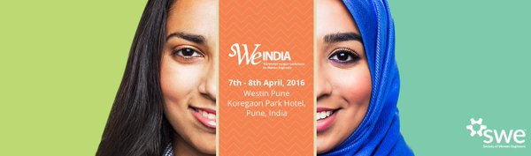
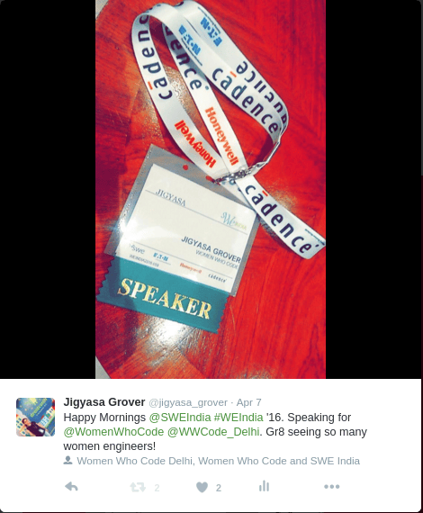
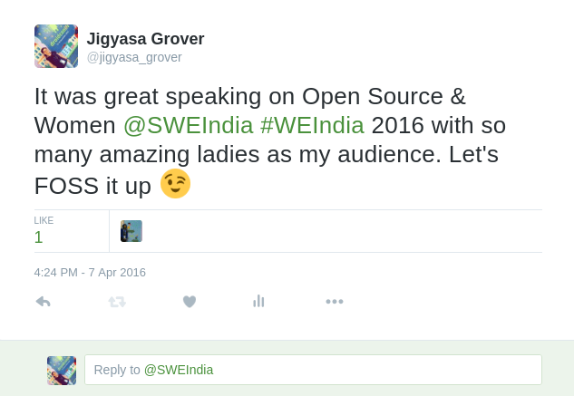
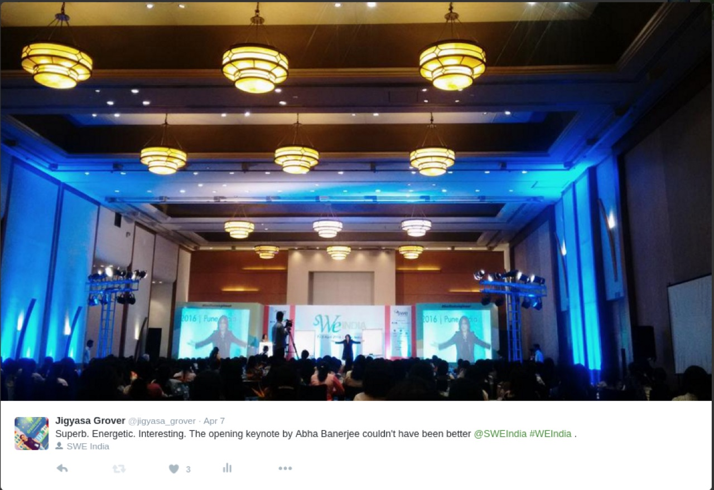
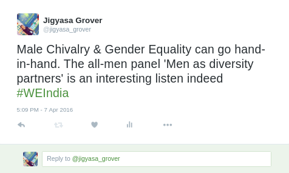
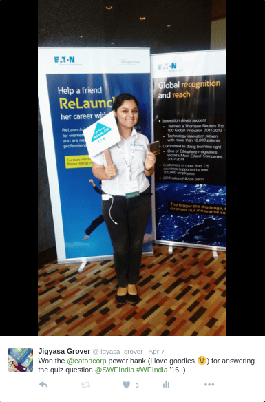
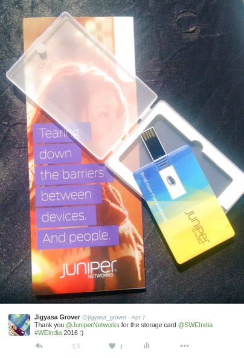
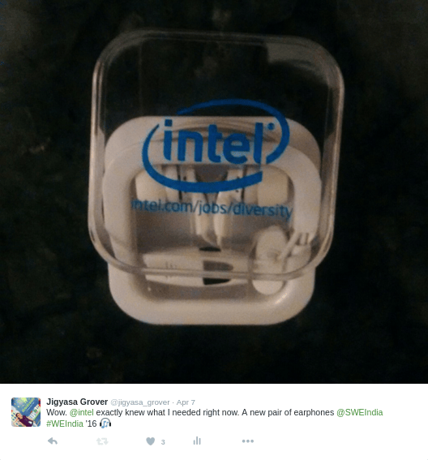
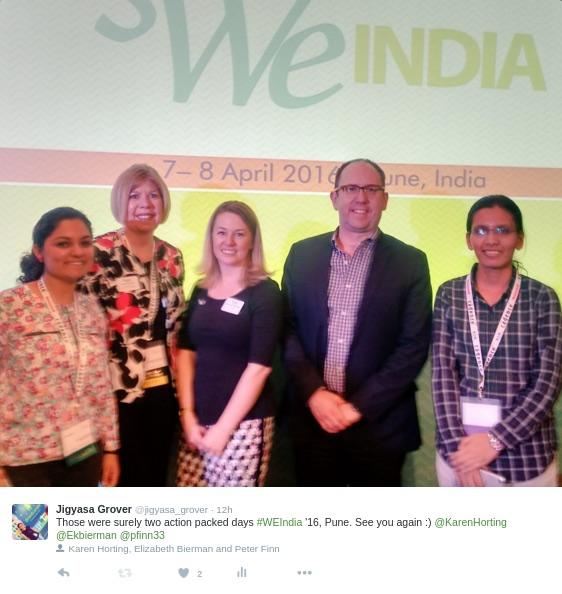
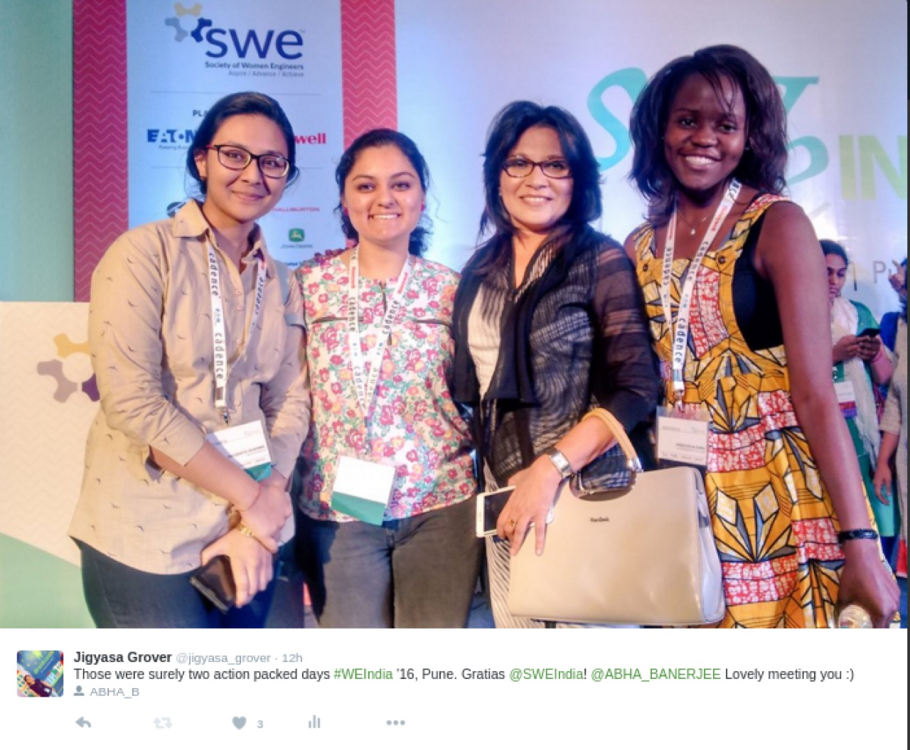

The Society of Women Engineers India hosted the inaugural <strong>WE India Conference</strong>, <em>Reach Out to Reach Up</em>, on 7- 8 April, 2016 at The Westin Pune Koregaon Park, Pune.

I feel so lucky to not only have an opportunity to attend this celebrated event but also got the chance to be a speaker and a representative of <em>Women Who Code</em>.

It was a different feeling being the youngest speaker at the congregation of so many amazing women engineers from India and also countries like USA, Germany, UK, Liberia, Rwanda, etc.

  <figure></figure>
  <figure></figure>

&nbsp;

SWE India featured expert presenters providing valuable education and content to women in engineering and technology.

It was indeed a great platform to network with technologists and engineers from the industry  as well as experience highly rated professional development offerings.

The opening session <em>&#8216;Mantra of Success&#8217;</em> by Abha Maryada Banerjee, India’s first woman motivational speaker of international acclaim, Leadership Author, Social Artist &amp; Designer, Thought Innovator, Entrepreneur, Lawyer, Poet and Actor was inspiring, energetic and loved by all.

With sessions ranging from Intellectual Properties, Finance for Women, Smarter &amp; Safer cities, Open Source &amp; Women, Women as mentors, Influential Leadership, Dynamic load metrics, Balancing work &amp; home, Data Sciences, Volunteering, Women Engineer Entrepreneurs etc. the two days were surely action packed.

The program itself was rich and interesting, and sometimes there was a problem deciding which talk to attend. Unfortunately, some potentially interesting talks were missed owing to problem of plenty😉

The all-men panel discussion <em>&#8216;Men as Diversity Partners&#8217;</em> moderated by Smita Tharoor was the highlight. It talked about how male chivalry and gender equality could go hand in hand.  Working in sync for both the genders is what is actually required now.

Thanks to <em>Eaton</em>, <em>John Deere</em>, <em>Cummins</em>, <em>Juniper Networks</em>, <em>Intel</em>, <em>United Technologies</em>, <em>Honeywell</em>, <em>Thermax</em> and <em>IBM</em> for coming together and providing a platform to women engineers to interact with real world professionals, network and help advance their careers.

Kudos <strong>SWE India</strong> for a very well organized event, great food and drinks, entertainment, and Schwags (of course 😉 )

  <figure></figure>
  <figure></figure>
  <figure></figure>

&nbsp;

  <figure></figure>
  <figure></figure>

&nbsp;

