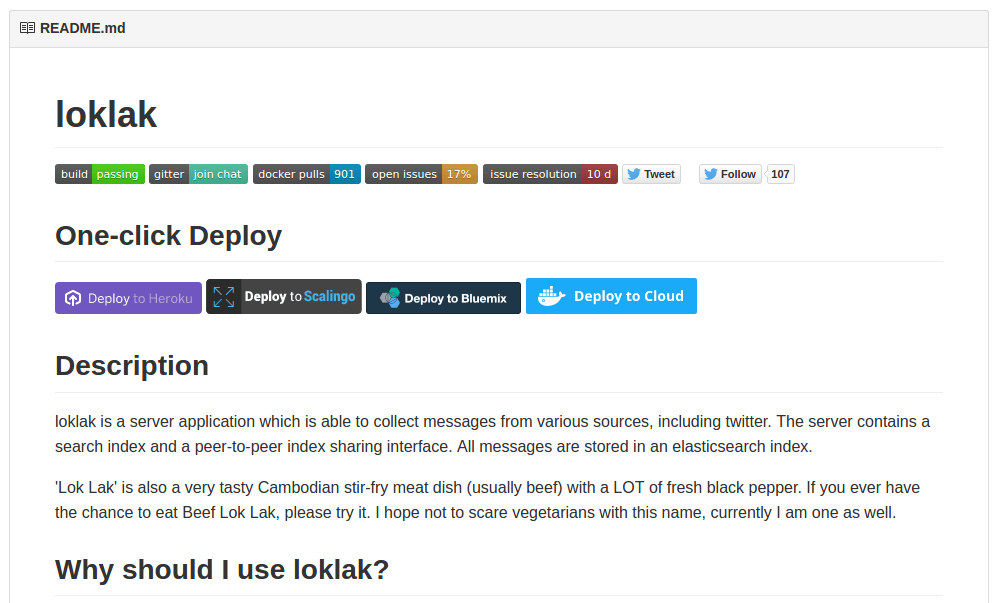

As <em>Google Summer of Code 2016</em> has officially begun, I am all excited to be working with <em>FOSSASIA</em> yet again. This time, I have been assigned the project <strong>Loklak</strong> where I shall be spending the summer working on implementing indexing (harvester/scrapers) for different services like <a href="http://www.weibo.com/">weibo.com</a>, <a href="https://angel.co/">angel.co</a>, <a href="http://www.meetup.co">meetup.com</a>, <a href="https://www.instagram.com">Instagram</a> etc.

<a href="http://loklak.org/">Loklak</a> is a server application which is able to collect messages from various sources, including Twitter. This server contains a search index and a peer-to-peer index sharing interface.

If one likes to be anonymous when searching things, want to archive Tweets or messages about specific topics and if you are looking for a tool to create statistics about Tweet topics, then Loklak is the best option to consider.

The <strong>Community Bonding</strong> period of Google Summer of Code 2016 was spent:

<ul>
<li>Getting access to all Loklak repositories viz. Loklak Server and Loklak Webclient on Github here at <a href="https://github.com/loklak">github.com/loklak</a>.</li>

<li>Exchanging contact information with mentor and fellow student developers to stay connected, discuss latest developments and exchange views about different issues regularly; Joining mailing lists, Gitter chat rooms etc.</li>

<li>Reading documentation(s) of Loklak to get more familiar with the project. While following the process of &#8216;Creating New App&#8217; I found missing steps and hence contributed in filling up the gaps.</li>

<li>Deploying <em>Loklak Server(s)</em> locally as well as 5 servers on Heroku (<a href="http://boiling-tor-63031.herokuapp.com">boiling-tor-63031.herokuapp.com</a>, <a href="http://dry-temple-51592.herokuapp.com">dry-temple-51592.herokuapp.com</a>, <a href="http://salty-falls-95103.herokuapp.com">salty-falls-95103.herokuapp.com</a>,  <a href="http://secret-lowlands-72884.herokuapp.com">secret-lowlands-72884.herokuapp.com</a>, and <a href="http://stormy-dusk-89765.herokuapp.com">stormy-dusk-89765.herokuapp.com</a>)  and a couple of them on Cloud9 and Digital Ocean.</li>

<li>In order to help new developers set up Loklak Server easily, I contributed in including <em>One-Click-Deployment  Button(s)</em> for <em>IBM Bluemix</em> and <em>Docker Cloud</em>.</li>
</ul>

 
Now that my university exams shall be over by next week, I plan to get started with implementing the features discussed and resolve the issues assigned to me 🙂

<strong>Upcoming: </strong>

<ul>
<li>Explore the <a href="https://github.com/loklak/loklak_server/blob/master/src/org/loklak/harvester/TwitterScraper.java">Twitter Scraper</a> code written by Michael Peter Christen (@0rb1t3r)</li>
<li>Implement <a href="https://www.mediawiki.org/wiki/Extension:GeoData#API">MediaWiki GeoData API </a> to display articles based on location</li>
<li>Tinker with <a href="http://loklak.net/">loklak.net</a></li>
</ul>

&nbsp;

<em>Stay tuned for more…</em>

&nbsp;

