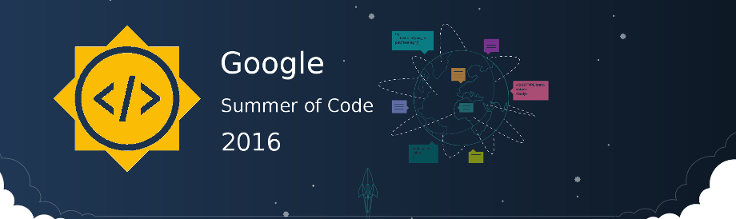

As <em>Google Summer of Code 2016</em> has officially begun, I am all excited to be working with <em>FOSSASIA</em> yet again. This time, I have been assigned the project <strong>Loklak</strong> where I shall be spending the summer working on implementing indexing (harvester/scrapers) for different services like <a href="http://www.weibo.com/">weibo.com</a>, <a href="https://angel.co/">angel.co</a>, <a href="http://www.meetup.co">meetup.com</a>, <a href="https://www.instagram.com">Instagram</a> etc.

<a href="http://loklak.org/">Loklak</a> is a server application which is able to collect messages from various sources, including Twitter. This server contains a search index and a peer-to-peer index sharing interface.

If one likes to be anonymous when searching things, want to archive Tweets or messages about specific topics and if you are looking for a tool to create statistics about Tweet topics, then Loklak is the best option to consider.

<h2 class="entry-title">Push &amp; Pull : Scraped Data into Index and back</h2>

&nbsp;

With many scrapers being integrated into the Loklak server, it is but natural that the load on the server would also increase if multitude of requests are to be served each millisecond.

Initially, when Loklak only harvested tweets from Twitter, <code><em>Elasticsearch</em></code> was implemented along-with a <code><em>Data Access Object</em></code> to do the needful task of indexing.

The <code><em>JSON Object(s)</em></code> pushed into the index were of the form <code><em>statuses</em></code> and had to be in a specific format to be shoved and retrieved easily in the index.

Sample:

<pre><code>
{
  "statuses": [
    {
      "id_str": "yourmessageid_1234",
      "screen_name": "testuser",
      "created_at": "2016-07-22T07:53:24.000Z",
      "text": "The rain is spain stays always in the plain",
      "source_type": "GENERIC",
      "place_name": "Georgia, USA",
      "location_point": [
        3.058579854228782,
        50.63296878274201
      ],
      "location_radius": 0,
      "user": {
        "user_id": "youruserid_5678",
        "name": "Mr. Bob",
        
      }
    }
  ]
}
</code></pre>

But with the inclusion of many other scrapers like Github, WordPress, Event Brite etc. and RSS Readers it was a bit cumbersome to use the exact same format as that of Twitter because not all fields matched.

For example:

<pre><code>
{
  "data": [
    {
      "location": "Canada - Ontario - London",
      "time": "Sun 9:33 PM"
    },
    {
      "location": "South Africa - East London",
      "time": "Mon 3:33 AM"
    }
  ]
}
</code></pre>

Hence, Scott suggested an idea of implementing a <code><em>DAO Wrapper</em></code> which would enable us to use the same schema as that of Twitter Index to push and pull data.

<code><em>DAO Wrapper</em></code> was implemented as <code><em>GenericJSONBuilder</em></code> which had the feature of adding the remaining fields of data other than the <code><em>text</em></code> into the same schema using <code><em>Markdown Format</em></code>

Peeking into the code:

<pre><code>
package org.loklak.data;

import javafx.util.Pair;
import org.loklak.objects.MessageEntry;
import org.loklak.objects.QueryEntry;
import org.loklak.objects.SourceType;
import org.loklak.objects.UserEntry;

import java.net.MalformedURLException;
import java.util.*;

/**
 * The json below is the minimum json
 * {
 "statuses": [
 {
 "id_str": "yourmessageid_1234",
 "screen_name": "testuser",
 "created_at": "2016-07-22T07:53:24.000Z",
 "text": "The rain is spain stays always in the plain",
 "source_type": "GENERIC",
 "place_name": "Georgia, USA",
 "location_point": [3.058579854228782,50.63296878274201],
 "location_radius": 0,
 "user": {
 "user_id": "youruserid_5678",
 "name": "Mr. Bob",
 }
 }
 ]
 }
 */
public class DAOWrapper {
    public static final class GenericJSONBuilder{
        private String id_str = null;
        private String screen_name = "unknown";
        private Date created_at = null;
        private String text = "";
        private String place_name = "unknown";
        private String user_name = "unknown@unknown";
        private String user_id = "unknown";
        private String image = null;
        private double lng = 0.0;
        private double lat = 0.0;
        private int loc_radius = 0;
        private ArrayList extras = new ArrayList();

        /**
         * Not required
         * @param author
         * @param domain
         * @return
         */
        public GenericJSONBuilder setAuthor(String author, String domain){
            user_name = author + "@" + domain;
            screen_name = author;
            return this;
        }

        /**
         * Not required
         * @param user_id_
         * @return
         */
        public GenericJSONBuilder setUserid(String user_id_){
            user_id = user_id_;
            return this;
        }

        /**
         * Not required
         * @param id_str_
         * @return
         */
        public GenericJSONBuilder setIDstr(String id_str_){
            id_str = id_str_;
            return this;
        }

        /**
         * Not required
         * @param createdTime
         * @return
         */
        public GenericJSONBuilder setCreatedTime(Date createdTime){
            created_at = createdTime;
            return this;
        }

        /**
         * Required
         * This is the text field. You can use JSON style in this field
         * @param text_
         * @return
         */
        public GenericJSONBuilder addText(String text_){
            text = text + text_;
            return this;
        }

        /**
         * Not required
         * @param name
         * @return
         */
        public GenericJSONBuilder setPlaceName(String name){
            place_name = name;
            return this;
        }

        /**
         * Not required
         * @param longtitude
         * @param latitude
         * @return
         */
        public GenericJSONBuilder setCoordinate(double longtitude, double latitude){
            lng = longtitude;
            lat = latitude;
            return this;
        }

        /**
         * Not required
         * @param radius
         * @return
         */
        public GenericJSONBuilder setCoordinateRadius(int radius){
            loc_radius = radius;
            return this;
        }

        /**
         * Not required
         * @param key
         * @param value
         * @return
         */
        public GenericJSONBuilder addField(String key, String value){
            String pair_string = "\"" + key + "\": \"" + value + "\"";
            extras.add(pair_string);
            return this;
        }

        private String buildFieldJSON(){
            String extra_json = "";
            for(String e:extras){
                extra_json =  extra_json + e + ",";
            }
            if(extra_json.length() &gt; 2) extra_json = "{" + extra_json.substring(0, extra_json.length() -1) + "}";
            return extra_json;
        }

        /**
         * Not required
         * @param link_
         * @return
         */
        public GenericJSONBuilder setImage(String link_){
            image = link_;
            return this;
        }

        public void persist(){
            try{
                //building message entry
                MessageEntry message = new MessageEntry();

                /**
                 * Use hash of text if id of message is not set
                 */
                if(id_str == null)
                    id_str = String.valueOf(text.hashCode());

                message.setIdStr(id_str);

                /**
                 * Get current time if not set
                 */
                if(created_at == null)
                    created_at = new Date();
                message.setCreatedAt(created_at);

                /**
                 * Append the field as JSON text
                 */
                message.setText(text + buildFieldJSON());

                double[] locPoint = new double[2];
                locPoint[0] = lng;
                locPoint[1] = lat;

                message.setLocationPoint(locPoint);

                message.setLocationRadius(loc_radius);

                message.setPlaceName(place_name, QueryEntry.PlaceContext.ABOUT);
                message.setSourceType(SourceType.GENERIC);

                /**
                 * Insert if there is a image field
                 */
                if(image != null) message.setImages(image);

                //building user
                UserEntry user = new UserEntry(user_id, screen_name, "", user_name);

                //build message and user wrapper
                DAO.MessageWrapper wrapper = new DAO.MessageWrapper(message,user, true);

                DAO.writeMessage(wrapper);
            } catch (MalformedURLException e){
            }
        }
    }

    public static GenericJSONBuilder builder(){
        return new GenericJSONBuilder();
    }

    public static void insert(Insertable msg){

        GenericJSONBuilder bd = builder()
        .setAuthor(msg.getUsername(), msg.getDomain())
        .addText(msg.getText())
        .setUserid(msg.getUserID());

        /**
         * Insert the fields
         */
        List&lt;Pair&lt;String, String&gt;&gt; fields = msg.getExtraField();
        for(Pair&lt;String, String&gt; field:fields){
            bd.addField(field.getKey(), field.getValue());
        }
    }
}

</code></pre>

<code><em>DAOWrapper</em></code> was then used with other scrappers to push the data into the index as:

<pre><code>
...
DAOWrapper dw = new DAOWrapper();
dw.builder().addText(json.toString());
dw.builder().setUserid("profile_"+profile);
dw.builder().persist();
...
</code></pre>

Here , <code><em>addText(...)</em></code> can be used several times to insert text in the object but <code><em>set...(...)</em></code> methods should be used only once and <code><em>perist()</em></code> should also be used only once as this is the method which finally pushes into the index.

Now, when a scraper receives a request to scrape a given HTML page, a check is first made if the data already exists in the index with the help of a unique <code><em>userIDString</em></code>. This saves the time and effort of scraping the page all over again, instead it simply returns the saved instance.

The check is done something like this:

<pre><code>
if(DAO.existUser("profile_"+profile)){
    /*
     *  Return existing JSON Data
    */
}else{
    /*
     *  Scrape the HTML Page addressed by the given URL
    */
}
</code></pre>

This pushing and pulling into the index would certainly reduce the load on the Loklak server.

Feel free to ask questions regarding the above.

Feedback and Suggestions welcome 🙂

