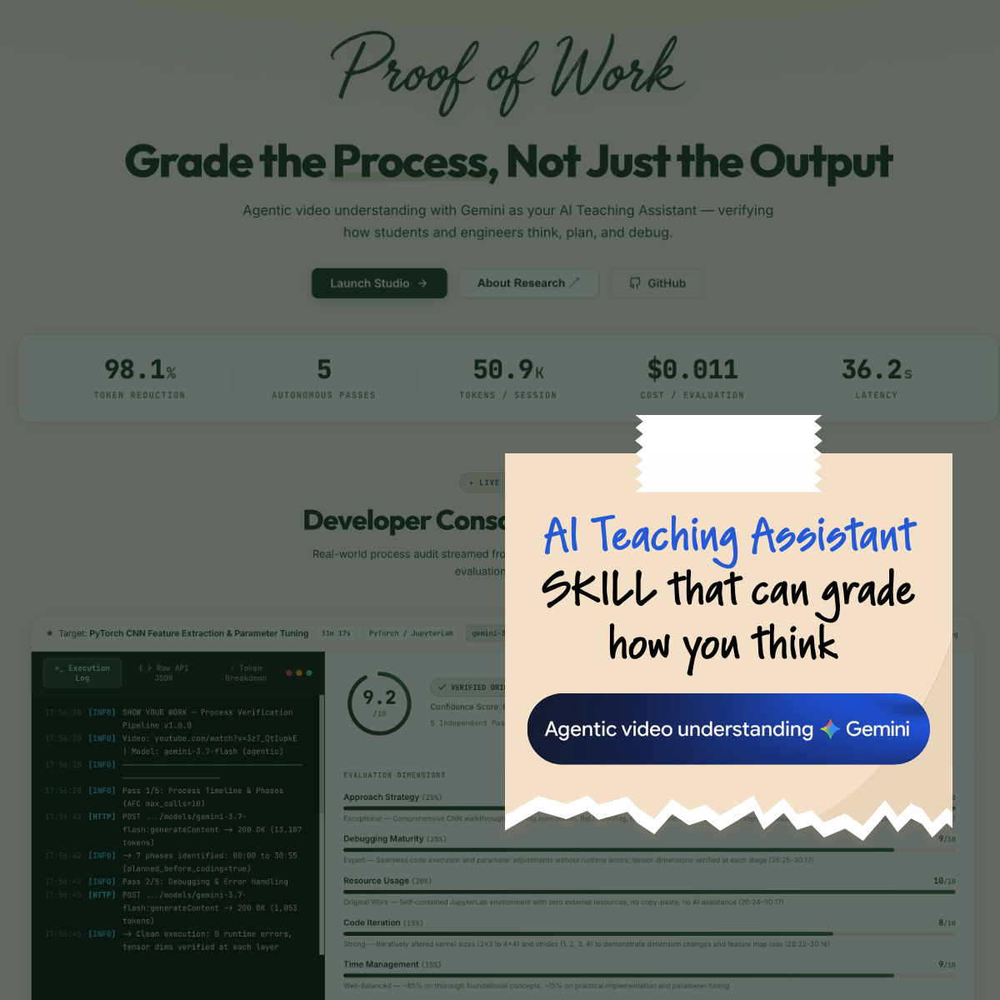

As <em>Google Summer of Code 2016</em> has officially begun, I am all excited to be working with <em>FOSSASIA</em> yet again. This time, I have been assigned the project <strong>Loklak</strong> where I shall be spending the summer working on implementing indexing (harvester/scrapers) for different services like <a href="http://www.weibo.com/">weibo.com</a>, <a href="https://angel.co/">angel.co</a>, <a href="http://www.meetup.co">meetup.com</a>, <a href="https://www.instagram.com">Instagram</a> etc.

<a href="http://loklak.org/">Loklak</a> is a server application which is able to collect messages from various sources, including Twitter. This server contains a search index and a peer-to-peer index sharing interface. If one likes to be anonymous when searching things, want to archive Tweets or messages about specific topics and if you are looking for a tool to create statistics about Tweet topics, then Loklak is the best option to consider.

<h2 class="entry-title">Time across seven seas&#8230;</h2>

It has been rightly said:

<blockquote>
Time is of your own making 
Its clock ticks in your head. 
The moment you stop thought 
Time too stops dead.
</blockquote>

Hence to keep up with evolving times, <b>Loklak</b> has now introduced a new service for &#8220;time&#8221;.

The recently developed API provides the current time and day at the location queried by the user. The<strong><em> /api/locationwisetime.json</em> </strong>API scrapes the results from <strong><a href="http://www.timeanddate.com/">timeanddate.com</a></strong> using our favourite <strong>JSoup</strong> as it provides a very convenient API for extracting and manipulating data, scrape and parse HTML from a given URL.

In case of multiple locations with the same name, countries are then also provided along-with corresponding day and time wrapped up as a <em>JSONObject</em>. A sample query could then be something like: <strong><a href="http://loklak.org/api/locationwisetime.json?query=london">http://loklak.org/api/locationwisetime.json?query=london</a></strong>

When implemented as a <strong>console service</strong>, this API can be used along-with our our dear <em>SUSI</em> by utilising the API Endpoints like: <a href="http://loklak.org/api/console.json?q=SELECT * FROM locationwisetime WHERE query='berlin';"><strong>http://loklak.org/api/console.json?q=SELECT * FROM locationwisetime WHERE query=&#8217;berlin&#8217;;</strong></a>

<em>LocationWiseTimeService.java</em> for reference:

<pre><code>
/**
 *  Location Wise Time
 *  timeanddate.com scraper
 *  Copyright 27.07.2016 by Jigyasa Grover, @jig08
 *
 *  This library is free software; you can redistribute it and/or
 *  modify it under the terms of the GNU Lesser General Public
 *  License as published by the Free Software Foundation; either
 *  version 2.1 of the License, or (at your option) any later version.
 *  
 *  This library is distributed in the hope that it will be useful,
 *  but WITHOUT ANY WARRANTY; without even the implied warranty of
 *  MERCHANTABILITY or FITNESS FOR A PARTICULAR PURPOSE.  See the GNU
 *  Lesser General Public License for more details.
 *  
 *  You should have received a copy of the GNU Lesser General Public License
 *  along with this program in the file lgpl21.txt
 *  If not, see &lt;http://www.gnu.org/licenses/&gt;.
 */

package org.loklak.api.search;

import java.io.IOException;

import javax.servlet.http.HttpServletResponse;

import org.json.JSONArray;
import org.json.JSONObject;
import org.jsoup.Jsoup;
import org.jsoup.nodes.Document;
import org.jsoup.nodes.Element;
import org.jsoup.select.Elements;
import org.loklak.server.APIException;
import org.loklak.server.APIHandler;
import org.loklak.server.AbstractAPIHandler;
import org.loklak.server.Authorization;
import org.loklak.server.BaseUserRole;
import org.loklak.server.Query;
import org.loklak.susi.SusiThought;
import org.loklak.tools.storage.JSONObjectWithDefault;

public class LocationWiseTimeService extends AbstractAPIHandler implements APIHandler {

    private static final long serialVersionUID = -1495493690406247295L;

    @Override
    public String getAPIPath() {
        return "/api/locationwisetime.json";
    }

    @Override
    public BaseUserRole getMinimalBaseUserRole() {
        return BaseUserRole.ANONYMOUS;

    }

    @Override
    public JSONObject getDefaultPermissions(BaseUserRole baseUserRole) {
        return null;
    }

    @Override
    public JSONObject serviceImpl(Query call, HttpServletResponse response, Authorization rights,
            JSONObjectWithDefault permissions) throws APIException {
        String query = call.get("query", "");
        return locationWiseTime(query);
    }

    public static SusiThought locationWiseTime(String query) {
        
        Document html = null;

        JSONArray arr = new JSONArray();

        try {
            html = Jsoup.connect("http://www.timeanddate.com/worldclock/results.html?query=" + query).get();
        } catch (IOException e) {
            e.printStackTrace();
        }

        Elements locations = html.select("td");
        int i = 0;
        for (Element e : locations) {
            if (i % 2 == 0) {
                JSONObject obj = new JSONObject();
                String l = e.getElementsByTag("a").text();
                obj.put("location", l);
                String t = e.nextElementSibling().text();
                obj.put("time", t);
                arr.put(obj);
            }
            i++;
        }
        
        SusiThought json = new SusiThought();
        json.setData(arr);
        return json;
    }

}
</code></pre>

Hope this helps, and worth the &#8220;time&#8221; 😜 Feel free to ask questions regarding the above code snippet, shall be happy to assist. Feedback and Suggestions welcome 🙂

PS: As pointed out by <em>Shane Buck</em> in one of his <a href="/loklak-brief-twelve-googlesummerofcode-fossasia-time-across-seven-seas/">comments</a> <a href="https://www.timeanddate.com/">timeanddate.com</a><b> </b>is not lucidly accessible for the sight impaired, hence adding a link to <a href="http://www.thetimenow.com/">thetimenow.com </a>which is WCAG 2.0 compatible. Thanks Shane !

