
Heyy !

So, for quite a while I had been thinking of organizing a fun live coding session which shall be an appreciable kick start  for all the aspiring (girl) developers in the capital region. Along with <a href="http://codingblocks.com/">Coding Blocks</a>, I came up with the idea of <em>PyGame 101</em> <em>Codelab</em> which was brought to being in association with <a href="https://www.facebook.com/womenwhocodedelhi/">Women Who Code Delhi</a> and <a href="https://www.facebook.com/googlewomentechmakersdelhi/">Google Women Techmakers Delhi</a> (Duties of being the Director of WWC Delhi and Lead, WTM Delhi 😉 ). 

<a href="https://www.facebook.com/events/246475389088112/">PyGame 101 Codelab</a> promised to make the audience learn to make a desktop game in Python from scratch with no high-end programming skills or Python knowledge required, just laptop, enthusiasm and willingness to learn. As with all other events in this league, it was open and free for all.

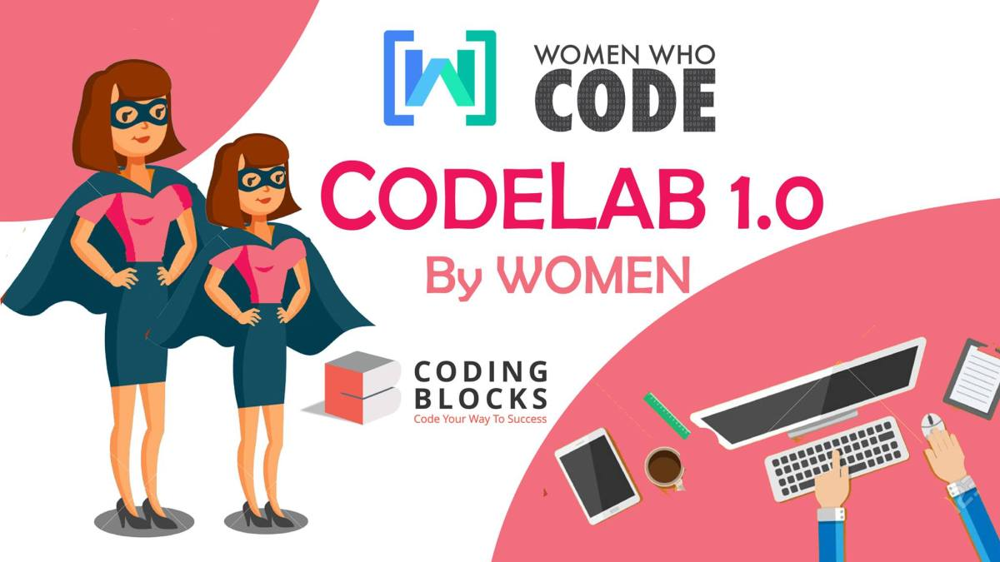

As the PyGame CodeLab emphasised on newbies, the session began with helping the students install Python and PyGame package followed up by brushing up of simple Python syntax and then beginning with utilisation of PyGame functions to build a very basic desktop game. 

The live coding session aimed to help all build a simple PyGame involving a bunny, who has to defend a castle against an attacking horde of badgers all complete with in-game sounds, score tracker, timer, etc. right from scratch in just 10 steps.

  <figure>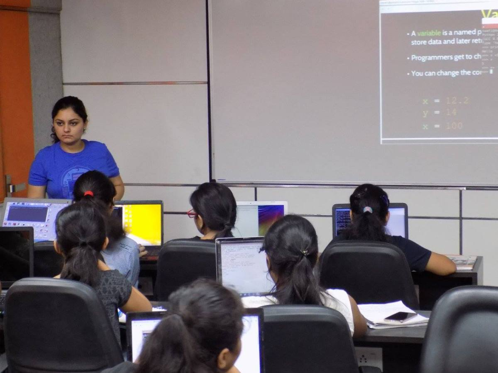</figure>
  <figure>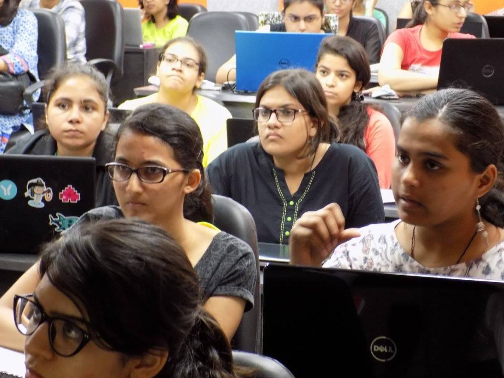</figure>

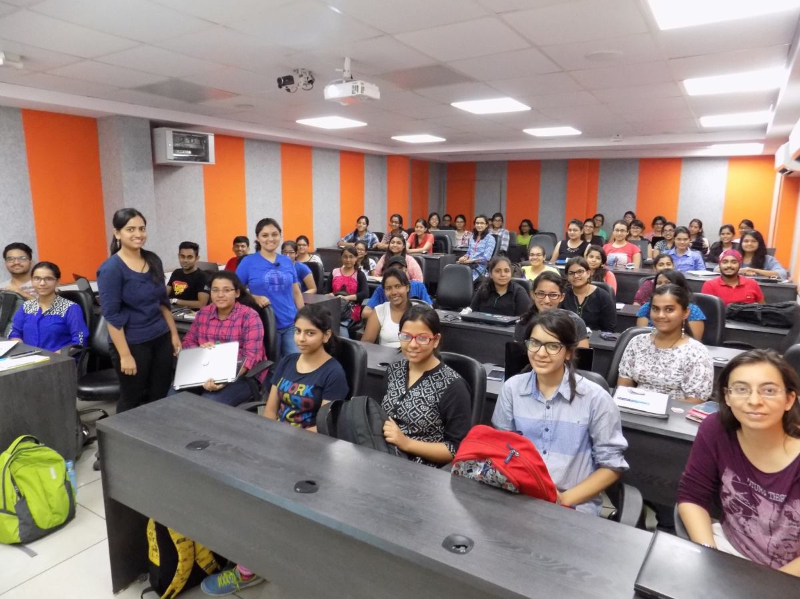

The 4 hour session made sure that everyone was at the same page after addition of even a tiny snippet in the codebase taking care of answering all queries and help debugging as well. When all was said and done, the session ended on a happy note with students interacting with each other, asking their general doubts about programming, open source or sharing personal experiences. 

I am super glad that the session received such a good response. I hope to organise other such coding sessions to and carry the flame forward.

Thanks !

  <figure>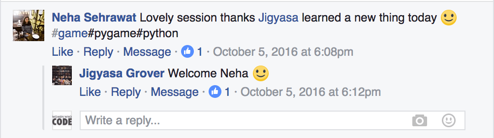</figure>
  <figure>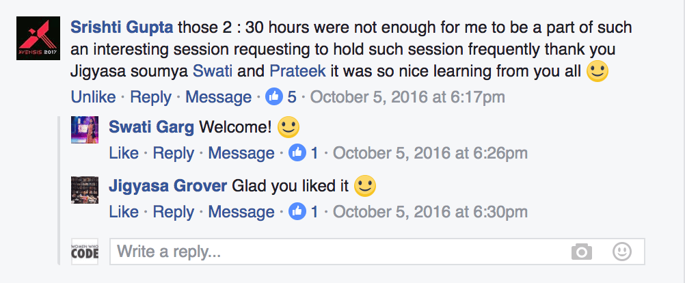</figure>

  <figure>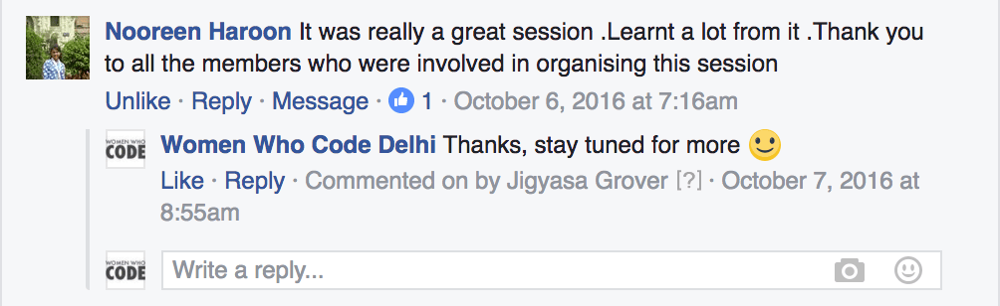</figure>
  <figure>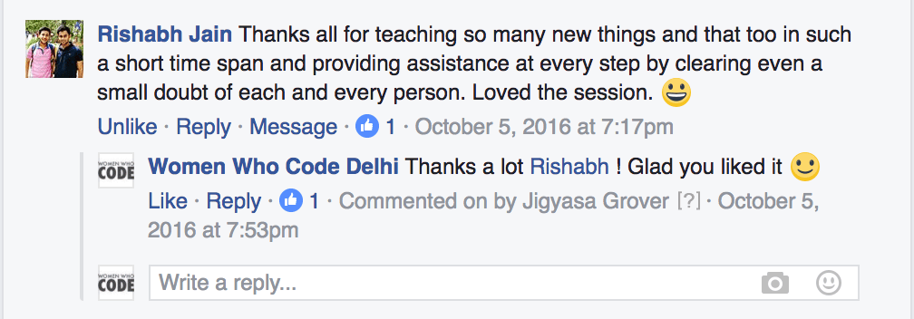</figure>

  <figure>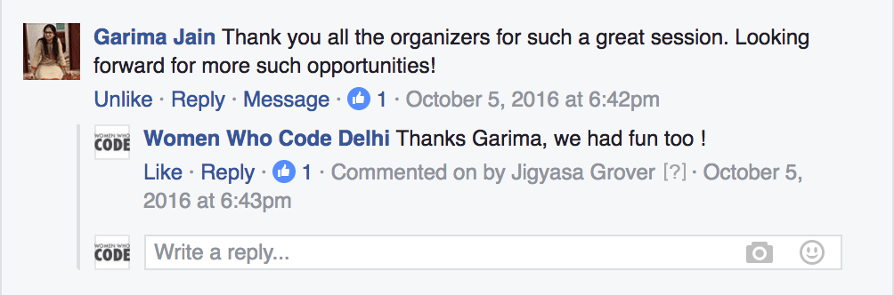</figure>
  <figure>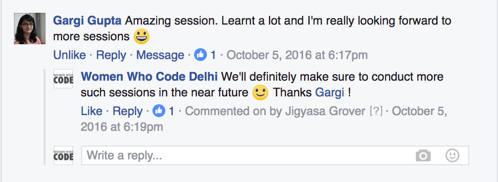</figure>

&nbsp;

<strong>Links to explore:</strong>

* <a href="https://www.facebook.com/events/246475389088112/">PyGame 101 Codelab : Event Details</a> 
* <a href="https://github.com/jig08/PyGame-101-Codelab">PyGame 101 Codelab : Github Repository</a> 
* <a href="https://github.com/jig08/PyGame-101-Codelab/blob/master/Introduction.pdf">Session Material : Introduction to Python</a> 
* <a href="https://github.com/jig08/PyGame-101-Codelab/blob/master/PyGame101.pdf">PyGame from Scratch</a> in <a href="https://github.com/jig08/PyGame-101-Codelab/tree/master/sample">10 Steps</a>

<em>The simple PyGame involves a bunny, who has to defend a castle against an attacking horde of badgers complete with timer, score tracker and in-game sounds !</em>

  <figure>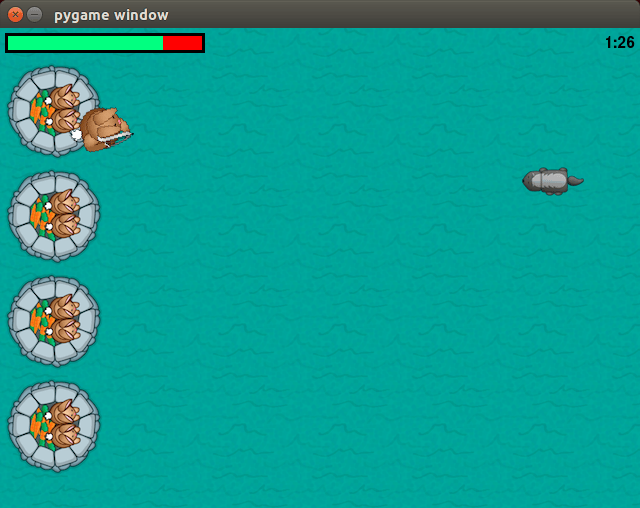</figure>
  <figure>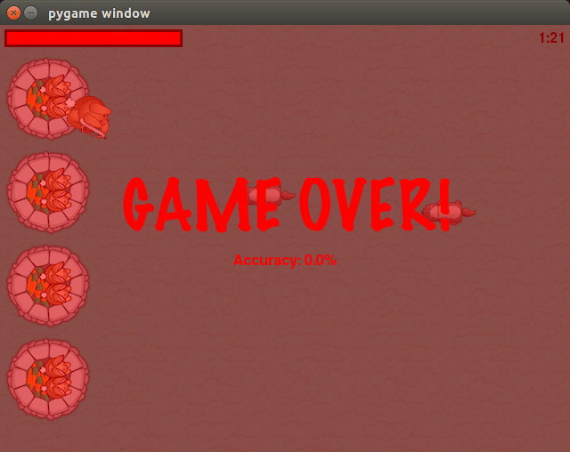</figure>

* <a href="https://github.com/jig08/PyGame-101-Codelab/blob/master/sample/Step1.py">Step 1: Initializing, Poitioning up the bunny and castles</a> 
* <a href="https://github.com/jig08/PyGame-101-Codelab/blob/master/sample/Step2.py">Step 2: Adding a background to the game scene</a> 
* <a href="https://github.com/jig08/PyGame-101-Codelab/blob/master/sample/Step3.py">Step 3: Making the bunny move</a> 
* <a href="https://github.com/jig08/PyGame-101-Codelab/blob/master/sample/Step4.py">Step 4: Making the bunny turn at different angles</a> 
* <a href="https://github.com/jig08/PyGame-101-Codelab/blob/master/sample/Step5.py">Step 5: Teaching it how to shoot</a> 
* <a href="https://github.com/jig08/PyGame-101-Codelab/blob/master/sample/Step6.py">Step 6: Introduce random badgers/enemies</a> 
* <a href="https://github.com/jig08/PyGame-101-Codelab/blob/master/sample/Step7.py">Step 7: Collisions with badgers and arrows</a> 
* <a href="https://github.com/jig08/PyGame-101-Codelab/blob/master/sample/Step8.py">Step 8: Adding a Health Meter and Clock</a> 
* <a href="https://github.com/jig08/PyGame-101-Codelab/blob/master/sample/Step9.py">Step 9: Conditions for a win</a> 
* <a href="https://github.com/jig08/PyGame-101-Codelab/blob/master/sample/Step10.py">Step 10: Music and Sound effects</a>

Give the <a href="https://github.com/jig08/PyGame-101-Codelab/blob/master/sample/game.py">tiny little game</a> a try..

Do not hesitate to post/comment. Feedback, Suggestions, Appreciations, Questions&#8230;. All welcome 😀

