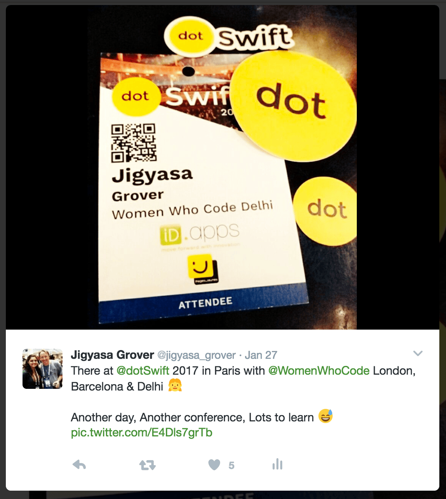
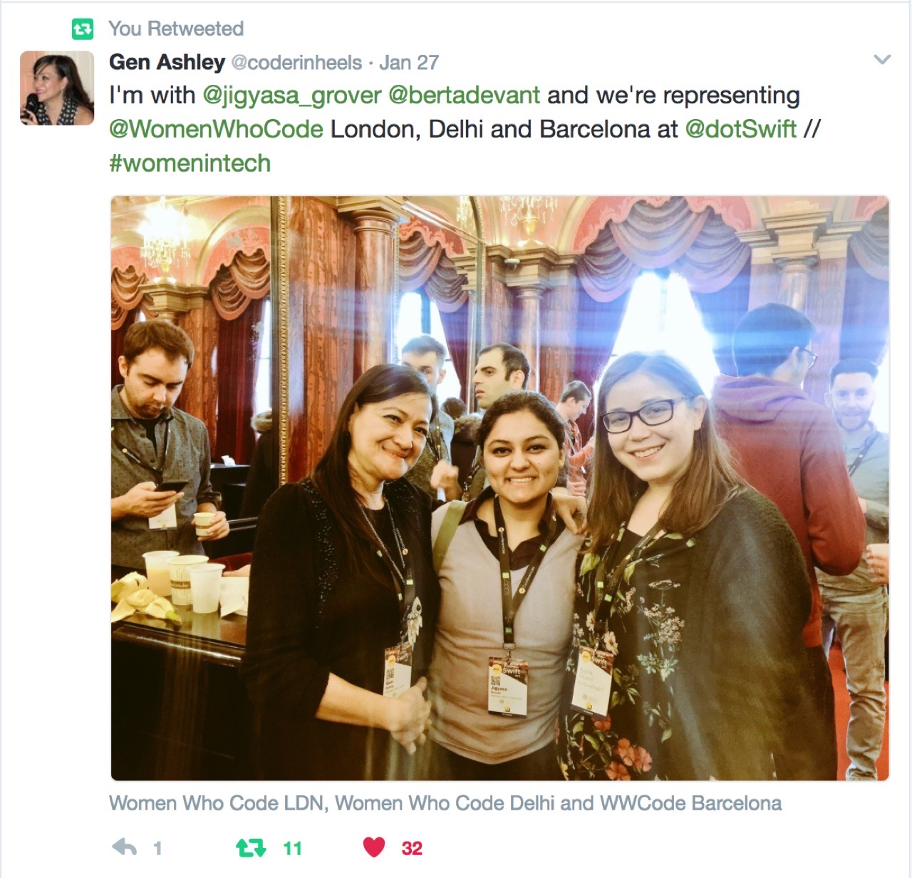
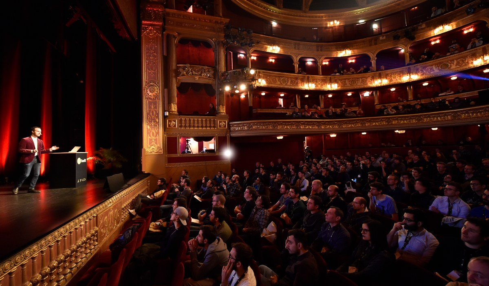
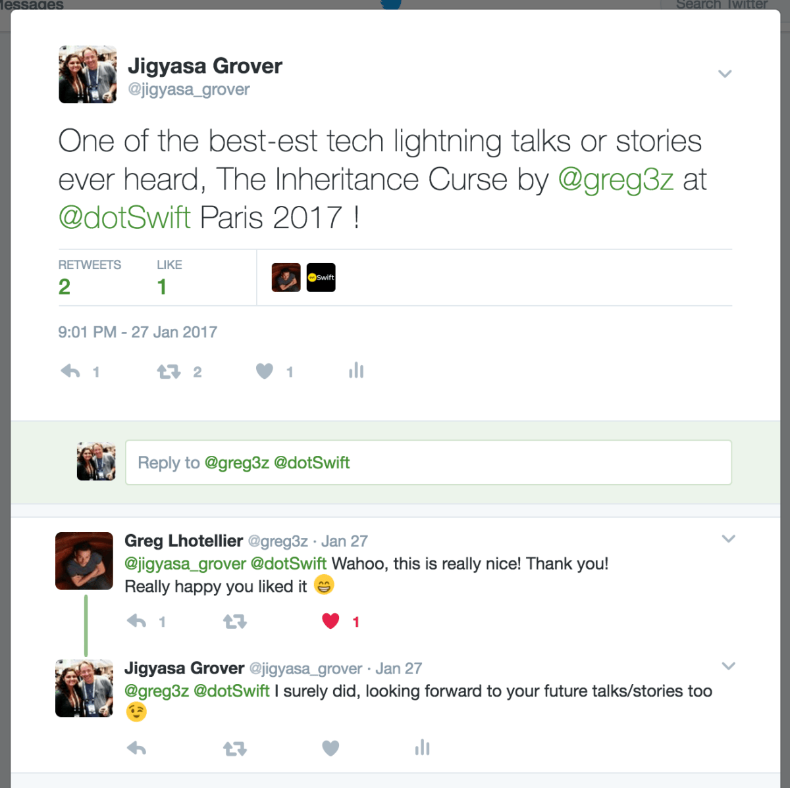
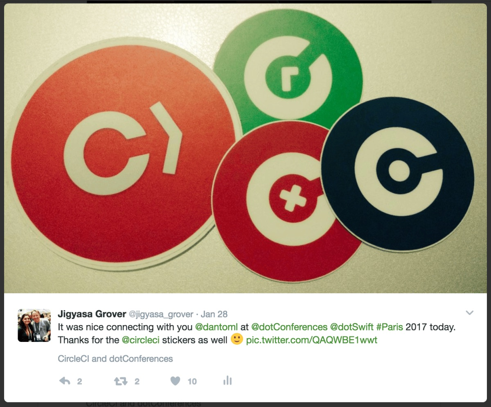
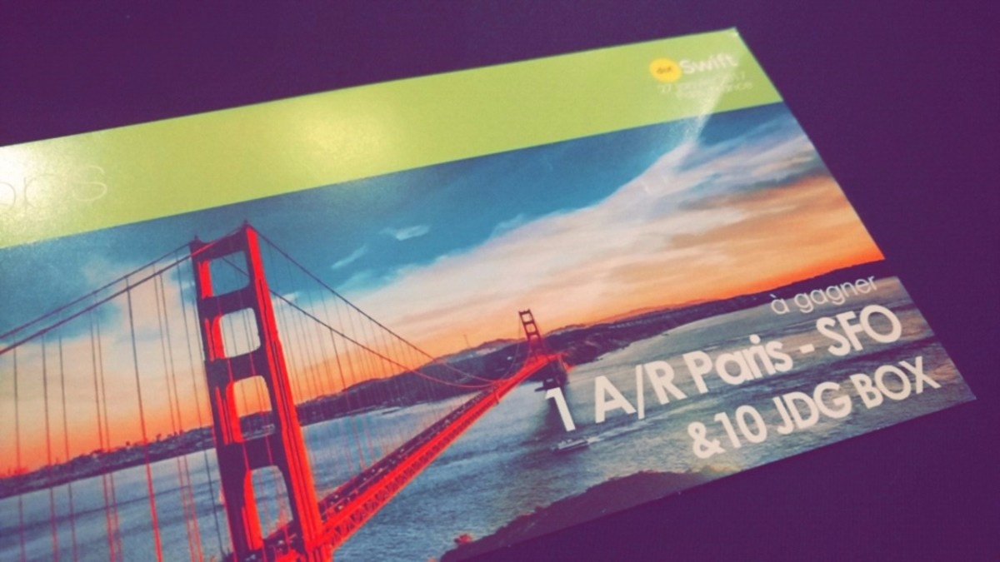
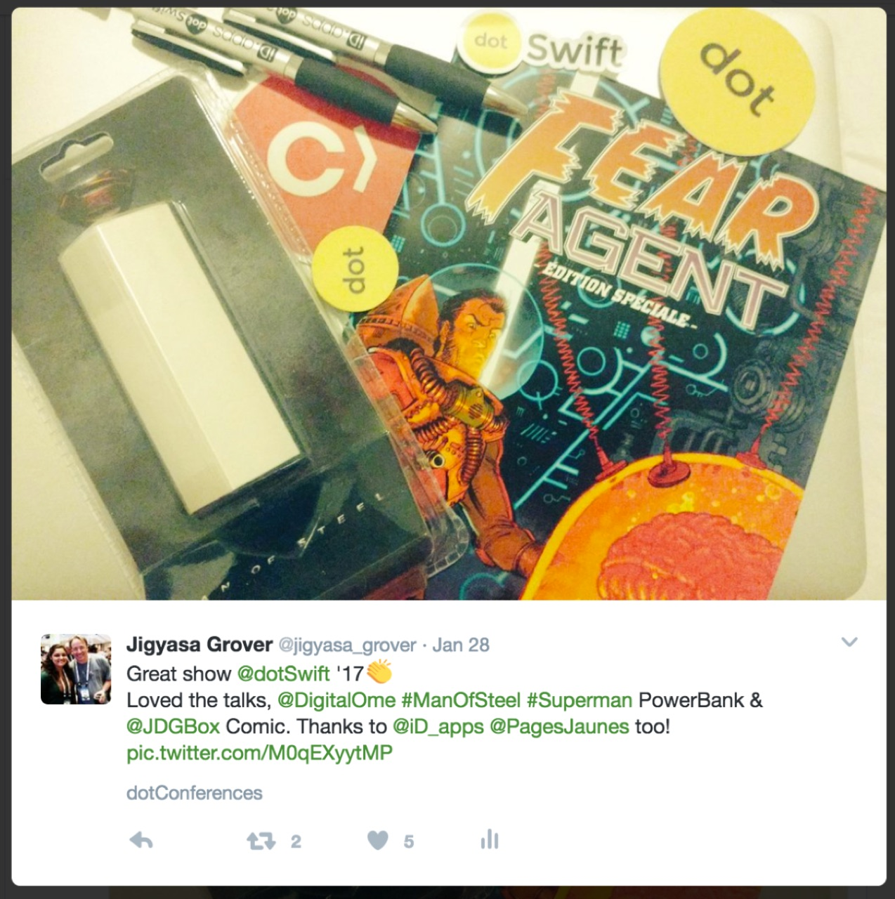

Year 2017 started on a delightful note with a special trip to Europe, and the lovely journey of explorations gained an extra ounce of sparkle when I was venerated with an opportunity to represent <a href="https://www.womenwhocode.com/delhi">Women Who Code Delhi</a> as Director at <strong><a href="https://www.womenwhocode.com/delhi">dotSwift Paris 2017</a></strong>, one of the finest European Swift Conference<strong>✨</strong>

It was a striking feeling to bring the much needed feel of diversity to the acclaimed event by being one of the very few women in a sea of tech-ie males (and/or others). Many thanks to <em>Women Who Code</em> which dispensed an appreciable chance to connect with <em>Gen Ashley</em>, Director of <em>Women Who Code</em> <em>London</em> and <em>Berta Devant</em>, Director of <em>Women Who Code</em> <em>Barcelona</em>

The conference was organised in <strong><a href="https://en.wikipedia.org/wiki/Th%C3%A9%C3%A2tre_des_Vari%C3%A9t%C3%A9s">Théâtre des Variétés</a></strong>, an old French theatre which once housed <em>Napolean Bonaprte</em> too ! Truly, it is one of the most royal &amp; grand place I have ever been for a tech conference as of now 😍

<strong>dotSwift Paris 2017</strong> was one of my first conference on <em>Swift</em>, and being a neophythe in this realm I fancied the lightning talks with interesting themes (for instance: <em>The Inheritance Curse</em> by <em><a href="https://twitter.com/greg3z">Greg Lhotellier</a> </em>put forward the challenges faced in inheriting certain methods by sewing it all up in a fairy tale <em>sorts</em> !) and also liked the regular sessions which encompassed the topics of Latest Updates, Open Source and Swift, Impacts of community etc. by speakers from renowned organisations and companies worldwide.

The much regular coffee breaks parcelled us just the appropriate time to freshen up, check out the sponsor give-aways and network with Swift experts, open source contributors and developers having real industry experience. As a mention, I got to interact with <em><a href="https://twitter.com/dantoml">Danielle Tomlinson</a></em> who is a developer at <a href="https://circleci.com/">CircleCI</a> and have a light tech discussion over tea &amp; snacks (and also get CircleCI stickers 😉)

My entry for the Raffle for a sponsored trip to San Francisco by dotConferences

Thanks to <em>iD.Apps</em>, <em>PagesJaunes</em>, <em>Digital</em> <em>OME</em> for coming together and providing a platform to budding developers to interact with real world professionals. Kudos <em>dotConferences</em> Team for a very well organised event, great food &amp; drinks and schwags !

