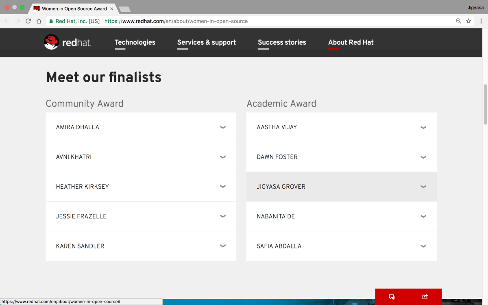

Heya fellas 😃

It feels delighted to be nominated as one of the five finalists throughout the world for <strong><a href="https://www.redhat.com/en/about/women-in-open-source">Red Hat Women in Open Source Academic Awards 2017</a></strong> owing to my significant contributions to the open source community spanning various organisations &amp; projects viz FOSSASIA, Pharo/Smalltalk, European Smalltalk Users Group (ESUG), Hashkat, Women Who Code, Google Developers Group, Learn IT Girl!, various tech stints in Canada, Europe, Singapore &amp; India, etc. and everyone&#8217;s best wishes.

After initial two rounds, final <a href="https://engage.redhat.com/opensourceawards-winners-votingform-2017">voting round</a> is open now till <em>March 6, 2017</em>. I request and appeal all of you to kindly bless me with your valuable votes.

Folks, Some love &amp; maximum clicks please 😉

Details: <a href="https://www.redhat.com/en/about/women-in-open-source">www.redhat.com/en/about/women-in-open-source</a> 
Vote here: <a href="https://engage.redhat.com/opensourceawards-winners-votingform-2017">engage.redhat.com/opensourceawards-winners-votingform-2017</a>

<blockquote>
<strong>Update:</strong> Thanks for all your support and blessings ! 
Read more <a href="/winning-red-hat-women-in-open-source-academic-award-2017-the-summit-a-week-in-boston-and-more/">Winning Red Hat Women in Open Source Academic Award 2017, The Summit, A week in Boston and more …</a>
</blockquote>
