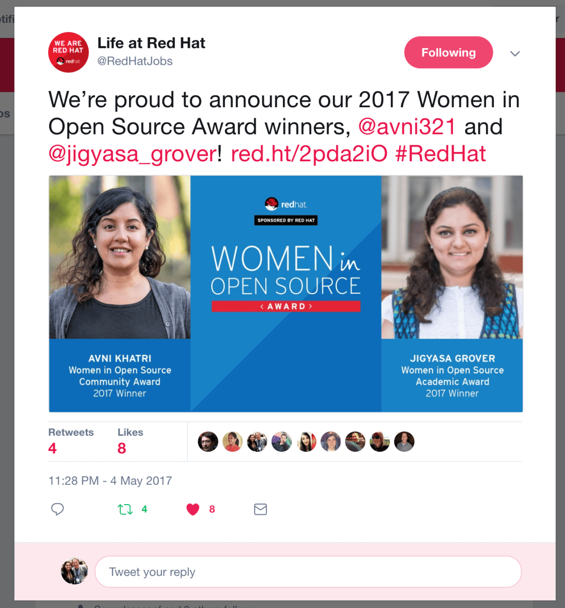
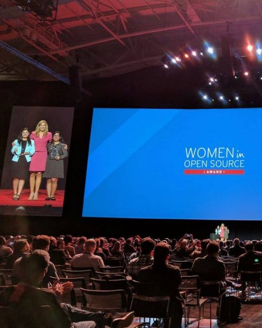
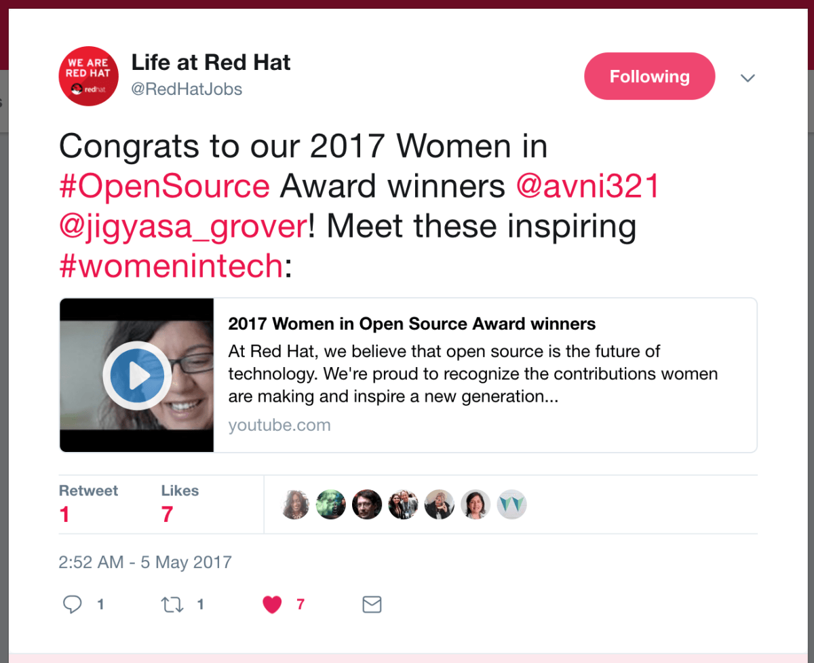
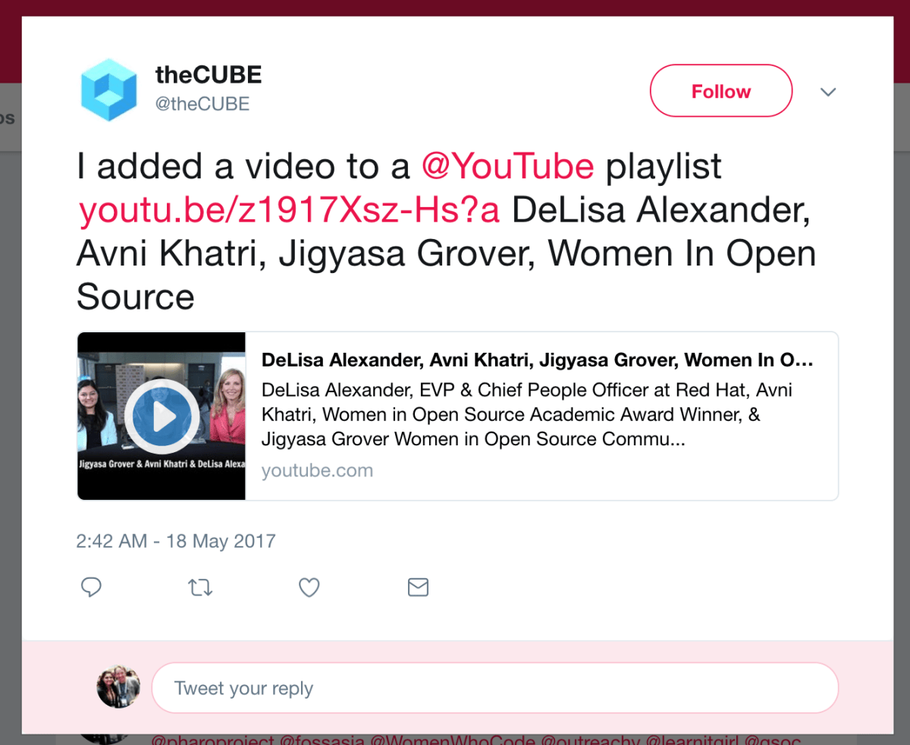
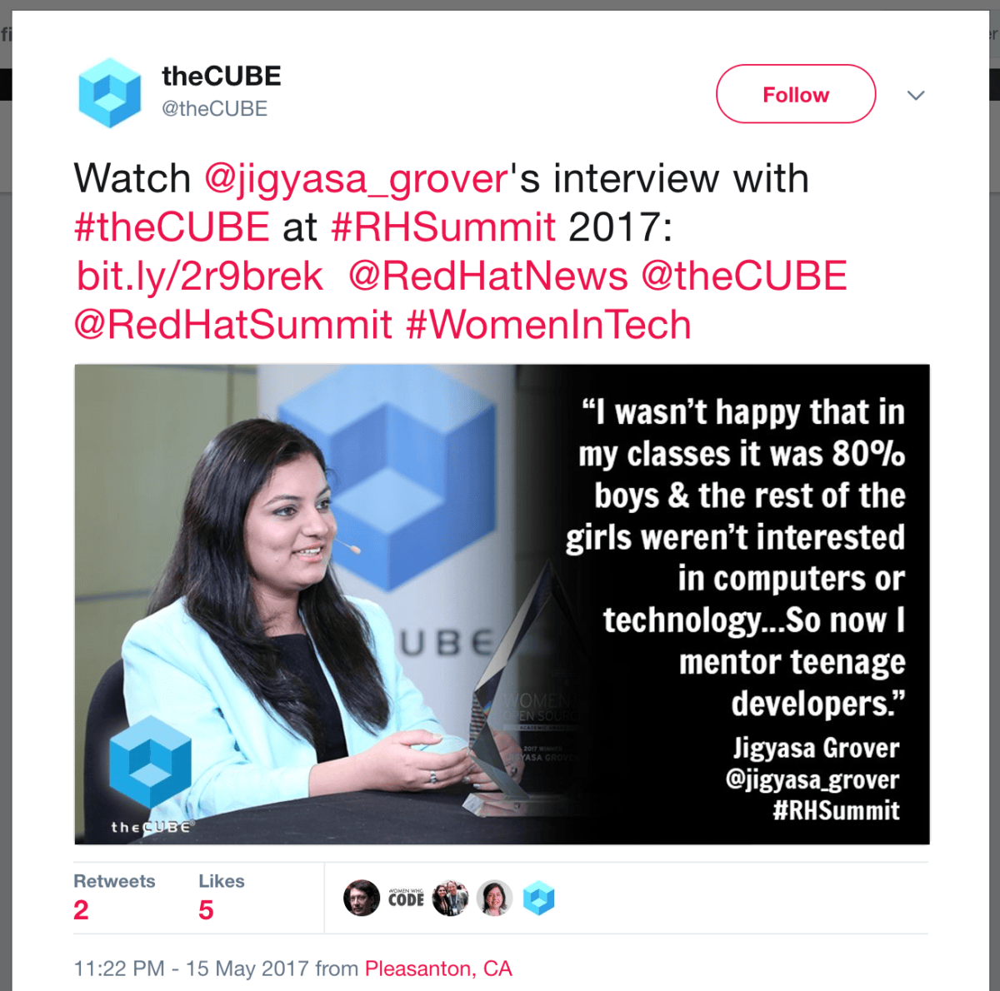
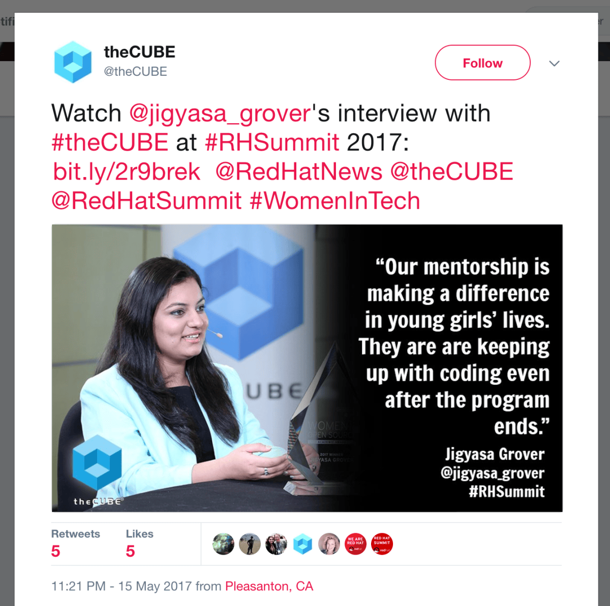

Following much procrastination, my blog gets to catch a glimpse of the much celebrated week I had in <em>May 2017</em> 🎉 Many thanks for everyone&#8217;s support and kind blessings, I feel honoured to be felicitated with the prestigious <a href="https://www.redhat.com/en/about/women-in-open-source"><strong>Red Hat Women in Open Source Academic Award 2017</strong></a>.

Right after wrapping up with the graduation celebration week at university, I hopped on a flight to Boston, Massachusetts USA to partake in the annual <strong>Red Hat Summit</strong>. Stepping down from the plane bearing the tiredness of 6-day/night partying and an 18hr long journey cutting extensive continents and vast oceans, I was greeted by a cheerful chauffeur and a beautiful black car which was assigned as my go-to vehicle for the week &lt;<em>yay !!&gt;</em>. Taken to the best hotel suite in town, facing the mighty Atlantic Ocean all the fatigue vanished away in milliseconds. After a short video call with folks back home, I dozed off pretty soon to re-energise self for the exciting days to come.

Subsequent morning, I woke up with a knock on my door and found a personalised surprise red gift hamper at the doorstep from Red Hat comprising choicest of the wines and champagne, funky bluetooth speakers, RedSox official merchandise and lots of other fine stuff &lt;<em>lazy enough to jot it down here, might post a picture&#8230;&gt;</em>. Next, I was driven to the Boston Convention and Exhibition Centre for a meeting with the Red Hat Team and a rehearsal for the grand day. The lunch with the <em>Chairman&#8217;s Award Winners</em> was organised on Boston seaside at one of the popular restaurants having their signature lobsters. Post-lunch, the award winners were taken for the famous Boston Duck Tour. Later that night, celebrations continued with a cozy little <em>Women in Open Source</em> dinner at Boston&#8217;s Little Italy which was attended by the panel of judges of the contest, Open Source Way director and other dignitaries.

Next day was spent in exploring the summit, attending innovative talk sessions, partaking in fun un-conference discussions and visiting booths of different organisations. It was a leisure day learning about latest products in town, trying out some cool gadgets, playing games, partaking in quizzes, VR challenges and winning lots of off-centric schwags. Before heading to the must-go Fenway Park to see the home team RedSox hit it up in baseball, we all enjoyed a hearty meal and drinks along-with interacting with many at the Jobs Social. Lots of hot chocolate and first-time live baseball game enthusiasm kept me going through that chilly night.

<strong>May the Fourth </strong>was the grand day with the award giving ceremony. Getting my make-up and hair done backstage and viewing the huge audience from screens backstage literally gave me chills. <em>DeLisa Alexander</em> (Executive Vice President &amp; Chief People Officer, Red Hat) begun the ceremony with a much loved reference to Star Wars. After the introductions, videos, I climbed up on the humongous stage when my name was announced with all flashlights beaming on my face I could not feel less proud and delighted.

  <figure></figure>
  <figure></figure>
  <figure></figure>

The entire day was packed with different activities chiefly involving press meets and photo shoots. We ended up clicking loads of pictures with the sparkling crystal glass trophy at different locations in and out of the centre. Around noon was the time for SiliconANGLE *live* TV Interview at theCUBE, and another which was later featured in the &#8220;Woman in Tech of the Week&#8221; series. Lunch was organised with Julia White from Microsoft Azure and other leading ladies at the summit. Late afternoon we again had a press panel followed by some other random interviews and pictures for blogs, news articles, magazine, journals etc.

  <figure></figure>
  <figure></figure>
  <figure></figure>

Very happy yet tired from so many celebrations, I spent the rest of the week exploring Boston and going sight-seeing with a friend. She took me around for a tour of the Northeastern University, and we chatted while trying out various eateries in Quincy Market and roaming around the Prudential Tower, Faneuil Hall Marketplace, Harbour-side and others. I also managed to squeeze out time for a short trip to Cambridge and visit MIT and Harvard Square.

All in all, it was an exciting week and too memorable a trip 😊 Cheers to the time that was, and the time to come !

<blockquote>

<em>I am thrilled, encouraged, and humbled to be presented with the prestigious Women in Open Source Academic Award. As a proud member of the open source community, I aspire to continue my work and exploration of new open source technologies, and to keep connecting people with the range of opportunities open source offers. Thank you, Red Hat, for this recognition and honor.</em>

</blockquote>

Here are a few videos from the Summit, do check them out 🙂

<em><strong>Life at Red Hat:</strong> At Red Hat, we believe that open source is the future of technology. We&#8217;re proud to recognise the contributions women are making and inspire a new generation to join the open source movement. Meet our 2017 Women in Open Source Award winners, Avni Khatri and Jigyasa Grover.</em> 

<iframe src="https://www.youtube.com/embed/BvhhHWvRz_0?version=3&amp;rel=1&amp;showsearch=0&amp;showinfo=1&amp;iv_load_policy=1&amp;fs=1&amp;hl=en&amp;autohide=2&amp;wmode=transparent" title="Embedded video" loading="lazy" allowfullscreen></iframe>

<em><strong>SiliconANGLE: </strong>DeLisa Alexander, EVP &amp; Chief People Officer at Red Hat, Avni Khatri, Women in Open Source Academic Award Winner, &amp; Jigyasa Grover Women in Open Source Community Winner sit down with theCUBE at Red Hat Summit 2017 in Boston, MA</em> 

<iframe src="https://www.youtube.com/embed/z1917Xsz-Hs?version=3&amp;rel=1&amp;showsearch=0&amp;showinfo=1&amp;iv_load_policy=1&amp;fs=1&amp;hl=en&amp;autohide=2&amp;wmode=transparent" title="Embedded video" loading="lazy" allowfullscreen></iframe>

<em><strong>Red Hat Summit 2017:</strong> DeLisa Alexander, executive vice president and chief people officer at Red Hat, introduces the two Women in Open Source Award winners. Learn how these women use open source to break down barriers and open doors &#8211; in academia and in the community. </em> 

<iframe src="https://www.youtube.com/embed/3HZqAcAr_1k?version=3&amp;rel=1&amp;showsearch=0&amp;showinfo=1&amp;iv_load_policy=1&amp;fs=1&amp;hl=en&amp;autohide=2&amp;wmode=transparent" title="Embedded video" loading="lazy" allowfullscreen></iframe>

It was elating and humbling to be up on that humongous stage getting felicitated by the very best in the field. Family, friends, well-wishers &#8230; Gracias 😇 Few features from the web:

<ul>
<li><a href="https://anitaborg.org/news/perspective/2017-open-source-award/">Anita Borg Institute: Congrats to the Women in Open Source Award Winners !</a></li>
<li><a href="http://fossforce.com/2017/05/women-in-open-source-award-2017/">FOSS FORCE: Red Hat’s Women in Open Source Award Winners, 2017 by Phil Shapiro</a></li>
<li><a href="http://www.cincomsmalltalk.com/main/2017/02/final-voting-take-place-red-hat-international-women-open-source-academic-awards-2017/">Cincom Smalltalk: Red Hat International Women in Open Source Academic Awards 2017</a></li>
<li><a href="https://finance.yahoo.com/news/red-hat-announces-2017-women-120000888.html">Yahoo! Finance: Red Hat Announces 2017 Women in Open Source Award Winners</a></li>
<li><a href="http://www.buzzingg.com/industry/it-ites/jigyasa-grover-dtu-red-hat-women-open-source-award/">Buzzingg: Delhi Engineering student among Top 5 Global Finalists for Red Hat Women in Open Source Award</a></li>
<li><a href="https://www.wallstreet-online.de/nachricht/9549637-red-announces-2017-women-open-source-award-winners">Wall Street Germany: Red Hat Announces 2017 Women in Open Source Award Winners</a></li>
<li><a href="https://www.thestreet.com/story/14118609/3/red-hat-announces-2017-women-in-open-source-award-winners.html">TheStreet: Red Hat Announces 2017 Women In Open Source Award Winners</a></li>
<li><a href="http://www.businesswire.com/news/home/20170504005534/en/">Business Wire: Red Hat Announces 2017 Women in Open Source Award Winners</a></li>
<li><a href="https://pressreleasejet.com/newswire/red-hat-announces-2017-women-in-open-source-award-winners.html">Press release Jet: Red Hat Announces 2017 Women in Open Source Award Winners</a></li>
<li><a href="https://readyspace.co.in/red-hat-announces-2017-women-in-open-source-award-winners/">Readyspace.io: Red Hat Announces 2017 Women in Open Source Award Winners</a></li>
<li><a href="http://www.bizcommunity.com/Article/196/743/158610.html">BizCommunity: Red Hat 2017 Women in Open Source Awards</a></li>
<li><a href="http://obsidian.co.za/feed/redhat/red-hat-announces-2017-women-open-source-award-winners">Obsidian, The Open Source Solution: Red Hat Announces 2017 Women in Open Source Award Winners</a></li>
<li><a href="https://siliconangle.com/blog/2017/05/05/life-imitates-tech-red-hat-awards-womens-open-source-social-education-efforts-rhsummit-womenintech/">SiliconANGLE: Life imitates tech &#8211; Red Hat awards women’s open-source social and education efforts</a></li>
<li><a href="https://corporate.canaltech.com.br/materia/software/entrevistamos-as-vencedoras-do-women-in-open-source-awards-94418/#">Corporate Canaltech Brazil: Entrevistamos as vencedoras do Women in Open Source Awards</a></li>
<li><a href="https://www.facebook.com/redhatjobs/posts/1370265613028220">Life at Red Hat &#8211; Facebook: We&#8217;re proud to introduce our 2017 Women in Open Source Award winners, Avni Khatri and Jigyasa Grover !</a></li>
<li><a href="http://www.crn.com/news/channel-programs/video/300084951/staying-competitive-in-the-industry-means-bringing-more-women-to-tech-roles.htm">CRN Live: Staying Competitive In The Industry Means Bringing More Women To Tech Roles</a></li>
<li><a href="http://www.htsyndication.com/htsportal/dq-channels/article/red-hat-announces-2017-women-in-open-source-award-winners/20696701">Hindustan Times Digital Streams: Red Hat Announces 2017 Women in Open Source Award Winners</a></li>
<li><a href="http://www.cio.com/article/3194554/linux/six-highlights-of-red-hat-summit-2017.html">CIO from IDG: Six highlights of Red Hat Summit 2017</a></li>
<li><a href="http://www.itweb.co.za/index.php?option=com_content&amp;view=article&amp;id=161543">ITWeb: Women&#8217;s voices needed in enterprise tech</a></li>
<li><a href="http://siliconangle.tv/weekly-wit-5317-jigyasa-grover-women-who-code-and-avni-khatri-kids-on-computers/">SiliconANGLE TV: Woman in Tech of the Week (5/3/17)</a></li>
</ul>
