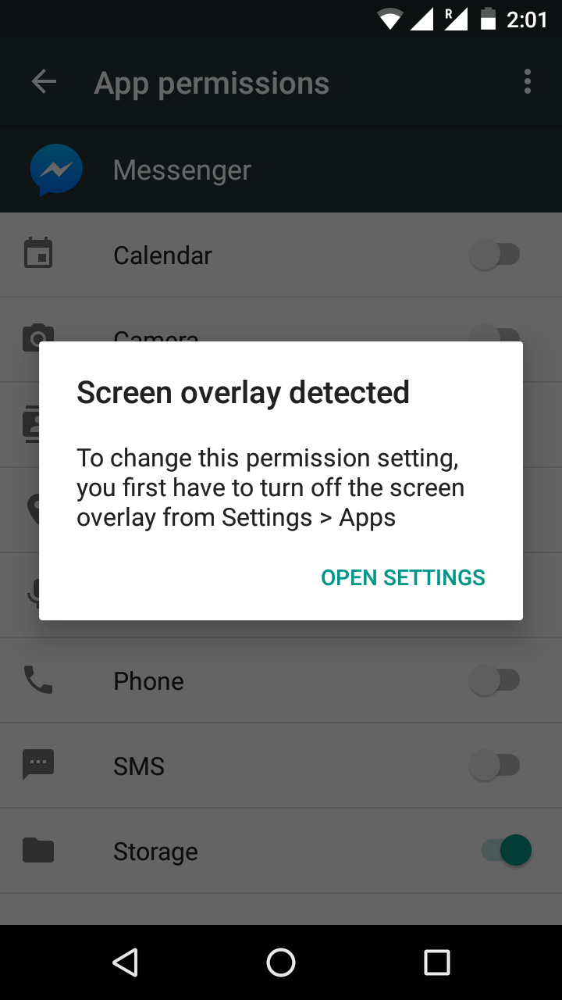
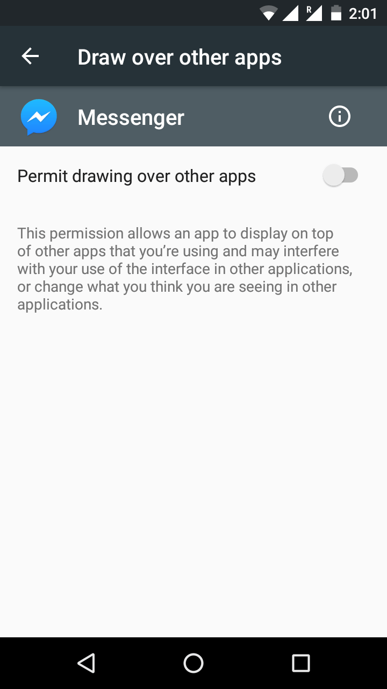
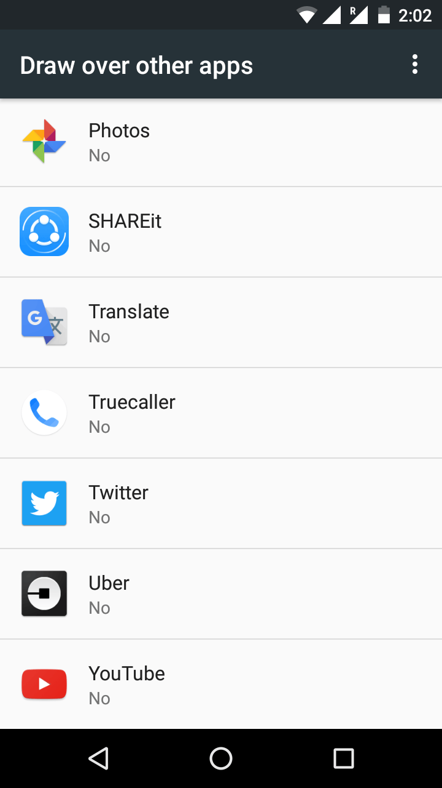
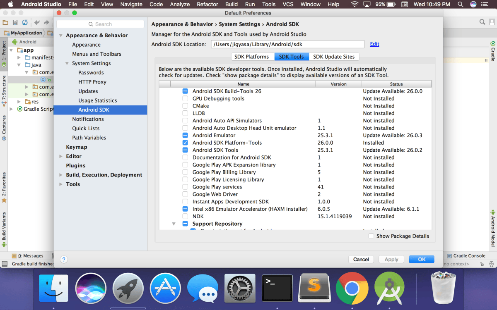
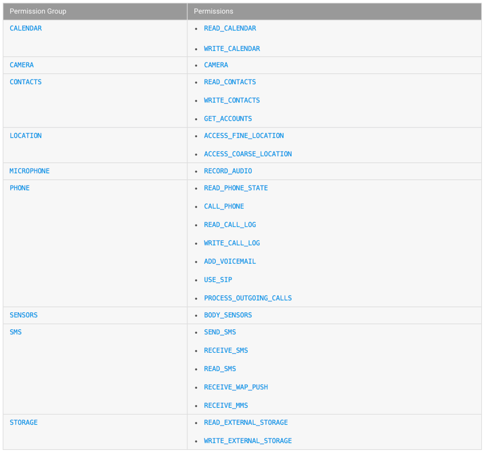

Hello all !

Oodles of carelessness and broken display glass led me to move down the ladder and use the spare <a href="https://www.motorola.com/us/products/moto-g-gen-3">Moto G (Gen 3)</a> at home till the former got overhauled or a new one framed its entry. It took a while to transfer all the stuff and set up apps while praying that data &amp; chats do not get lost during the gloomy move 🙁

So now that all was installed and updated in the tiny old device, I began using the phone as usual till the trouble knocked when the apps asked for certain permissions, the Lollipop style. Granting permissions had always been easier, nothing of a big deal. But this time the warning box <em>&#8220;Screen overlay detected&#8221;</em> beeped each time asking me to turn off the screen overlay from settings. Trying to disable the particular app&#8217;s permission to draw over other apps did not help neither did disabling the same for <em>all</em> the apps in the phone, I even tried tinkering with the System Apps.

  <figure></figure>
  <figure></figure>
  <figure></figure>

I was fed up of the endless loop I was stuck in, trying to grant permission, disabling the permit to draw over the other apps (which is already now off) and so on. And then it came across, like a tiny sparkle on the dull canvas ~ <em>&#8220;Trying to grant the permissions manually via the ADB ?&#8221;</em>

Android Debug Bridge (adb) is a versatile command-line tool that lets you communicate with a device (an emulator or a connected Android device). A client-server program, it provides access to a Unix shell that you can use to run a variety of commands on a device.

Frantically, I started googling to find the right way to do the needful. I started off with downloading the ADB package with SDK Manager in Android Studio, which installs it at <em>android_sdk/platform-tools/</em>. I installed the package using Android Studio as I had a bit of experience with it before, but one can also download standalone Android SDK Platform-Tools package from <a href="https://developer.android.com/studio/releases/platform-tools.html">developer.android.com/studio/platform-tools</a>

&#8220;Android SDK Platform-Tools&#8221; are installed with the latest Version 26.0.0

Glad, that the package was smoothly installed I casually tried the following in the terminal which gave a very sad response 😅

<pre>Jigyasa's MacBook Pro:~ jigyasa$ adb
-bash: adb: command not found
Jigyasa's MacBook Pro:~ jigyasa$ adb devices
-bash: adb: command not found
</pre>

I realised I had to find the exact location of the Android SDK Platform-Tools package and add it to the <em>PATH</em> environment variable. By default, the package is located at <strong>/Users/&lt;user&gt;/Library/Android/sdk/platform-tools/adb</strong>. The next steps included creating the<strong> <em>.bash_profile</em></strong>, adding the <strong>PATH</strong> environment variable by opening the <em>.bash_profile,</em> adding <strong>export PATH=$PATH:[your SDK location] /platform-tools</strong> to the file, hitting ⌘s to save it and finally loading the variable.

<pre>Jigyasa's MacBook Pro:~ jigyasa$ cd
Jigyasa's MacBook Pro:~ jigyasa$ touch .bash_profile
Jigyasa's MacBook Pro:~ jigyasa$ open .bash_profile
Jigyasa's MacBook Pro:~ jigyasa$ source ~/.bash_profile
Jigyasa's MacBook Pro:~ jigyasa$ adb
Android Debug Bridge version 1.0.39
Revision 3db08f2c6889-android
Installed as /Users/jigyasa/Library/Android/sdk/platform-tools/adb
</pre>

The next steps were super easy, connecting the device in the debugging mode and running the command using the template <strong>adb shell pm grant &lt;app&#8217;s-package-name&gt; android.permission.&lt;specific-permission-to-be-granted&gt;</strong><em>.</em>

For instance, I tried the following commands for WhatsApp:

<pre>Jigyasa's MacBook Pro:~ jigyasa$ adb shell pm grant com.whatsapp android.permission.CAMERA
Jigyasa's MacBook Pro:~ jigyasa$ adb shell pm grant com.whatsapp android.permission.READ_CONTACTS
Jigyasa's MacBook Pro:~ jigyasa$ adb shell pm grant com.whatsapp android.permission.WRITE_CONTACTS
Jigyasa's MacBook Pro:~ jigyasa$ adb shell pm grant com.whatsapp android.permission.GET_ACCOUNTS
Jigyasa's MacBook Pro:~ jigyasa$ adb shell pm grant com.whatsapp android.permission.ACCESS_FINE_LOCATION
Jigyasa's MacBook Pro:~ jigyasa$ adb shell pm grant com.whatsapp android.permission.ACCESS_COARSE_LOCATION
</pre>

In case of Facebook (com.facebook.katana), here we go:

<pre>Jigyasa's MacBook Pro:~ jigyasa$ adb shell pm grant com.facebook.katana android.permission.READ_EXTERNAL_STORAGE
Jigyasa's MacBook Pro:~ jigyasa$ adb shell pm grant com.facebook.katana android.permission.WRITE_EXTERNAL_STORAGE
Jigyasa's MacBook Pro:~ jigyasa$ adb shell pm grant com.facebook.katana android.permission.ACCESS_FINE_LOCATION
Jigyasa's MacBook Pro:~ jigyasa$ adb shell pm grant com.facebook.katana android.permission.ACCESS_COARSE_LOCATION
Jigyasa's MacBook Pro:~ jigyasa$ adb shell pm grant com.facebook.katana android.permission.RECORD_AUDIO
Jigyasa's MacBook Pro:~ jigyasa$ adb shell pm grant com.facebook.katana android.permission.READ_PHONE_STATE
Jigyasa's MacBook Pro:~ jigyasa$ adb shell pm grant com.facebook.katana android.permission.READ_CALENDAR
Jigyasa's MacBook Pro:~ jigyasa$ adb shell pm grant com.facebook.katana android.permission.WRITE_CALENDAR
</pre>

For someone who is looking for the exact permissions that can be granted, a cheat sheet like the following might help.

Android permission groups. (source: <a href="https://developer.android.com/guide/topics/permissions/requesting.html#normal-dangerous)">developer.android.com/guide/topics/permissions</a>)

&nbsp;

I am still stuck in the loop if I try to do it the layman&#8217;s way using the GUI. If any one of you who can help with it and has any pointers, I shall be really grateful. Till then, doing it the hacker-way. Hope this trick helps someone in the same muddle 😇

