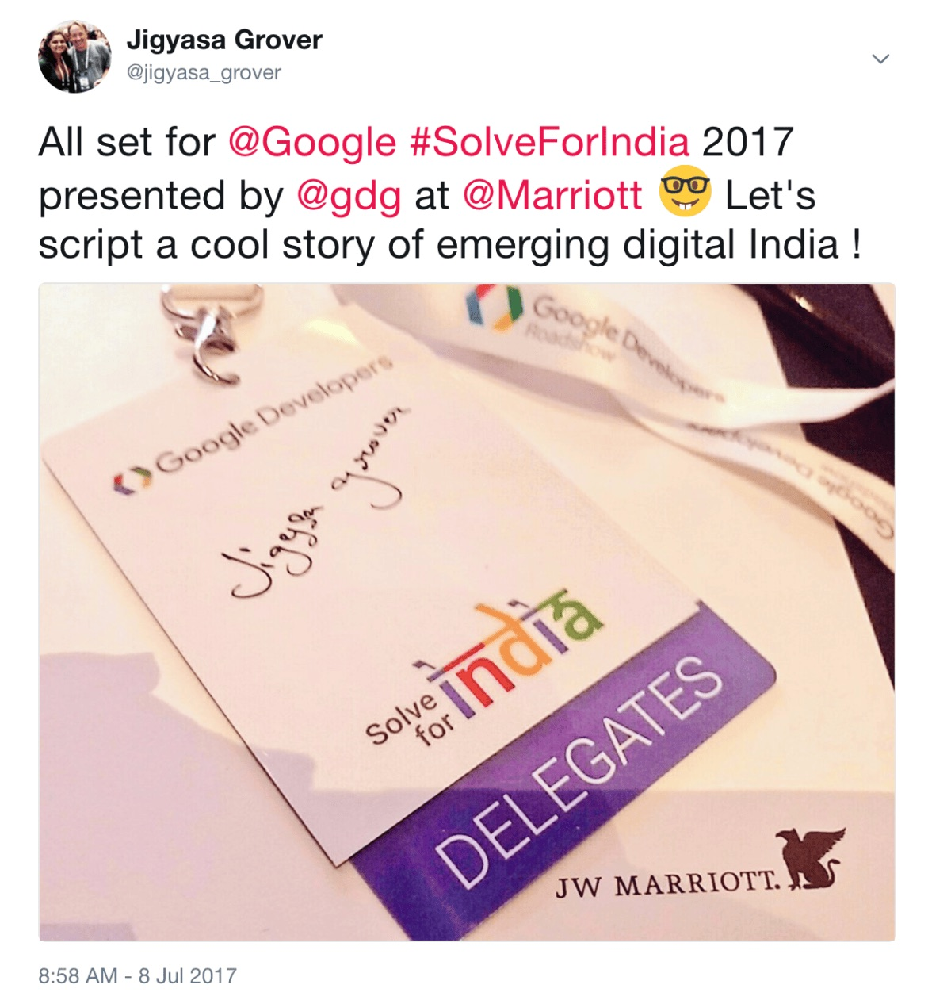
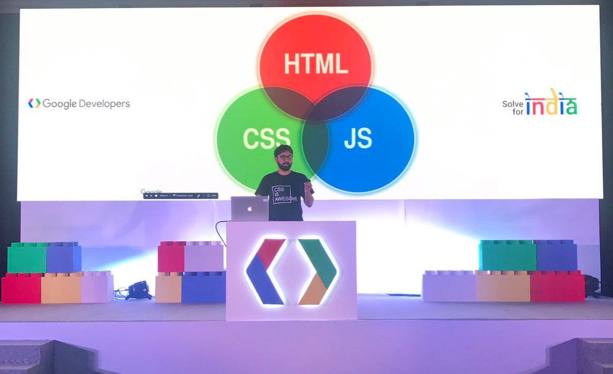
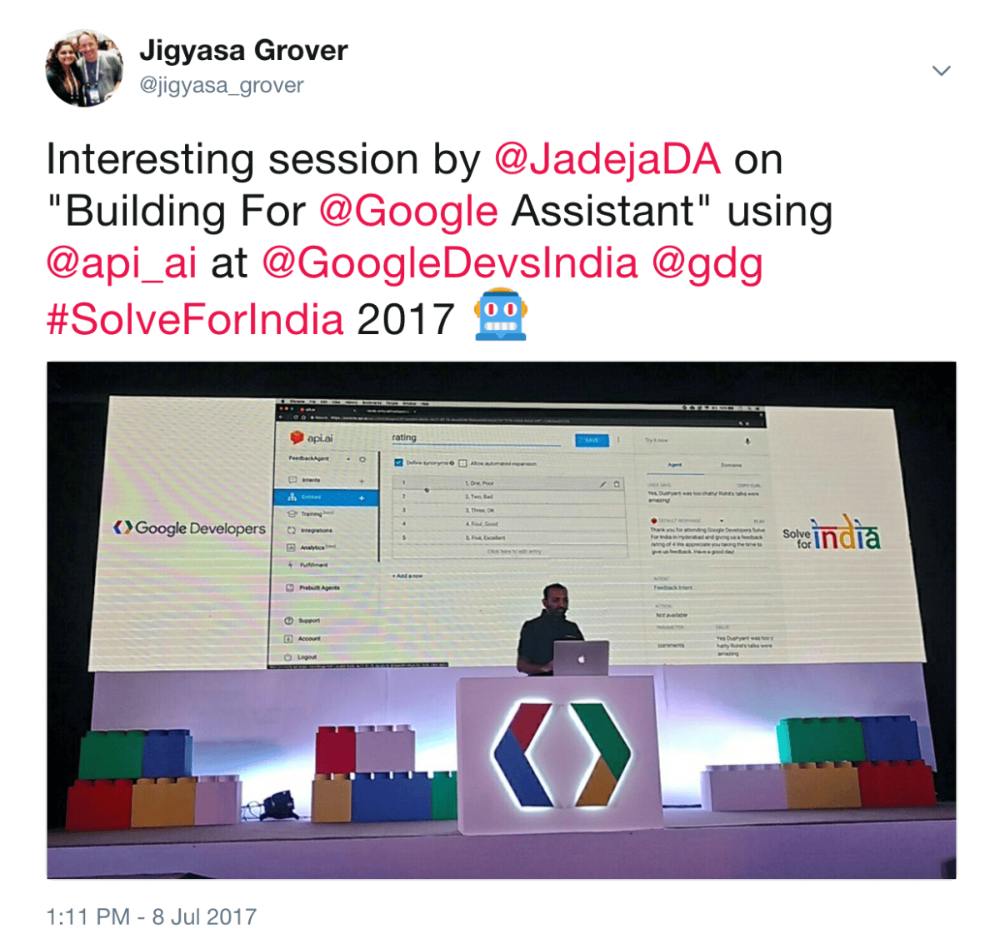
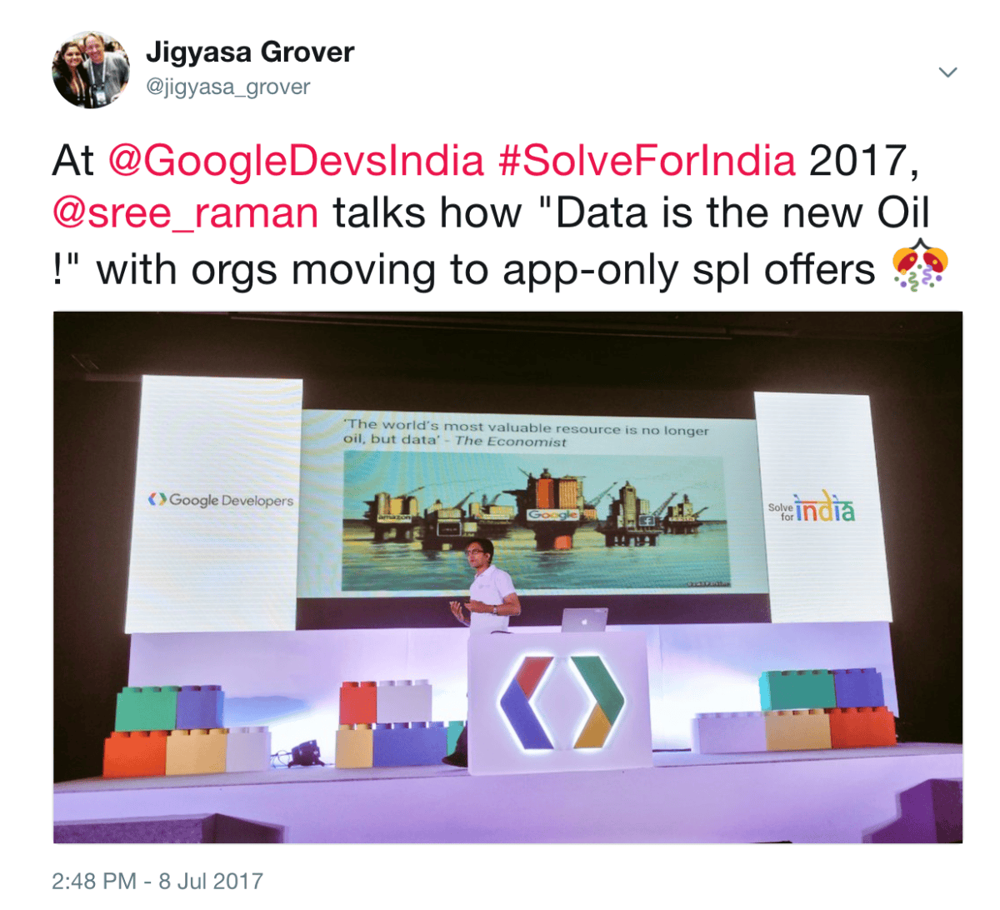
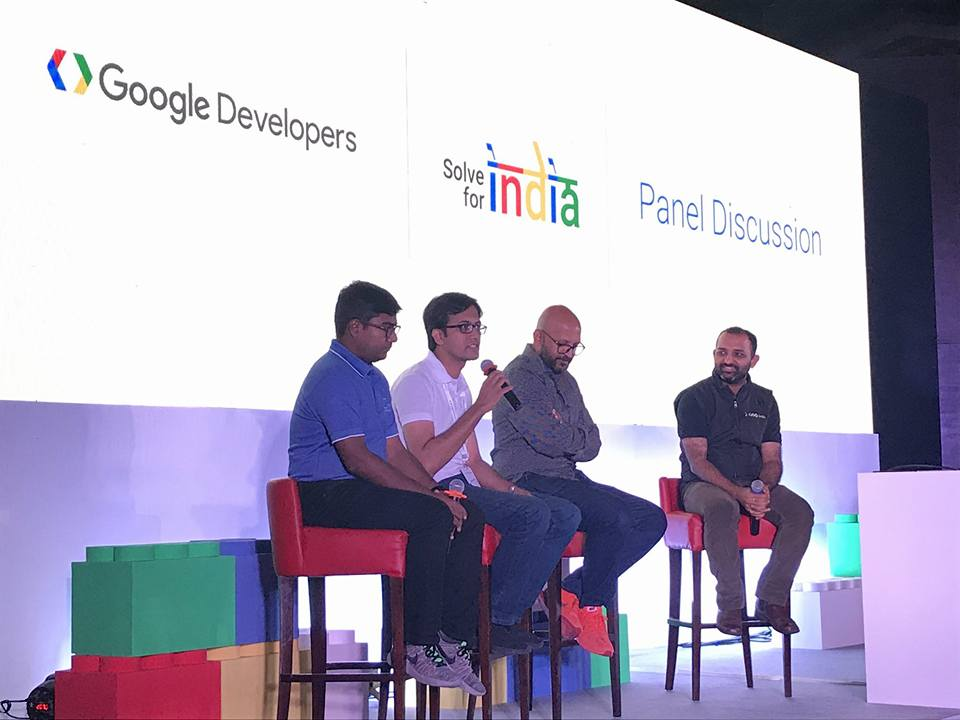
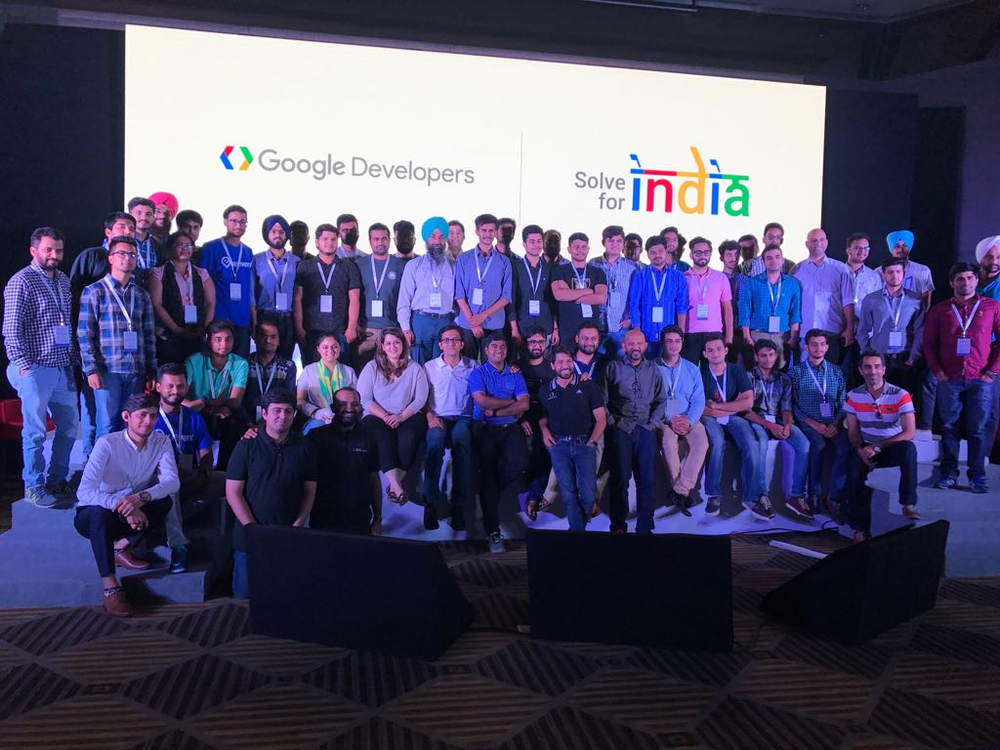

Hot summer days coupled with a plastered right hand (jammed my fingers in a heavy door at the hinge side 😔) had fabricated a torpid being from my usual busy self. An email from <strong>Google Developers India</strong> inviting me as a <em>Delegate</em> at their upcoming congress <strong>Google Solve for India 2017</strong> was all that I needed to perk up my weekend.

<em>FYI: Google Developers&#8217; Solve for India initiative aims to nurture developers, tech entrepreneurs and reach, support, mentors across India through access to open technologies, training and recommendations at networking conferences reaching the grassroots in India. </em>

Keeping up with my excitement, I reached the <em>JW Marirott</em>, a 5⭐️ luxury hotel well in time to begin with registrations and coffee &amp; snacks sprinkled with a pre-event networking session which witnessed attendees ranging from government officials involved in national Digital India programs to open source enthusiasts from university/colleges and startup founders. Soon after, the doors to the main hall opened and we were warmly welcomed by an interesting welcome note by Jadeja Dushyantsinh, Program Manager at Google India briefed about the agenda of the day along with showcasing some really cool videos like <a href="https://www.youtube.com/watch?v=EMytLoFjeTA">India In A Day by Google</a> and some (like &#8211; <a href="https://www.youtube.com/watch?v=zoPvgZ1Vbmc">Launchpad Bengaluru: Meet the startup ecosystem in India</a>) about various startups getting mentorship from the very best in the field under <a href="https://www.youtube.com/channel/UCorTyjVGM-PV5CCKbosONow">Google Launchpad</a>.

The stage was all set and Karthik Padmanabhan, Lead Developer Relations from Google India talked about the <em>Next Billion Users, </em>need for offline modes and promoted the creation of content in local languages to empower the nation. Next Rohit Gupta, Solution Engineer from the Google Cloud Platform team put forward a lucid illustration of GCP and its various use cases in a crisp manner. To put the audience at ease regarding the upcoming trend of Progressive Web Apps we had  Google Developer Web Expert, Hemanth come on stage to compare PWA with native apps and guide all of us to the future belonging to PWA clearing away many doubts on the way.

Google Developer Web  Expert, Hemanth talking about the upcoming trend of Progressive Web Apps !

After a hearty meal comprising of North Indian delicacies and Italian Tiramisu, Jadeja Dushyantsinh came up next to conduct a hands-on session targeted at assisting each one to build our very own Google Assistant using <a href="http://api.ai/">API.ai</a> followed by a riveting talk by Sreeraman Thiagarajan, Google Developer Marketing Expert on &#8220;Data is the new oil!&#8221; and showing instances of <a href="https://firebase.google.com/">Firebase</a> utilities with AdMob/AdSense etc.

  <figure></figure>
  <figure></figure>

The day-long conference ended with an interactive panel discussion touching topics like the current state of Startup Ecosystem in India, how they see the future and the best practices according to the Google Experts followed by a Open House session.

All in all, it was a really nicely managed and organised event. Thank you GDG for <strong>#SolveForIndia</strong> signature bag, Google Assistant T-Shirt apart from the pleasurable opportunity. I had a fun time discussing and indulging with the developers and startup junkies as they demonstrated examples of mobile first solutions with strong offline and Indic language capabilities. <strong>Great show Google !</strong>

&nbsp;

