
Visiting Goa in monsoon with a plastered right hand might not be the best of the travel ideas, yet it was certainly delighting to have had the honour of being invited to<strong> <a href="http://ieeewiels.org/">IEEE Women in Engineering International Leadership Summit 2017</a></strong> to speak on Open Source and represent <strong>Women Who Code</strong>.

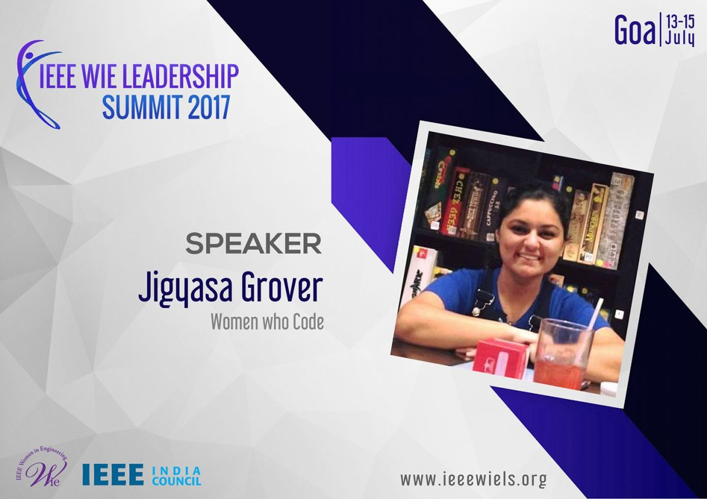
IEEE Women in Engineering (WIE) is one of the largest international professional organizations dedicated to promoting women engineers and scientists.

  <figure>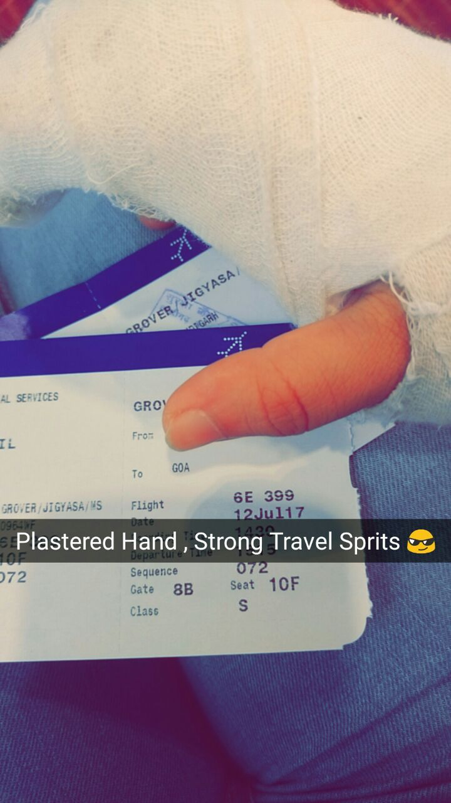</figure>
  <figure>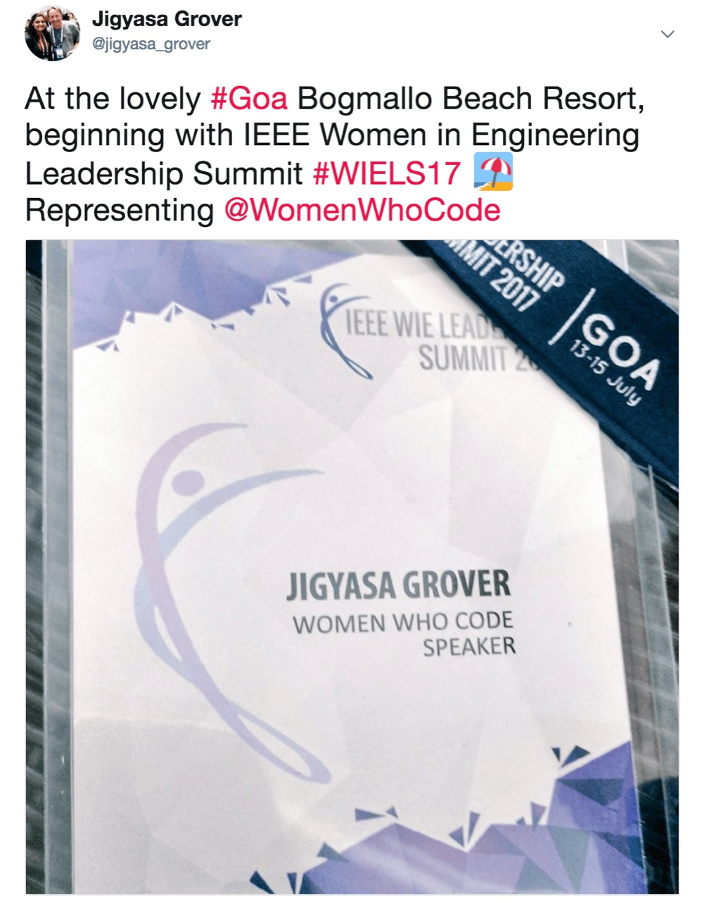</figure>

With a scintillating theme of <strong>&#8220;Disrupt- Breaking the barriers of thought&#8221;</strong>, the 3 day conference had the entire <em>5⭐️ Bogmallo Beach Resort</em> reserved for the attendees and the speakers. Perfect beachside venue, the Summit&#8217;s agenda was filled to the brim with inspiring and constructive talks, workshops aiming to promote the sense of innovation, art &amp; design, technology, leadership and entrepreneurial zeal among its participants and bringing such opportunities from across the globe to Goa.

I surely had the best chance to meet eminent speakers for various tracks namely, Leadership, Innovation, Technology, Entrepreneurship and, Design &amp; Art coming from cool organisations like Google, Texas Instruments, TCS, IBM, intel, Accenture, Node, Stryker etc. It was amazing to hear inspirational stories from business leaders at noteworthy positions and social activists who have walked the extra mile and have made a mark for themselves internationally.

  <figure>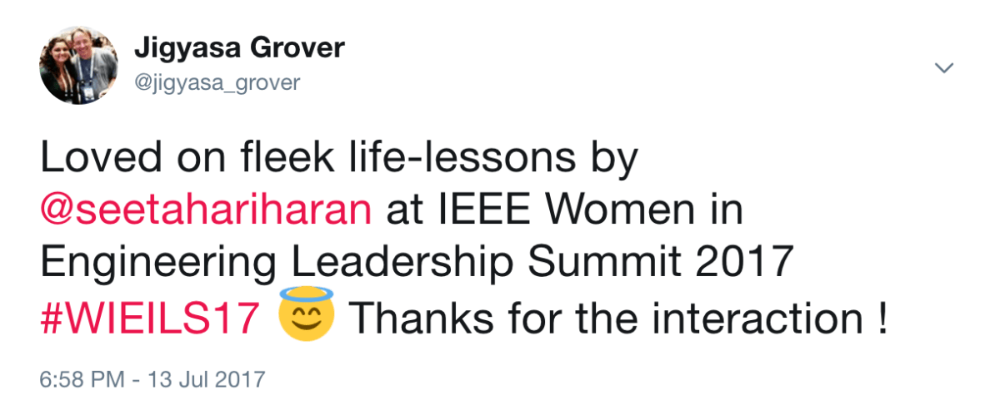</figure>
  <figure>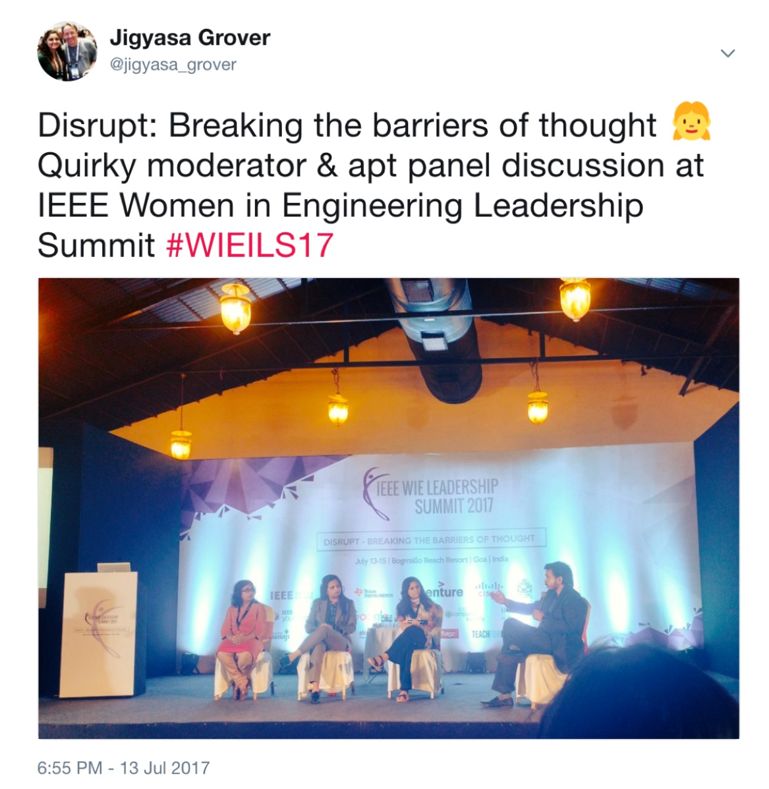</figure>

I was amongst the youngest speakers out there and it felt so nice talking about the missive of <em>Women Who Code</em> and conducting an interactive session on getting newbies started with contributing to the vast world of Open Source, especially with delegates from different parts of the world like Malaysia, India, Tunisia, Sri Lanka, Afghanistan, etc.

It was really a proud moment when I was invited as the <em>Guest of Honour</em> to felicitate the IEEE Delegates from Tunisia after they presented about the myriad activities being held under their guidance &amp; support and their vision for the upcoming years. Cherry on the cake was meeting Lakshya Sivaramakrisna, Google Women Techmakers India lead in person, attend her code-lab on getting started with <a href="https://www.tensorflow.org/">TensorFlow</a> and discuss about the current scenario of women techies especially in Delhi and plan the roadmap.

  <figure>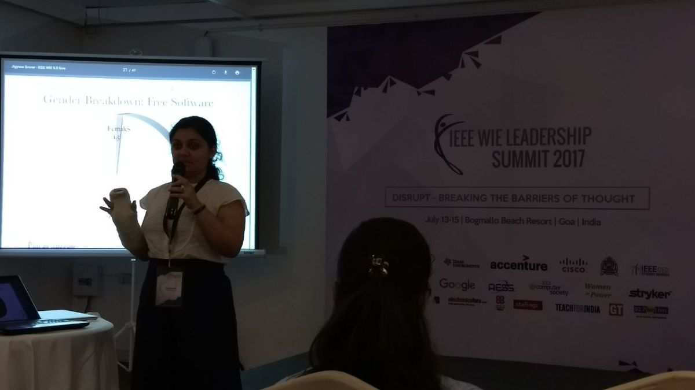</figure>
  <figure>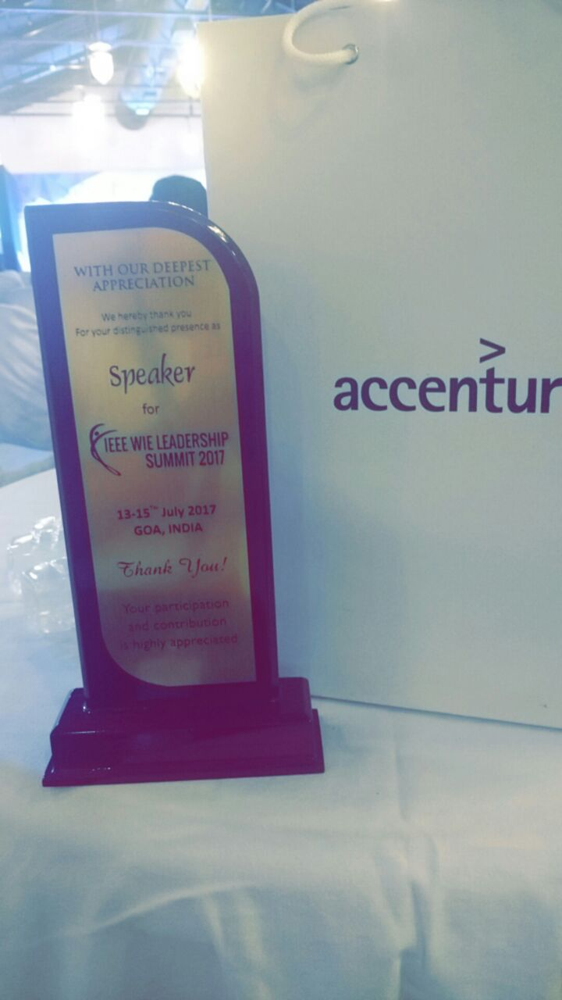</figure>

  <figure>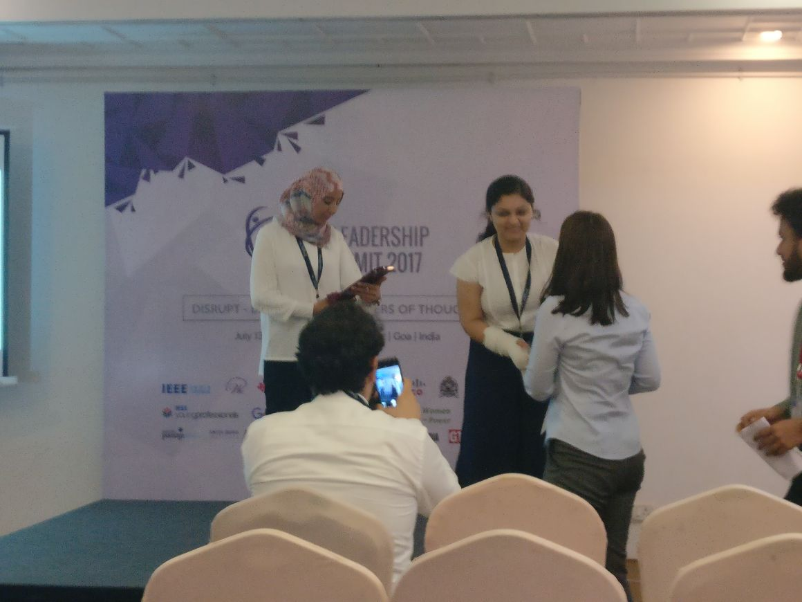</figure>
  <figure>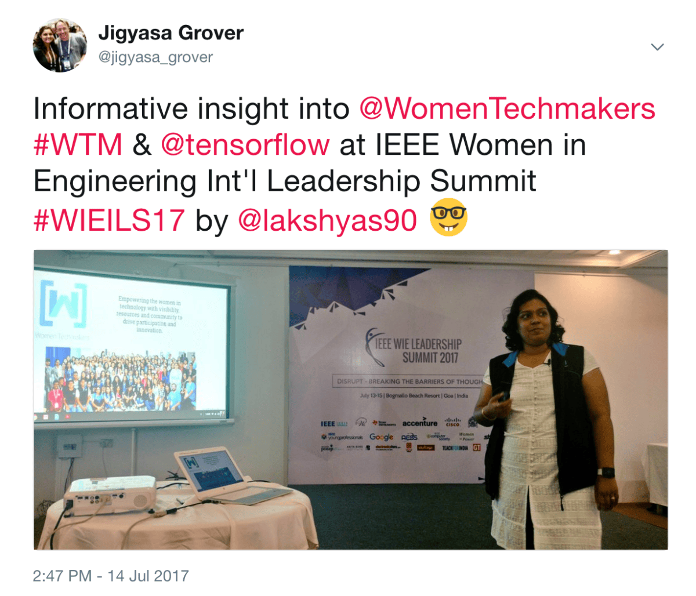</figure>

Apart from networking, meeting so many talented women engineers out there, this event gave the right set of golden (just like the sand of the beautiful Goan beaches) chances to explore the pretty beaches of Goa roaring with the fierce waves in this season and enjoy the fine land where where Indian culture intertwines with Portuguese influences.

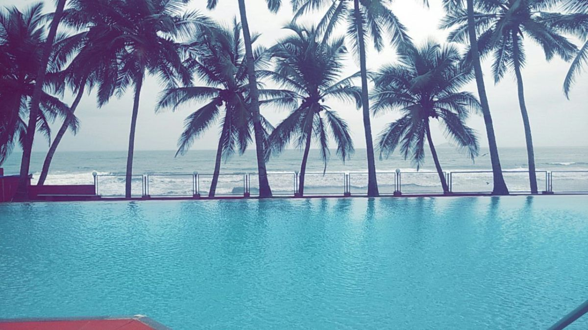
Lovely view from the alley leading to conference halls 😍

Amazingly put up Dr. Nitish Guinde, Dr. Vijayalatha Reddy, Jibin Sabu, Nithin Samuel, Gyanprakash, Goa Engineering College, volunteers and the all the IEEE chapters involved! It really lived up to its name and aim of creating a vibrant community of women and men collectively using their diverse talents to innovate for the benefit of humanity.

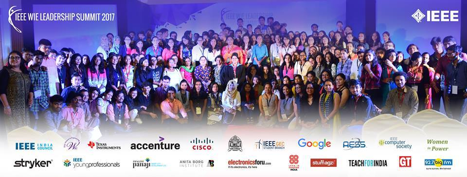

