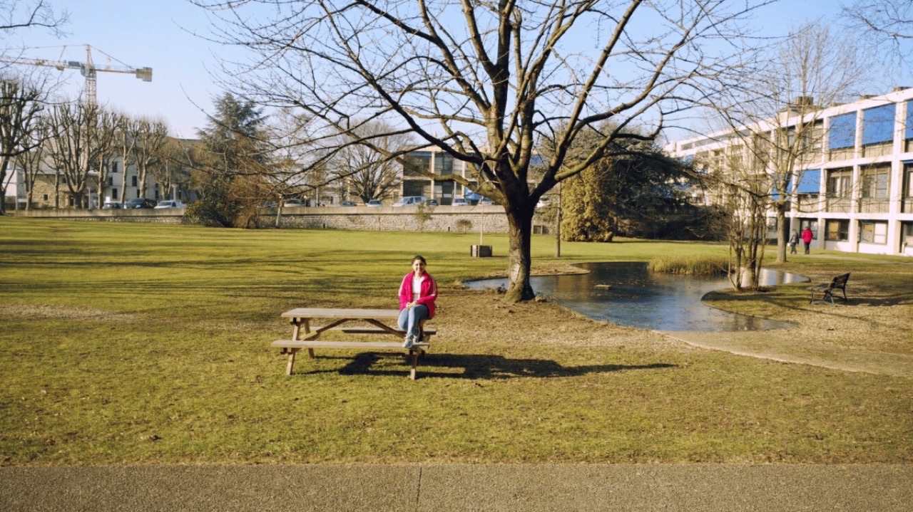
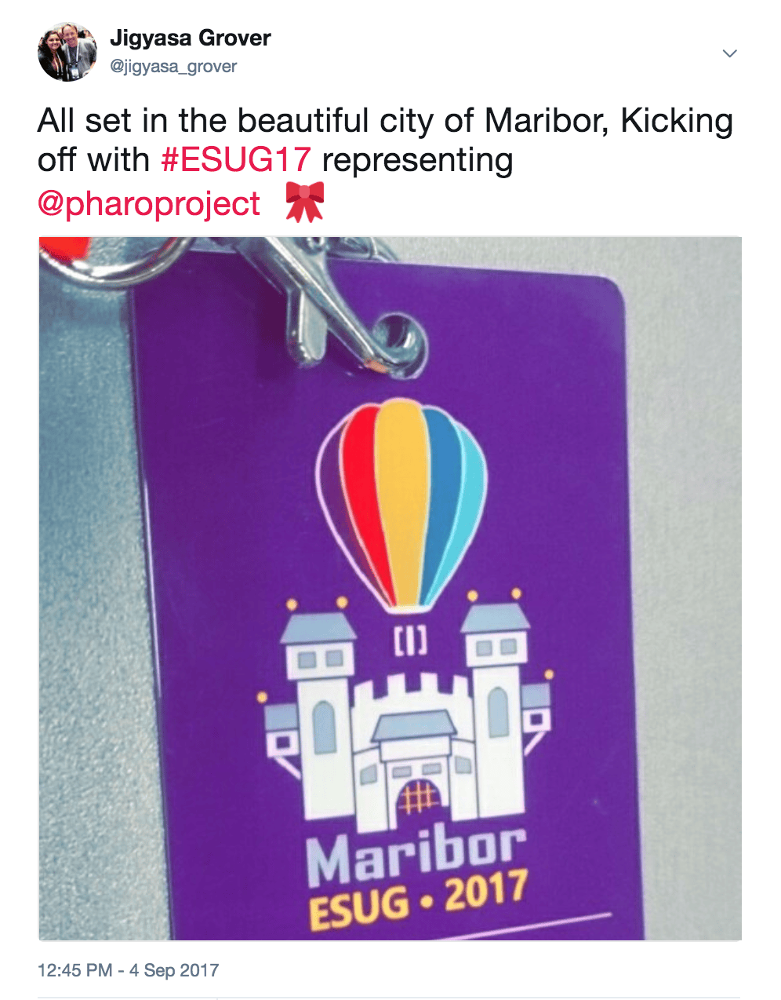
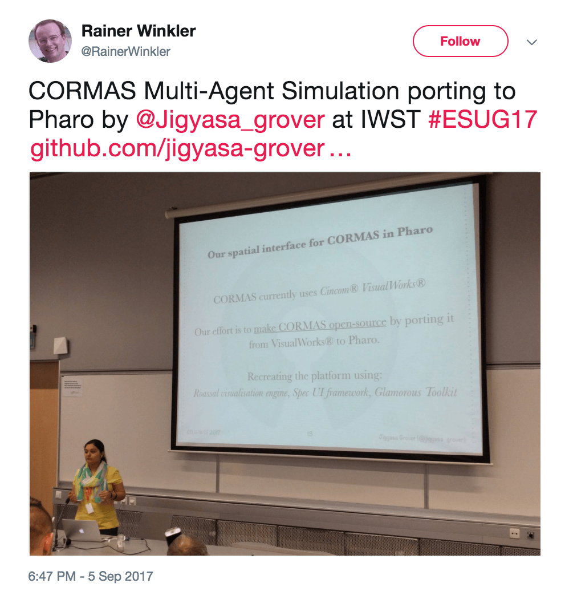
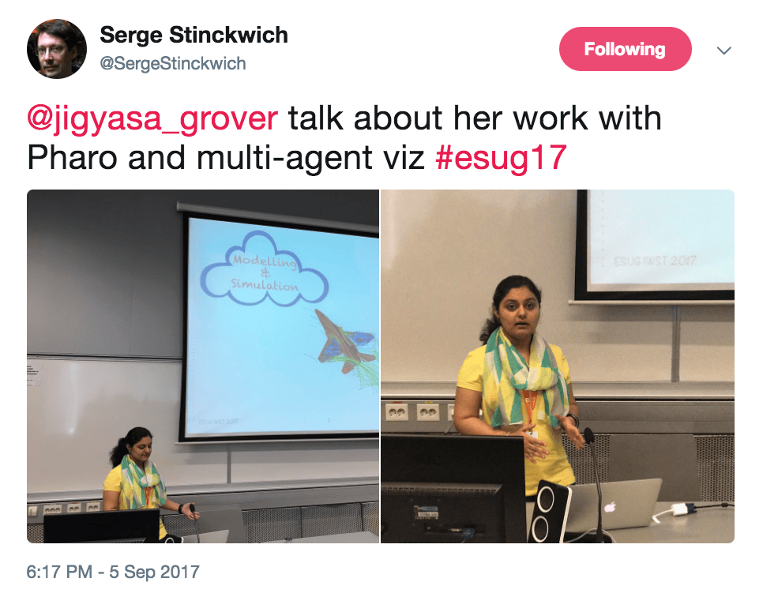
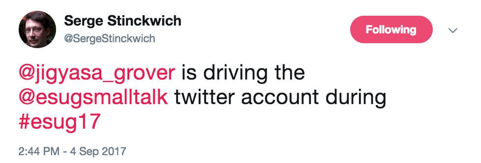
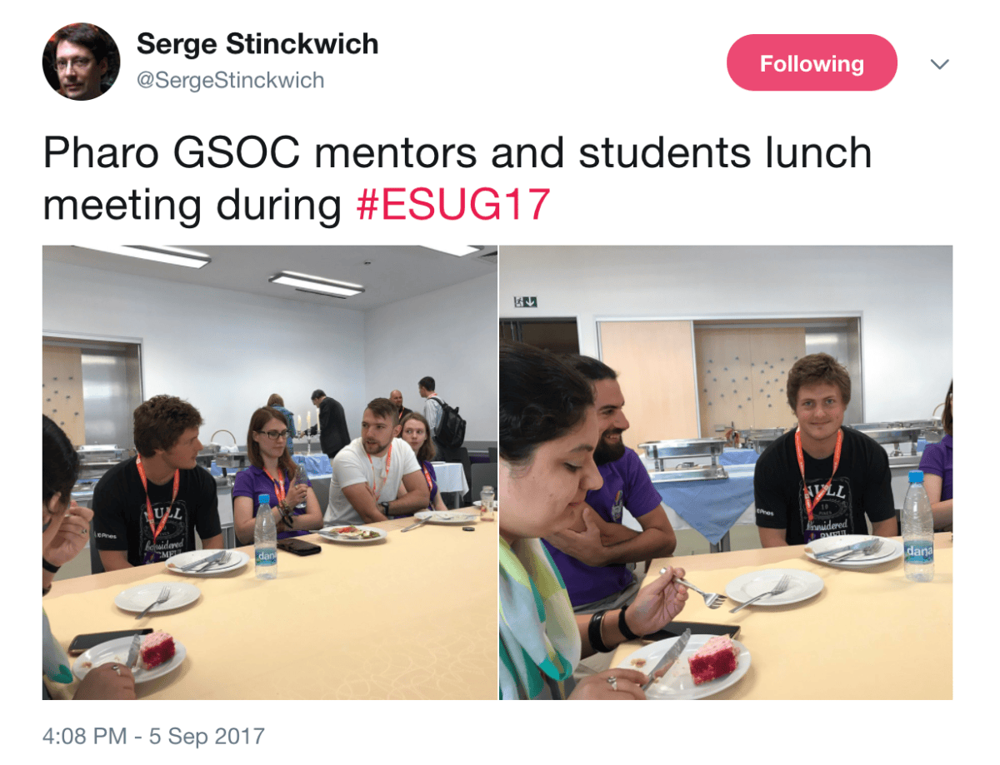
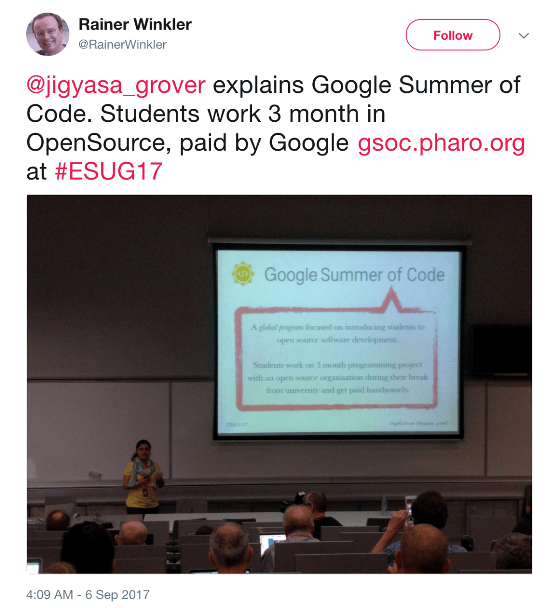
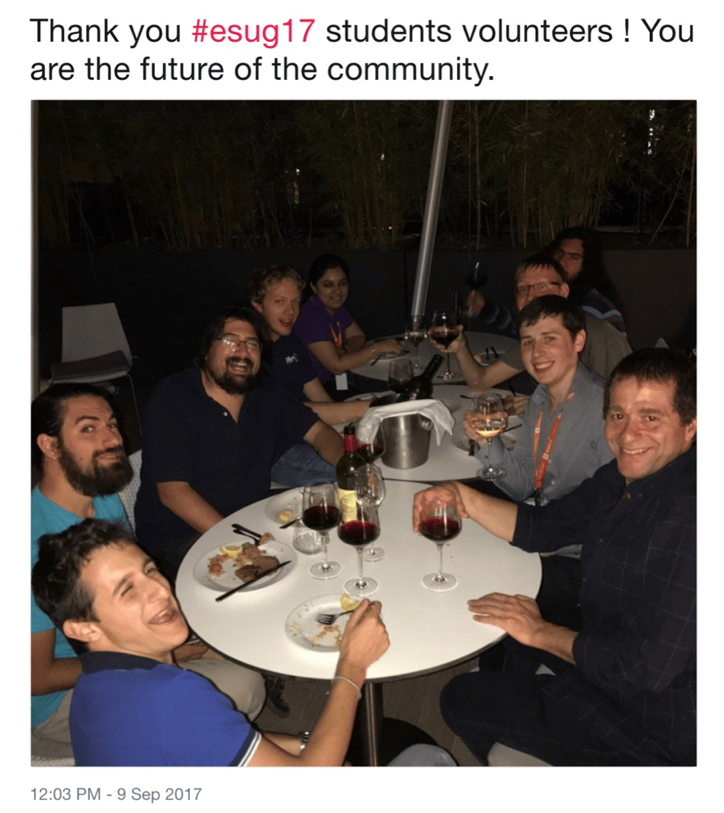

<em>&#8220;When and how did you get started with Open Source?&#8221;     </em>

This is the question I get asked the most often, And it never catches me off guard. I have a very nice anecdote (saving it up for a post for some other day) to share as an answer to this which starts with <a href="http://pharo.org/">Pharo</a>. My history with Pharo dates back to late 2014 when I was a noob (I still am, in many aspects 😂)

Since then, I have always worked remotely for <em>Pharo</em>, ranging from developing <strong>sQuick</strong> (the offline text search utility) under <em>FOSSASIA </em>, desktop apps like <strong>SiteMap Generator</strong> including file hierarchy, <strong>MorphoPhysics</strong> using concepts of elasticity, in-built <strong>Contact Manager</strong> widget, <strong>Rolling Dice</strong> game, Lights Out puzzle for electric geeks, <strong>Text Editor </strong>as hobby project, etc. to authoring chapters and full-blown tutorials in the books <strong>Fun with Pharo</strong> and <strong>Pharo in Progress</strong> with <strong>Square Brackets Associates</strong> and bug-fixes in <strong>Pharo 4.0</strong>.

Starting this year, I got an assignment to work on the applied modelling of relationship between societies and their environment initiated by <strong>Centre de coopération internationale en recherche agronomique pour le développement</strong> in the beautiful country of France. As expected, it was indeed a wonderful learning experience as I fabricated CORMAS&#8217; Pharo extension from scratch at the esteemed <strong>Institut de Recherche pour le Développement</strong> under the supervision of Dr. Serge Stinckwich, Nick Papoulias and Pierre Bommel.

<strong>After lunch break, on a sunny day in the beautiful campus of &#8216;<em>Institut de Recherche pour le Développement&#8217;</em> featuring frozen pond in the background in Paris</strong>

A good time was spent elbowing on the lines of object-oriented programming which has had a long-standing history with simulation systems in terms of human-computer interaction dating back to <em>Simula</em> and early versions of <em>Smalltalk-72</em> and <em>Smalltalk-76</em> (which form the heart of Pharo environment). It was observed that these frameworks were based on discrete, event-based simulations as revealed by the classic simulation examples of <a href="http://stephane.ducasse.free.fr/FreeBooks/BlueBook/Bluebook.pdf">Smalltalk-80 Blue-book</a> (for me &amp; many, it&#8217;s like the Bible of Smalltalk).

Nevertheless present time trends have pivoted towards agent-based modelling and abstractions, with systems like <em>NetLogo</em> capturing a sizeable following and heed. Two of the widely known agent-based modelling (ABM) platforms in Smalltalk (<em>MobiDyC</em> &amp; <em>CORMAS</em>) have recently begun experimenting with porting their systems to Pharo. The rationale behind this choice is to allow modern re-imagination of the platforms that can take advantage of developments in: agile visualization, moldable tools, domain-specific languages (DSLs) and so on.

Hence, we focused our work on the salient user interface component of these platforms, namely the <em>spatial interface</em>, which empowers a user to visualize the evolution of the system through time. We started with a concise analysis of the state-of-the-art for spatial interfaces and their platforms (MobiDyC, NetLogo, GAMA and CORMAS), scrutinising in terms of programming flexibility, extensibility, portability, scalability, and interaction. Subsequently we progressed in building an open-source extension for CORMAS’ spatial interface in Pharo.

The handful of weeks I spent working on this project were full of  exploring the mesmerising <em>City of Lights &amp; Love</em> in the peak of its winter. From visiting Eiffel Tower at different temperatures/times of the day, posing in front of The Louvre for that perfect click, catching up with my Canadian friend in a 150 year old Bouillon Chartier to attending local conferences &amp; concerts and solo wandering in the much acclaimed Champs-Élysées. It was like living out of the books and travelogues, where Paris existed for me  before this trip. To be honest, it turned out to be much more than that (both ways 😉). Bidding adieu to the lovely city and the friends I had made in such a short span of time was definitely not smooth.

Once I was back home, I was in constant touch with all my supervisors as we began work on documenting the project in a well defined manner in a hope to come up with a publication to be presented in the community&#8217;s upcoming annual conference. A special shoot-out to Nick for being on those weird time hangout calls (timezones !) just minutes before the final submission deadline topped with the weak(-est) internet connection. The team was super happy when the results were out and our publication had made it, though with some final reviews pending.

After a few weeks of evaluation, re-working and finalising travel plans, I flew to Maribor (Slovenia) to present our work at the <strong>ESUG 25th International Smalltalk Joint Conference</strong> (🎉) which was published in ACM Library under <em>Proceedings of the 12th Edition of the International Workshop on Smalltalk Technologies</em>. Check it out <a href="https://dl.acm.org/citation.cfm?id=3139915">here</a> !

&nbsp;

  <figure></figure>
  <figure></figure>
  <figure></figure>
  <figure></figure>

Not only was I speaker for two sessions (one was done as a responsible <strong>Google Summer of Code Org Admin</strong> &#8211; on the spot) but I also made myself available as a student volunteer in my venture to give back to the cozy little community of Pharo-ers !

&nbsp;

  <figure></figure>
  <figure></figure>
  <figure></figure>

Of course, due acknowledgements &#8211; This work and all the associated travels were funded by the <em>FuturAgua Project (Belmont Forum)</em> with a complementary scholarship from <em>European Smalltalk Users Group</em>. A kind thanks to Pierre Bommel (CIRAD), Serge Stinckwich (IRD), Nick Papoylias (IRD) and Stéphane Ducasse (INRIA) for their continuous support and guidance.

