
I had just settled in after my ~10 day long trip to Orlando, Florida when I found myself packing again to spend a weekend in the Bay Area for the <strong>Google Mentor Summit 2017</strong> where I was representing <a href="http://pharo.org/">Pharo Consortium</a> as the organisation administrator and also chipped in to represent <a href="https://fossasia.org/">FOSSASIA</a>.

  <figure>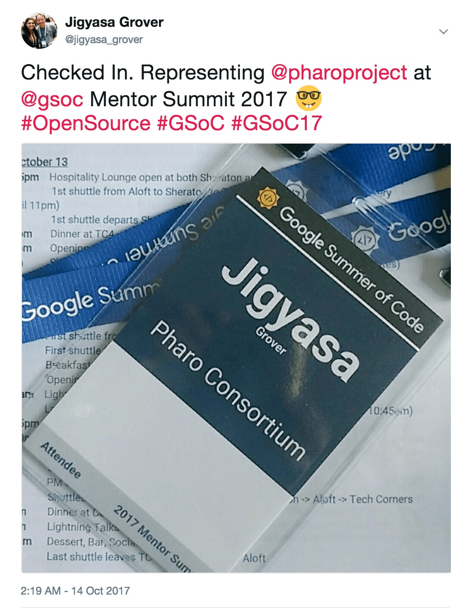</figure>
  <figure>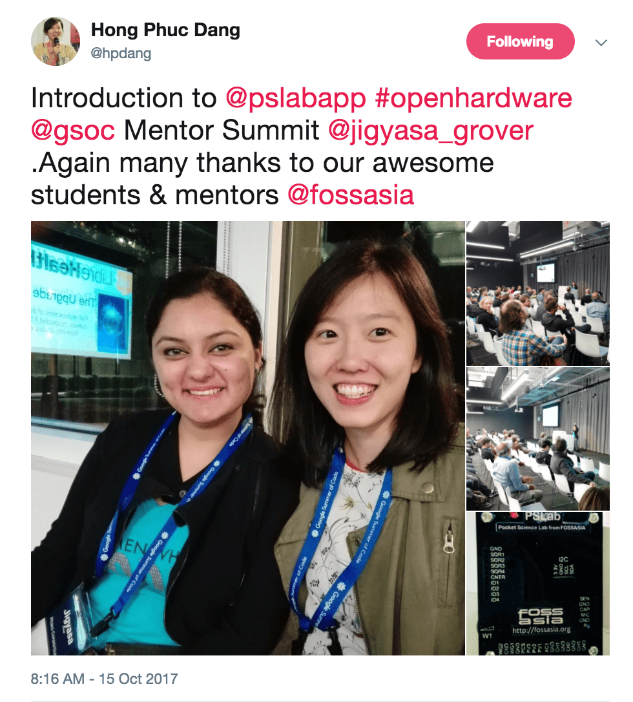</figure>

After landing in SFO, I headed straight to the beautiful Sheraton Hotel (<em>an entry to pool directly from the back door of your room, beat that?</em>)  where all the delegates from ~120+ had started to arrive. Quickly after checking in and freshening up, I darted to the hospitality room to engage in interesting conversations with mentors from all over the world (many were completely jet-lagged having seen 24+ hr long day) and grab some delicious snacks &amp; a much needed drink after the travel 🍹

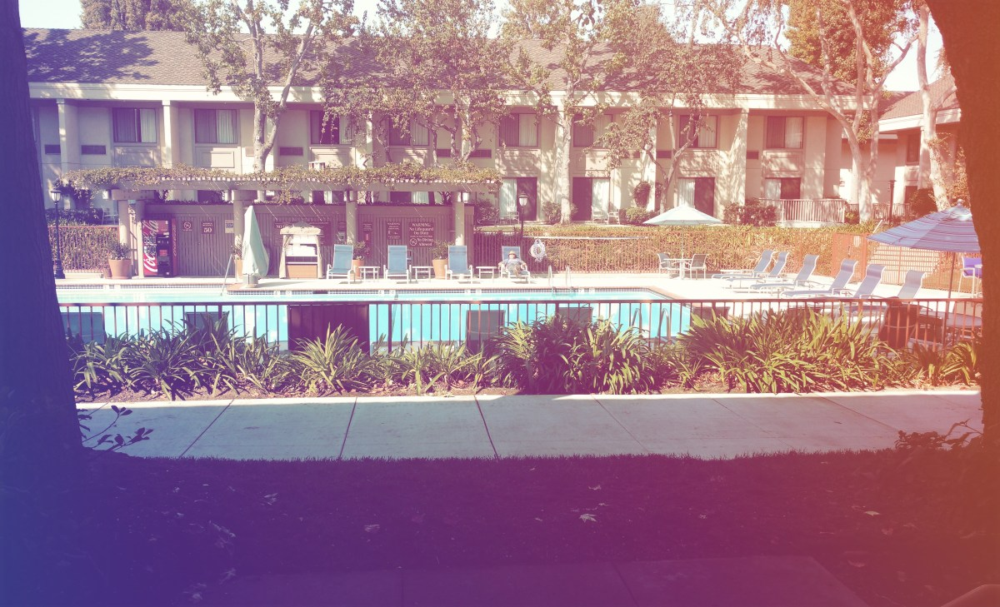

Soon after, we boarded the shuttle to the <strong>Google Tech Corners</strong> for the welcome dinner hosted by Google Open Source. I finally met the amazing open source evangelists I had been in touch with virtually, chiefly Maybelline Burgos (whom I couldn&#8217;t meet at GHC, <em>reason:</em> 18k+ women and hectic schedule), Ginny from Systers and Katie McLaughlin who had flown all the way from New South Wales. The welcome session was fun and interactive where we introduced ourselves with 4 words that spell us out, I answered with my favorites: <strong><em>&#8220;Travel, Sleep, Desserts, &amp; Family.&#8221; </em></strong>. To celebrate the Friday night in the Bay Area, I grouped with a couple of mentors to enjoy the night life in Mountain View.

  <figure>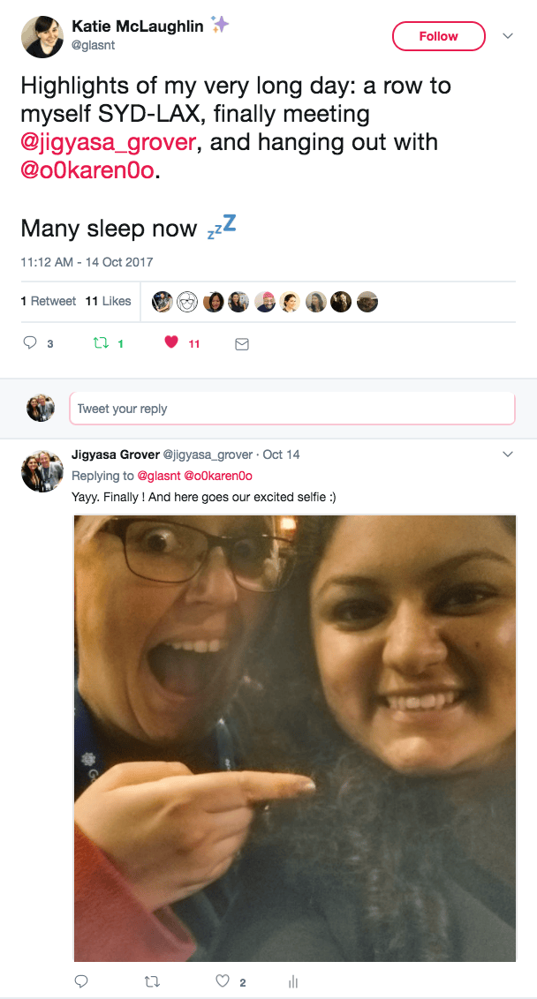</figure>
  <figure>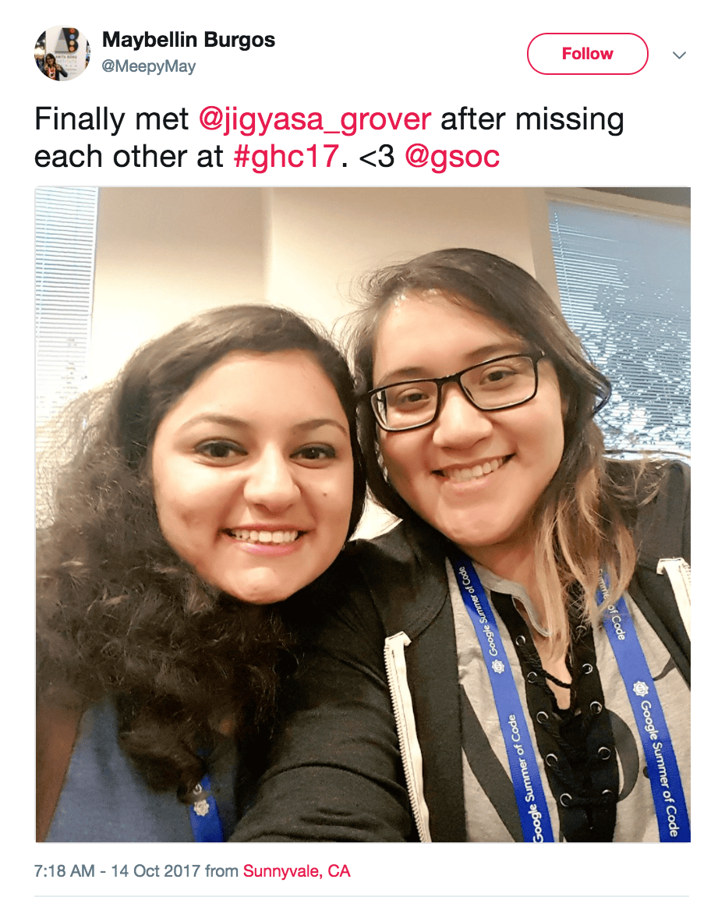</figure>

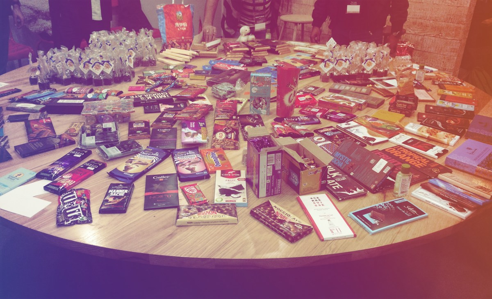
The &#8220;traditional&#8221; chocolate table, having quirky chocolates from around the world.

Saturday began with <em>Lightning Talks</em> and <em>Unconference Sessions </em>organised by different organisations to showcase their project updates and also get feedback from the community along with brainstorming on assorted perspectives. I participated in the talk by a delegate from École polytechnique fédérale de Lausanne (EPFL) and bagged the <a href="https://bluebrain.epfl.ch/">Blue Brain</a> project puzzle. Doing my part, I presented the core idea of Pharo Consortium and the works done by the chosen 5 students who worked on <em>&#8220;Pharo DataFrame &#8211; Descriptive Statistics&#8221;</em>, <em>&#8220;Advancing in Pharo Code Quality Support&#8221;</em>, <em>&#8220;Enhancing Pharo Command Line Interface&#8221;</em>, <em>&#8220;Improving FastTable and extend its possibilities&#8221;</em> and <em>&#8220;Improving the VM Profiler&#8221;. </em>I also presented the <a href="https://pslab.fossasia.org/">Pocket Science Lab (Open Hardware)</a> project being done under FOSSASIA which was appreciated by a lot of the attendees <em>(always flattering to receive lovely comments on it from such experienced fellows)</em>. The night ended with a lovely dinner &amp; drinks programme organised under the stars with  sizzling fire-pits in the chilly weather of Sunnyvale with stimulating music from the live performers and artists who drew <em>&#8216;almost&#8217;</em> perfect caricatures.

  <figure>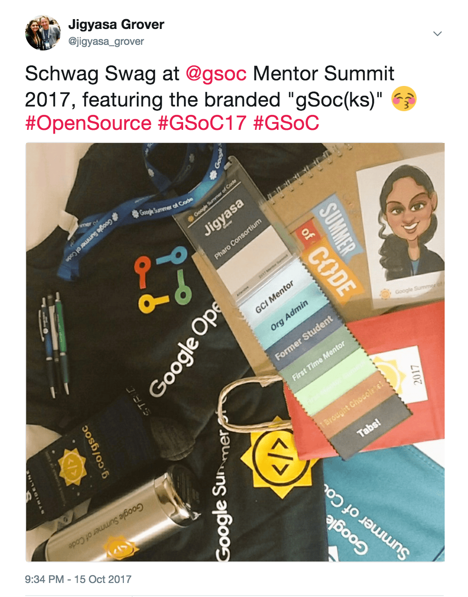</figure>
  <figure>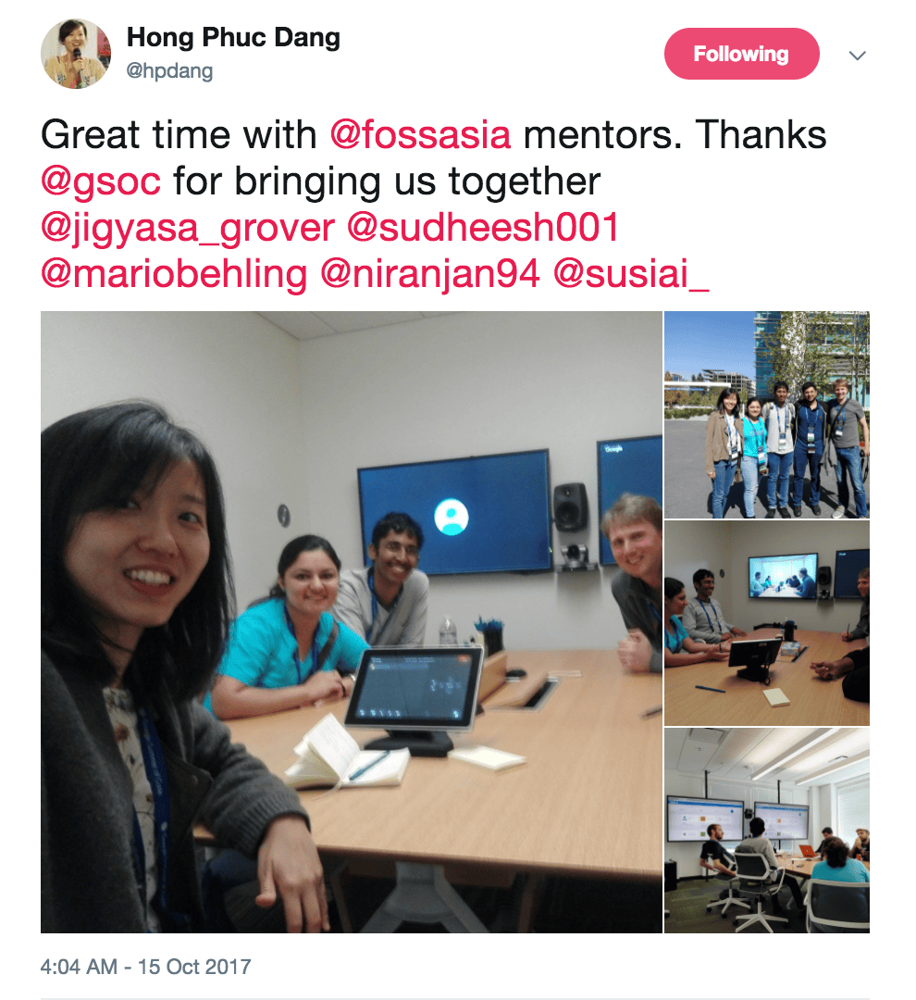</figure>
  <figure>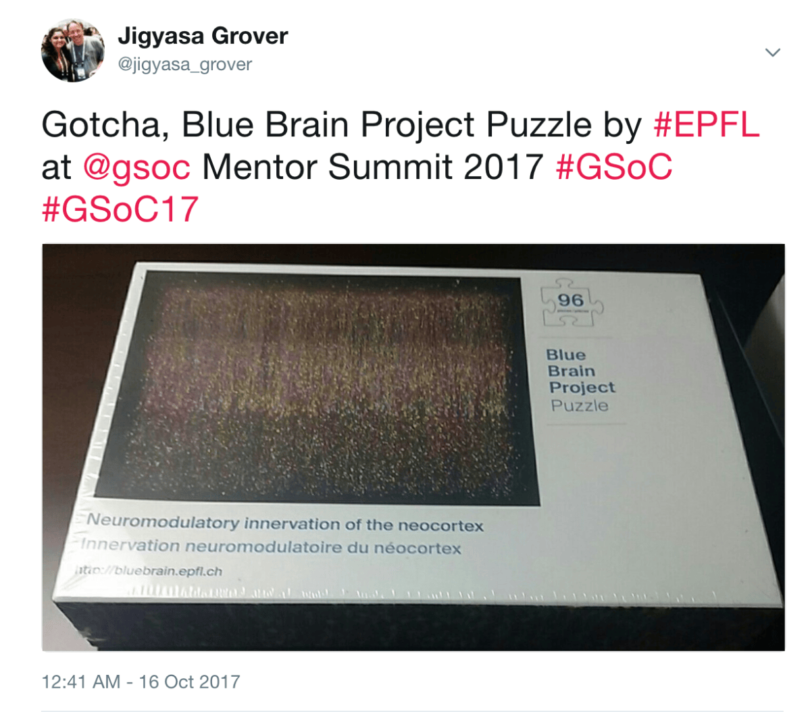</figure>

  <figure>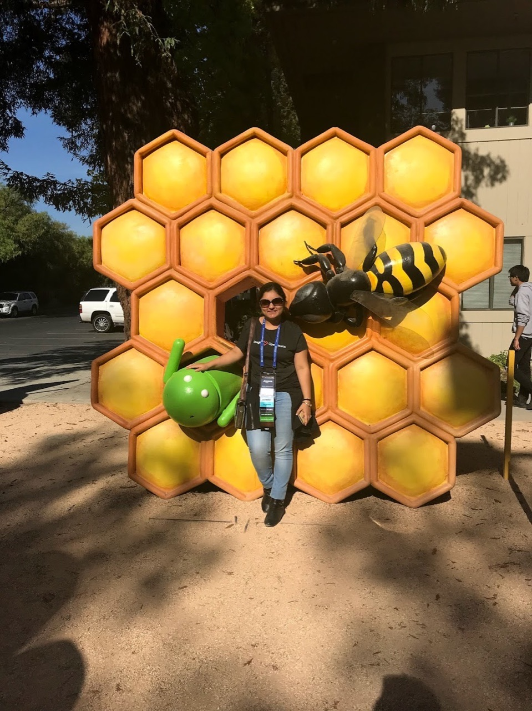</figure>
  <figure>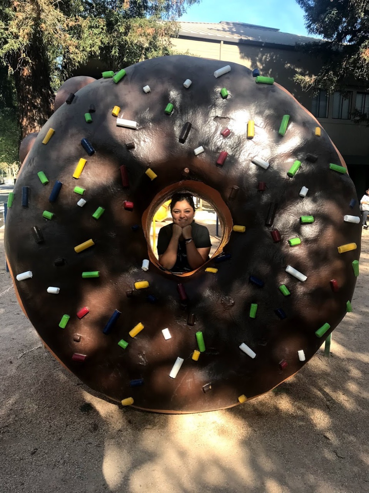</figure>
  <figure>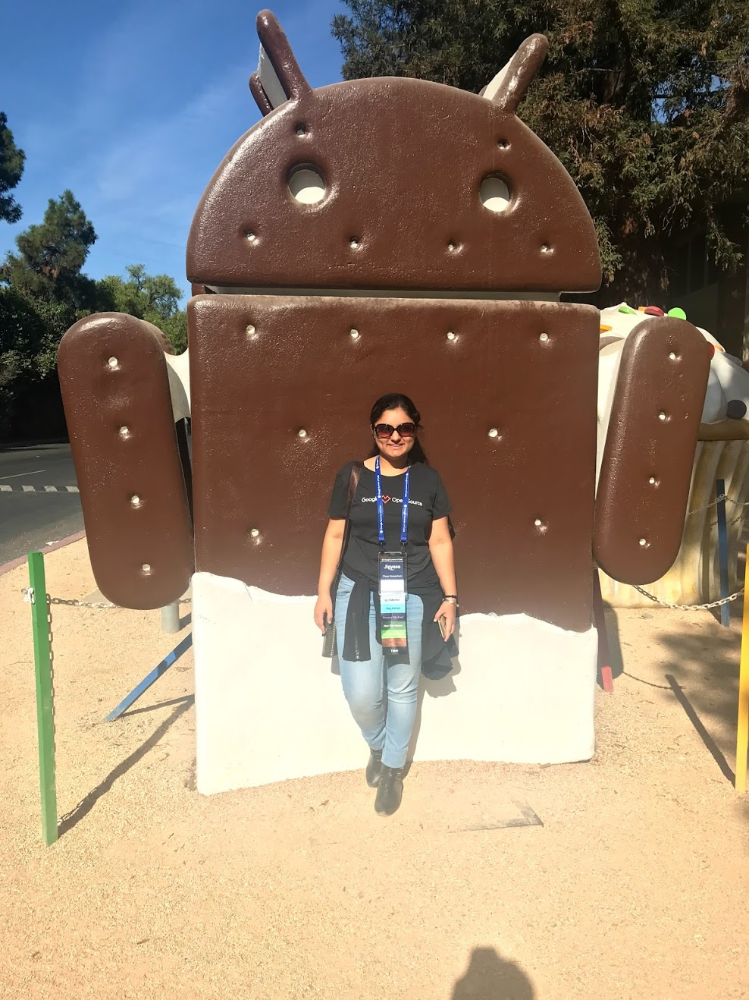</figure>
  <figure>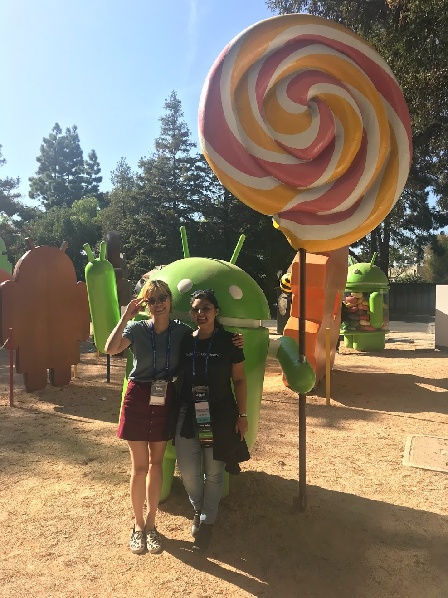</figure>

Sunday seemed like a relaxed day, after two crazy days of travel, tech talks, amazing food and oodles of networking. We took a trip to the Google HQ in Mountain View where we had a great time checking out the Google Store, all the cool gadgets and gizmos. As usual, the trip ended with me working at the airport. I have been doing this quite often to catch up with work while balancing my travel life, loving it nonetheless ❤️

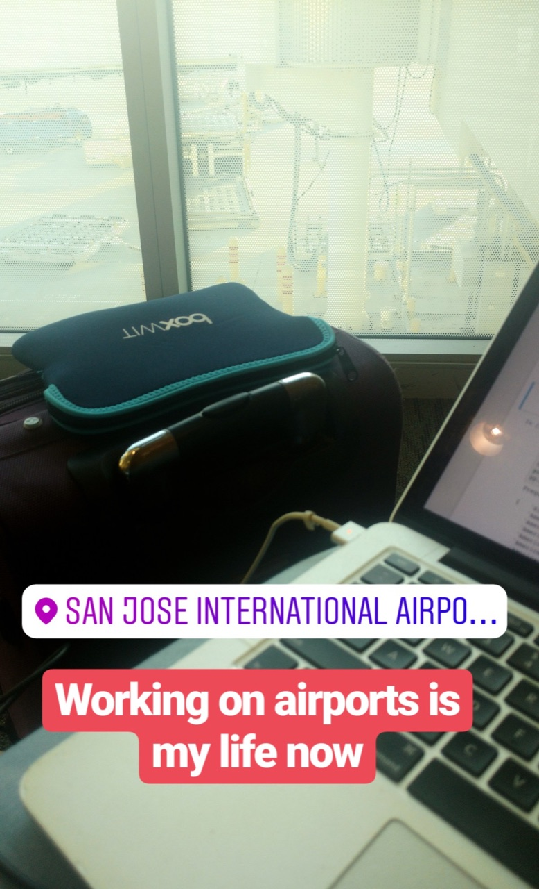

