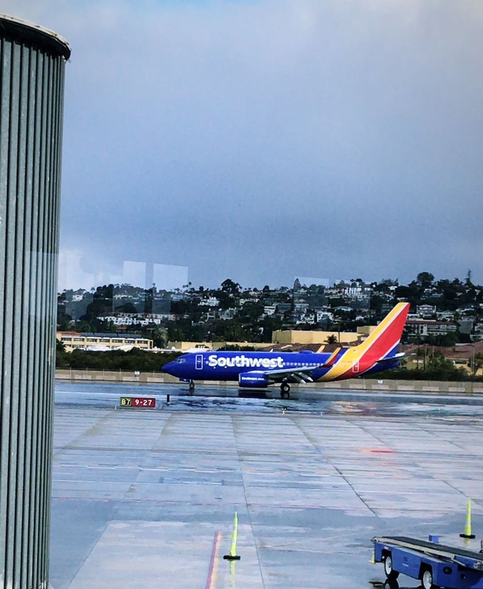
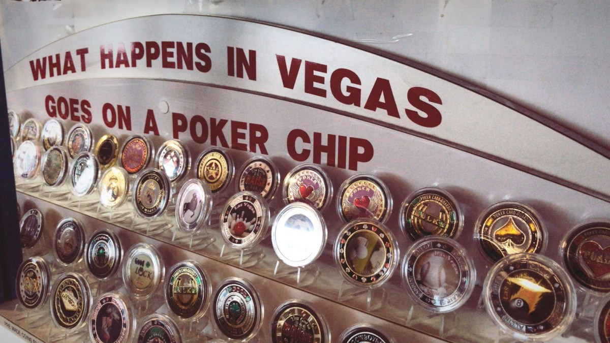
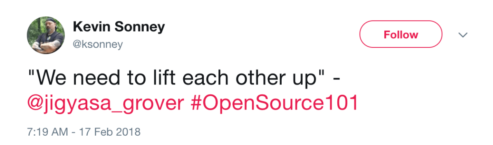
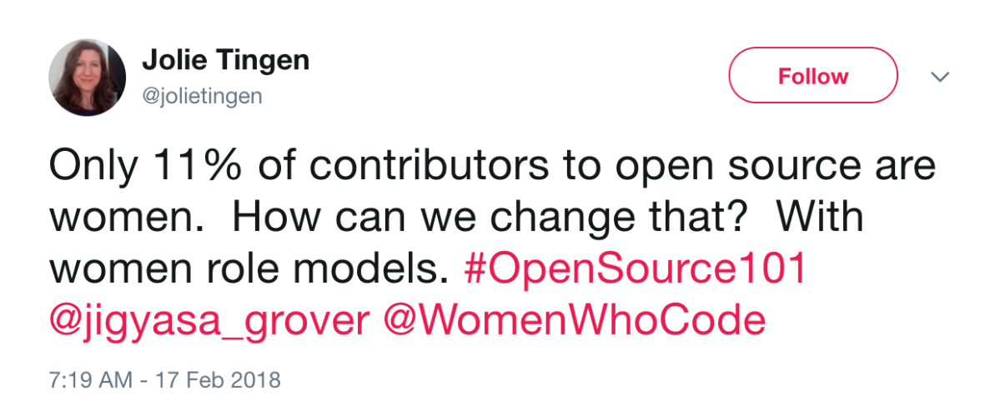
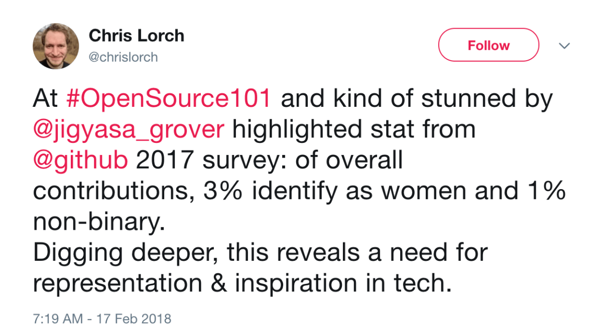
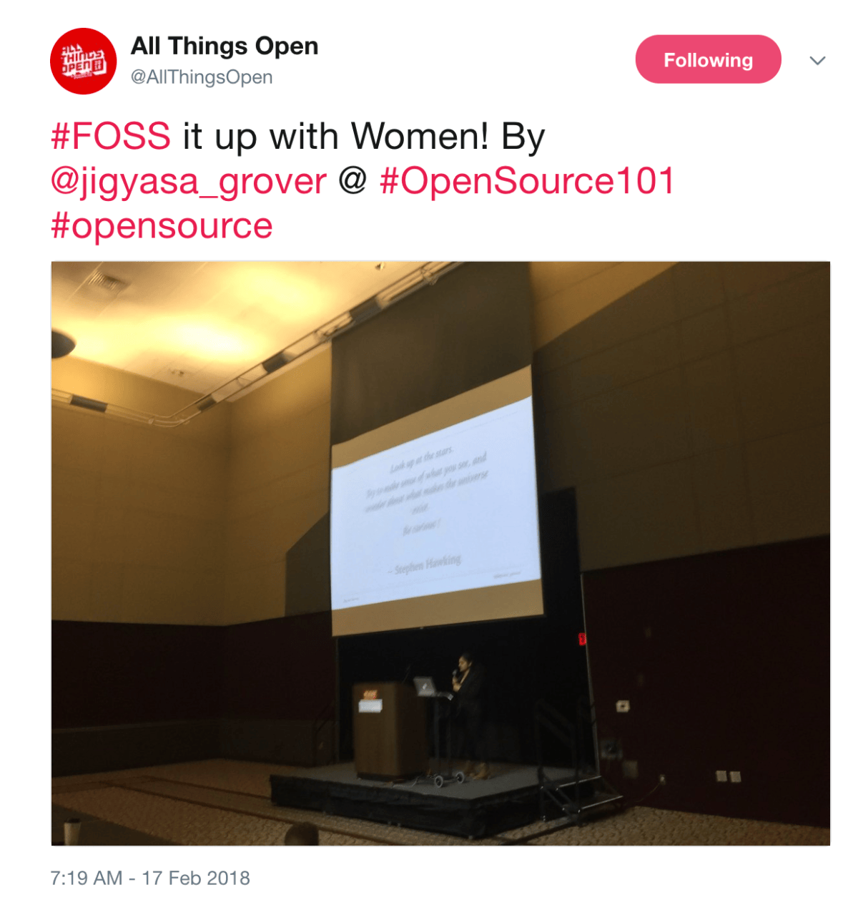
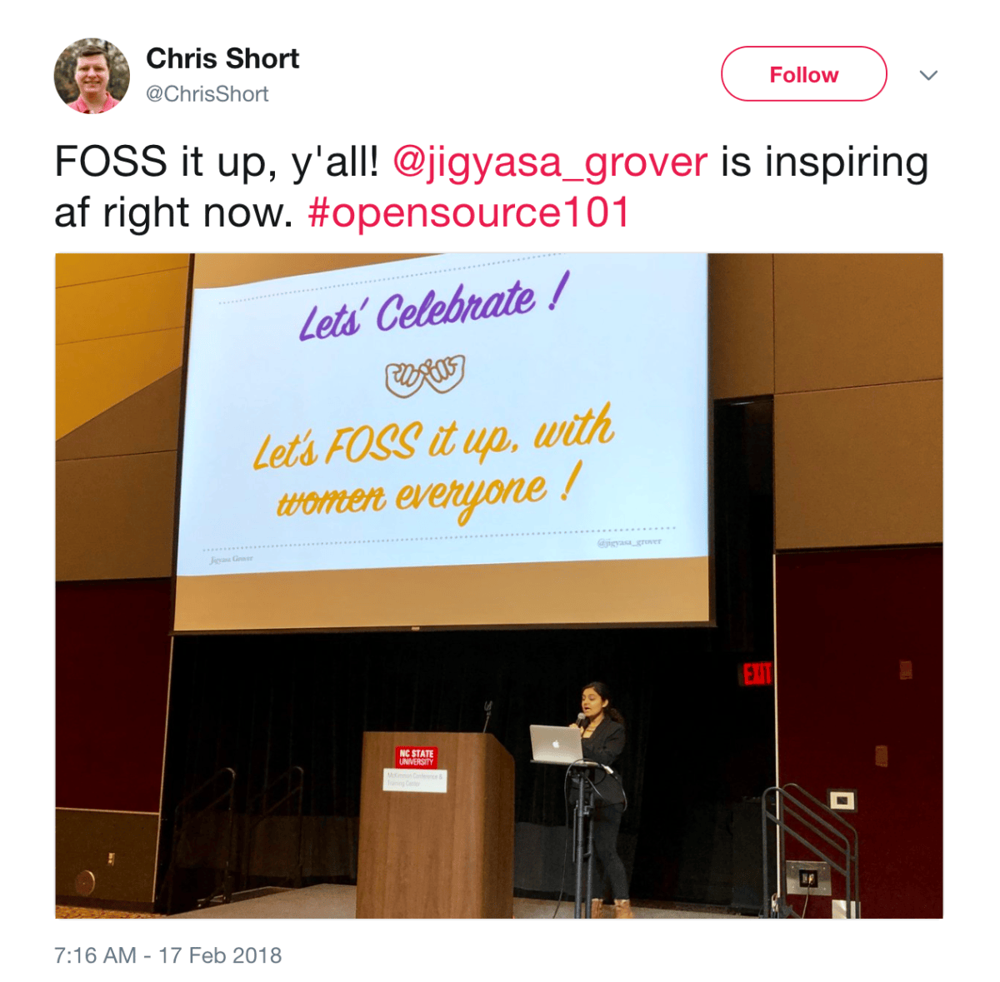
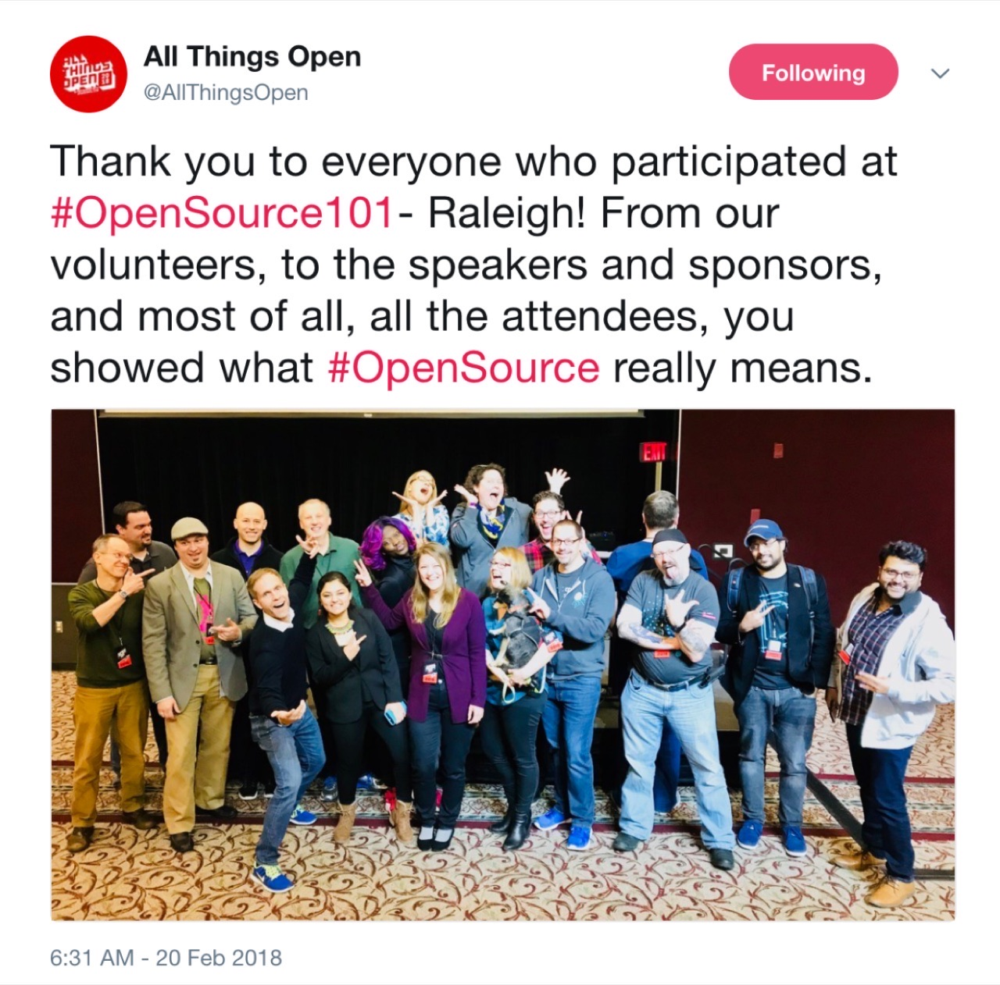

So the day I am to fly within California itself, taking an hour long flight cost me sitting at the airport for more than 5+ hours. <em>Because why not ?</em> Chilly weather and cancelled flights were all that California offered me that day.  After I was done surfing the internet, checking EMails, eating/drinking and catching up on the latest episode of my current (<em>and only</em>) TV Series&#8230;. I thought I&#8217;d quickly jot down my travel tale from the last weekend which was a mini-adventure on it&#8217;s own.

<em><strong>Rain Rain Go Away, Little Jig wants to Fly !</strong></em>

It was no less than a prestigious occasion, and the first for me when I was invited to present the opening keynote at <strong>Open Source 101</strong>, held at <em>The McKimmon Center</em> in the cozy town of <em>Raleigh</em> 🎉 I instantly accepted the kind invitation especially since the conference aimed to cover the very basics of open technology targeting existing professionals and students before it jumped onto the much advanced themes in the upcoming <strong>All Things Open</strong> being held later this year.

The travel to Raleigh was kinda long-ish, but the good part was the evening I got to spend in Las Vegas. <em>What happens in Vegas, stays in Vegas ?</em> 🤷🏻‍♀️ Well, all I did was explore the strip, casinos, buy some souvenir poker chips and eat ~ things I could manage to squeeze in the little time I had in the <em>Sin City</em> .

<em>PS: A crazy road-trip to Las Vegas involving me carrying no work burden coming soon 😉</em>

  <figure></figure>
  <figure></figure>

After a loooong travel full of flight delays, landing way after midnight, hopping time-zones, getting too little time to sleep I woke up to a beautiful cold Saturday in North Carolina &#8230;. all excited yet nervous on getting on the big stage to actually set the theme of the entire conference. <em>A huge responsibility on tiny shoulders, eh ?</em>

Going through troubles of the initial A/V settings (<em>can we ever avoid them in any event despite never ending run-throughs?</em>), I was soon up on stage in front of a lovely audience. Starting off by rolling back in time and seeing how Open Source had evolved during the years, followed by the current scenario, I brushed up the crowd with the latest statistics and talked about how to bring in a diverse user/developer base, I thoroughly enjoyed the nods from the attentive audience which boosted my confidence !

&nbsp;

  <figure></figure>
  <figure></figure>
  <figure></figure>
  <figure></figure>

&nbsp;

After the keynote and talks on the main-stage, the conference broke into smaller rooms for themed talks spanning accessibility, licensing, containers, testing, and other very interesting applications like mind machine interfacing and smart cities, I tried attending most of the talks to have the latest updates for all.

&nbsp;

  <figure></figure>
  <figure></figure>

Absolutely, I had a fun time delivering the keynote, attending the 101 talks and interacting with all the open source personalities up there.

The highlight of the day was being tweeted as <em>&#8220;inspring af&#8221;</em> which felt really flattering. Thank you <em>Todd Lewis</em> and the entire <em>ATO</em> team for putting together this, See you at <strong>Open Source 101</strong> Columbia next 👋🏻

