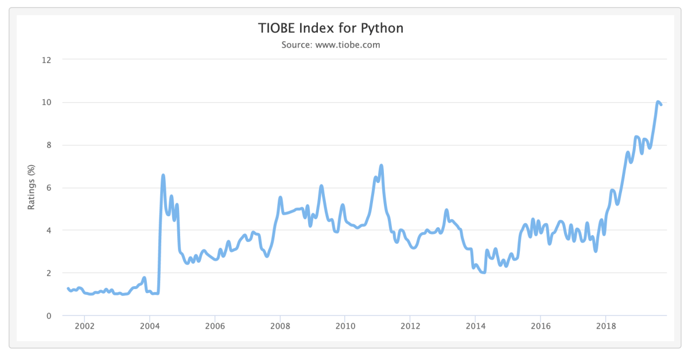
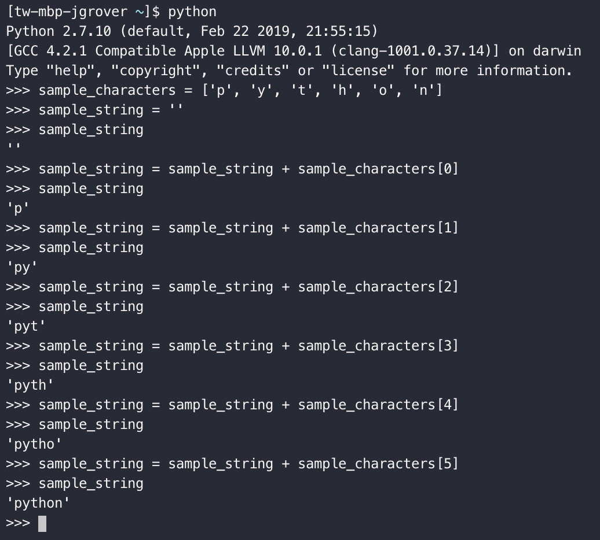
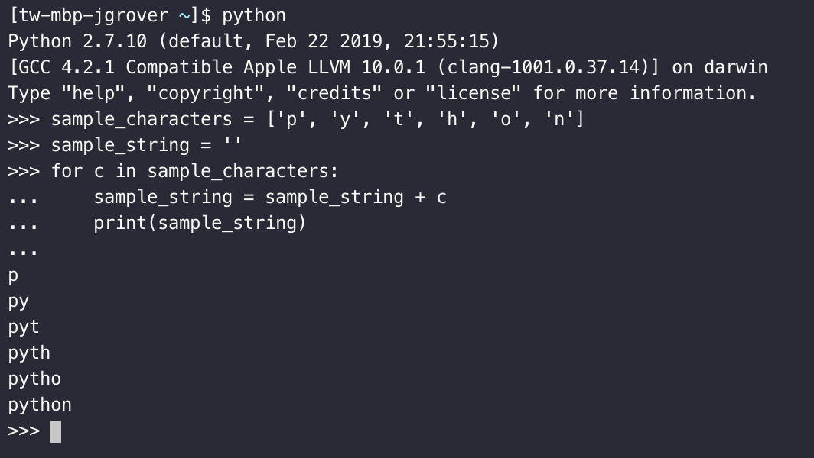
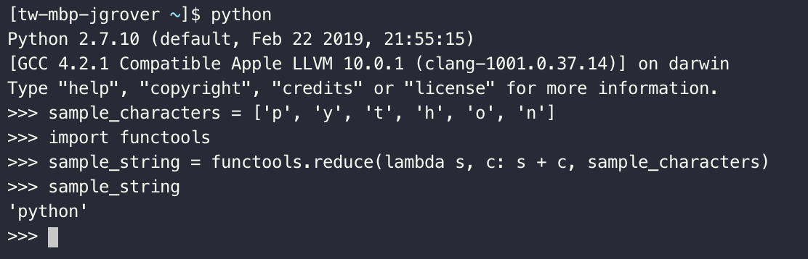
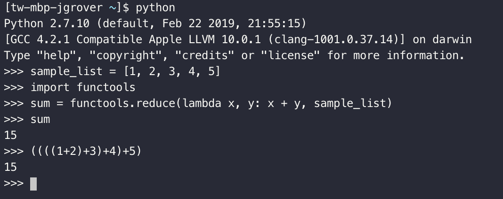
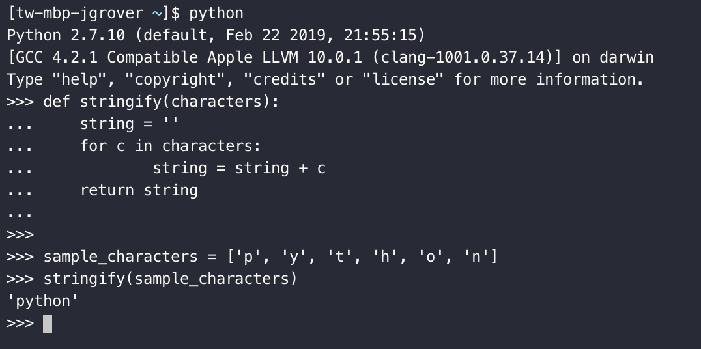
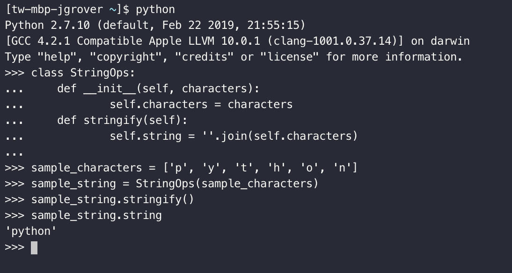

On a Sunday like today, I just sat down to do some regular work, sort out bills, renew my lease and insurances and continuously looking at the date made the reality hit me hard &#8211; 2019 is <em>almost</em> over &#8211; oh, how time flies 🚀

Nonetheless, blessed as 2019 has been a great year for me, both personally and professionally 👼🏻 I was honored to have received so many opportunities and invites to speak at various technical conferences in different parts of the world (my special one for this year would be <em>Central America</em>) and a ton of cities in the United States. One of my most loved talks would be the one where I talked about the rapid rise and modern dominance of <strong>Python</strong> since it won the celebrated title of being the <strong>Programming Language of the Year 2018</strong> 🏆 after scoring the most search engine ranking points as calculated by <a href="https://www.tiobe.com/tiobe-index/">TIOBE</a>.

My talk points the reasons for the contemporary bloom owing to the ease of learning and availability of extensive libraries and frameworks making the tasks easier, modular and portable in nature. But what wins the cake 🎂  is the flexibility it provides in terms of being multi paradigm and dispensing the freedom to all kinds of developers to choose their own style, be comfortable with the entire environment and not restrict the creativity. After discussing the different paradigms of programming Python supports alongside a very simple hands-on example and discussing how it lets you be the snake charmer 🐍 I also reviewed the different cases in Machine Learning, Data Manipulation giving out pointers on which paradigm was suitable for which use-case and some hints on how to choose one for your case to develop an efficient design solution.

I have also written a detailed article on it for <a href="https://opensource.com/">opensource.com</a>, so do check it out if you are interested in Python or programming paradigms in general &#8211; <a href="https://opensource.com/article/19/10/python-programming-paradigms">opensource.com &#8211; Perceiving Python programming paradigms</a> 👋🏻

<strong>as it is from OpenSource.com: </strong>

Early each year, TIOBE announces its Programming Language of The Year. When its latest annual <a href="https://www.tiobe.com/tiobe-index//programming-languages-definition/" target="_blank" rel="noopener">TIOBE index</a> report came out, I was not at all surprised to see <a href="https://www.tiobe.com/tiobe-index/python/" target="_blank" rel="noopener">Python again winning the title</a>, which was based on capturing the most search engine ranking points (especially on Google, Bing, Yahoo, Wikipedia, Amazon, YouTube, and Baidu) in 2018.

Adding weight to TIOBE&#8217;s findings, earlier this year, nearly 90,000 developers took Stack Overflow&#8217;s annual <a href="https://insights.stackoverflow.com/survey/2019" target="_blank" rel="noopener">Developer Survey</a>, which is the largest and most comprehensive survey of people who code around the world. The main takeaway from this year&#8217;s results was:

&#8220;Python, the fastest-growing major programming language, has risen in the ranks of programming languages in our survey yet again, edging out Java this year and standing as the second most loved language (behind Rust).&#8221;

Ever since I started programming and exploring different languages, I have seen admiration for Python soaring high. Since 2003, it has consistently been among the top 10 most popular programming languages. As TIOBE&#8217;s report stated:

&#8220;It is the most frequently taught first language at universities nowadays, it is number one in the statistical domain, number one in AI programming, number one in scripting and number one in writing system tests. Besides this, Python is also leading in web programming and scientific computing (just to name some other domains). In summary, Python is everywhere.&#8221;

There are several reasons for Python&#8217;s rapid rise, bloom, and dominance in multiple domains, including web development, scientific computing, testing, data science, machine learning, and more. The reasons include its readable and maintainable code; extensive support for third-party integrations and libraries; modular, dynamic, and portable structure; flexible programming; learning ease and support; user-friendly data structures; productivity and speed; and, most important, community support. The diverse application of Python is a result of its combined features, which give it an edge over other languages.

But in my opinion, the comparative simplicity of its syntax and the staggering flexibility it provides developers coming from many other languages win the cake. Very few languages can match Python&#8217;s ability to conform to a developer&#8217;s coding style rather than forcing him or her to code in a particular way. Python lets more advanced developers use the style they feel is best suited to solve a particular problem.

While working with Python, you are like a snake charmer. This allows you to take advantage of Python&#8217;s promise to offer a non-conforming environment for developers to code in the style best suited for a particular situation and to make the code more readable, testable, and coherent.

<h2 id="python-programming-paradigms">Python Programming Paradigms</h2>

Python supports four main <a href="https://en.wikipedia.org/wiki/Programming_paradigm" target="_blank" rel="noopener">programming paradigms</a>: imperative, functional, procedural, and object-oriented. Whether you agree that they are valid or even useful, Python strives to make all four available and working. Before we dive in to see which programming paradigm is most suitable for specific use cases, it is a good time to do a quick review of them.

<h3 id="imperative-programming-paradigm">Imperative Programming Paradigm</h3>

The <a href="https://en.wikipedia.org/wiki/Imperative_programming" target="_blank" rel="noopener">imperative programming paradigm</a> uses the imperative mood of natural language to express directions. It executes commands in a step-by-step manner, just like a series of verbal commands. Following the &#8220;how-to-solve&#8221; approach, it makes direct changes to the state of the program; hence it is also called the stateful programming model. Using the imperative programming paradigm, you can quickly write very simple yet elegant code, and it is super-handy for tasks that involve data manipulation. Owing to its comparatively slower and sequential execution strategy, it cannot be used for complex or parallel computations.

Talk is cheap, show me the code. 

&#8211; Linus Torvalds

Consider this example task, where the goal is to take a list of characters and concatenate it to form a string. A way to do it in an imperative programming style would be something like: 

Here, the variable <strong>sample_string</strong> is also like a state of the program that is getting changed after executing the series of commands, and it can be easily extracted to track the progress of the program. The same can be done using a <strong>for</strong> loop (also considered imperative programming) in a shorter version of the above code:

<h3 id="functional-programming-paradigm">Functional Programming Paradigm</h3>

The <a href="https://en.wikipedia.org/wiki/Functional_programming" target="_blank" rel="noopener">functional programming paradigm</a> treats program computation as the evaluation of mathematical functions based on <a href="https://en.wikipedia.org/wiki/Lambda_calculus" target="_blank" rel="noopener">lambda calculus</a>. Lambda calculus is a formal system in mathematical logic for expressing computation based on function abstraction and application using variable binding and substitution. It follows the &#8220;what-to-solve&#8221; approach—that is, it expresses logic without describing its control flow—hence it is also classified as the declarative programming model. 

The functional programming paradigm promotes stateless functions, but it&#8217;s important to note that Python&#8217;s implementation of functional programming deviates from standard implementation. Python is said to be an <em>impure</em> functional language because it is possible to maintain state and create side effects if you are not careful. That said, functional programming is handy for parallel processing and is super-efficient for tasks requiring recursion and concurrent execution.

Using the same example, the functional way of concatenating a list of characters to form a string would be the same as above. Since the computation happens in a single line, there is no explicit way to obtain the state of the program with <strong>sample_string</strong> and track the progress. The functional programming implementation of this example is fascinating, as it reduces the lines of code and simply does its job in a single line, with the exception of using the <strong>functools</strong> module and the <strong>reduce</strong> method. The three keywords—<strong>functools</strong>, <strong>reduce</strong>, and <strong>lambda</strong>—are defined as follows:

<ul>
<li><strong>functools</strong> is a module for higher-order functions and provides for functions that act on or return other functions. It encourages writing reusable code, as it is easier to replicate existing functions with some arguments already passed and create a new version of a function in a well-documented manner.</li>
<li><strong>reduce</strong> is a method that applies a function of two arguments cumulatively to the items in sequence, from left to right, to reduce the sequence to a single value. For example:</li>
<li><strong>lambda functions</strong> are small, anonymized (i.e., nameless) functions that can take any number of arguments but spit out only one value. They are useful when they are used as an argument for another function or reside inside another function; hence they are meant to be used only for one instance at a time.</li>
</ul>
<h3 id="procedural-programming-paradigm">Procedural Programming Paradigm</h3>

The <a href="https://en.wikipedia.org/wiki/Procedural_programming" target="_blank" rel="noopener">procedural programming paradigm</a> is a subtype of imperative programming in which statements are structured into procedures (also known as subroutines or functions). The program composition is more of a procedure call where the programs might reside somewhere in the universe and the execution is sequential, thus becoming a bottleneck for resource utilization. Like the imperative programming paradigm, procedural programming follows the stateful model. The procedural programming paradigm facilitates the practice of good program design and allows modules to be reused in the form of code libraries.

This modularized form of development is a very old development style. The different modules in a program can have no relationship with each other and can be located in different locations, but having a multitude of modules creates hardships for many developers, as it not only leads to duplication of logic but also a lot of overhead in terms of finding and making the right calls. Note that in the following implementation, the method <strong>stringify</strong> could be defined anywhere in the universe and, to do its trick, only require the proper call with the desired arguments.

<h3 id="object-oriented-programming-paradigm">Object-Oriented Programming Paradigm</h3>

The <a href="https://en.wikipedia.org/wiki/Object-oriented_programming" target="_blank" rel="noopener">object-oriented programming paradigm</a> considers basic entities as objects whose instance can contain both data and the corresponding methods to modify that data. The different principles of object-oriented design help code reusability, data hiding, etc., but it is a complex beast, and writing the same logic an in object-oriented method is tricky. For example:

<h2 id="what-programming-paradigm-should-i-choose">What programming paradigm should I choose?</h2>

It&#8217;s important to note that there is no comparison between the different types of programming paradigms. Since software is nothing but knowledge representation, the answer to the question: <em>&#8220;What is the best way to represent my problem?&#8221;</em> is choosing a specific programming paradigm.

In layman&#8217;s terms, if your problem involves a series of simple sequential manipulations, following the old-school imperative programming paradigm would be the least expensive in terms of time and effort and give you the best results. In the case of problems requiring mathematical transformations of values, filtering information, mapping, and reductions, functional programming with program computation as mathematical functions might come in handy. If the problem is structured as a bunch of interrelated objects with certain attributes that can change with the passage of time, depending on certain conditions, object-oriented programming will be super-useful. Of course, a rule-based approach would not work here, as programming paradigm choice is also heavily dependent on the type of data to be processed, the dynamic needs of the system, and various other things like scalability.

<h2 id="recent-trends">Recent trends</h2>

Analyzing the latest tech buzzwords can help identify why certain programming paradigms work better than others.

<ul>
<li><strong>Machine learning</strong> uses a healthy mix of imperative programming and functional programming with a dash of immutability. Feature extraction and preprocessing are best approached functionally, as they require mathematical processing of data because mappings, reductions, and filtrations can pretty much be done in parallel without much dependence on each others&#8217; data points. Training of machine learning models is best approached via old-school imperative programming, as optimizing functions&#8217; value (a.k.a. the state of the program) needs to be updated at each iteration and therefore requires sequential execution at many points in the algorithm. It is quicker than functional programming in that case. It also avoids creating copies of everything after each step; instead it just updates the previous-value placeholders.</li>
<li><strong>Deep learning</strong> can be performed well in a functional manner, as deep learning models are compositional. The entire process optimizes a set of composite functions, weights are immutable and stateless, and updates can be applied in any order as long as corresponding inputs are computed. Using functional programming provides concurrency and parallelism at no cost and also makes it easier to work with large, distributed models. There are also certain custom paradigms where functional programming is intertwined with informational theory to avoid overfitting in the statistical models.</li>
<li><strong>Data manipulation</strong> can be approached with either functional or object-oriented programming. In the functional programming way, everything is immutable, algorithms are expressed succinctly, and there is native pattern matching, but formulation of the mathematical expression-like command is an art. Approaching it in an object-oriented programming way provides for recursive and iterative loops and a class-based structure that makes it easier to scale for bigger data and new functions. The downside is that the algorithms and the code logic are not expressed in a readable way. Although both paradigms tend to have an automatic garbage-collection system and can access and manipulate databases smoothly, the choice of which one to choose is heavily dependent on the programmer&#8217;s knowledge.</li>
</ul>
<h2 id="takeaway">Takeaway</h2>

There is a high probability that any two developers would disagree on the best coding style for any situation and have valid arguments to support their opinion. The amazing thing about Python is that it lets you choose the programming paradigm that works the best for you in a given situation.

As the above examples demonstrate, a task can always be broken into sub-tasks where each smaller part is coded in a completely different paradigm. The mix-and-match style works perfectly as long as the packages used are minimal, the inputs and outputs are clearly defined, and the complexity is moderated. There are no rules that say you can’t combine styles as needed. Python doesn’t stop in the middle of interpreting your application and display a style error when you mix styles.

Because there is no perfect guidebook for choosing a correct coding style for a given use case, the best suggestion is to try several paradigms weighing in their pros and cons until you find the one that leads to a simple yet efficient solution. There will be times during this experimentation when you will see that instead of using a single style throughout, a combination of programming paradigms works better for different parts to a solution. During this process, it is also highly recommended to document the requirements and the trials of different styles to share with the community and get feedback. The comments and suggestions will help with development as well as your teammates and any future developers that are added to the team.

&nbsp;

