
As a Machine Learning Engineer, I got to read/present a couple of research papers pertaining to my domain at work this year so I thought why not share it here on my blog as well 💁🏻‍♀️

In this segment, I will share reading specifically related to click-through rate (CTR) estimation viz. <a href="https://www.microsoft.com/en-us/research/wp-content/uploads/2017/04/main-1.pdf">Model Ensemble for Click Prediction in Bing Search Ads</a> by <em>Microsoft Bing</em> and <em>Microsoft Research </em>published in April 2017.

According to <a href="https://support.google.com/google-ads/answer/2615875?hl=en">Google Ads Help</a>, <em><strong>CTR is a ratio showing how often people who see your ad end up clicking it</strong>. It can be used to gauge how well your keywords and ads are performing.</em>

<blockquote>
By definition: CTR is the number of clicks that your ad receives divided by the number of times your ad is shown: CTR = clicks ÷ impressions. For example, if you had 5 clicks and 100 impressions, then your CTR would be 5%. Each of your ads and keywords have their own CTRs that you can see listed in your account. A high CTR is a good indication that users find your ads helpful and relevant. CTR also contributes to your keyword&#8217;s expected CTR, which is a component of Ad Rank. Note that a good CTR is relative to what you&#8217;re advertising and on which networks. You can use CTR to gauge which ads and keywords are successful for you and which need to be improved. The more your keywords and ads relate to each other and to your business, the more likely a user is to click on your ad after searching on your keyword phrase.

Reference: <a href="https://support.google.com/google-ads/answer/2615875?hl=en">Google Ads Help</a>
</blockquote>

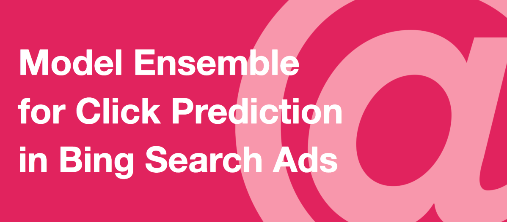

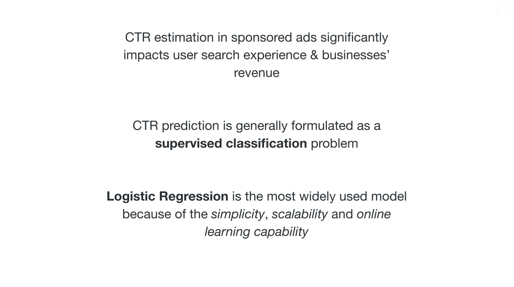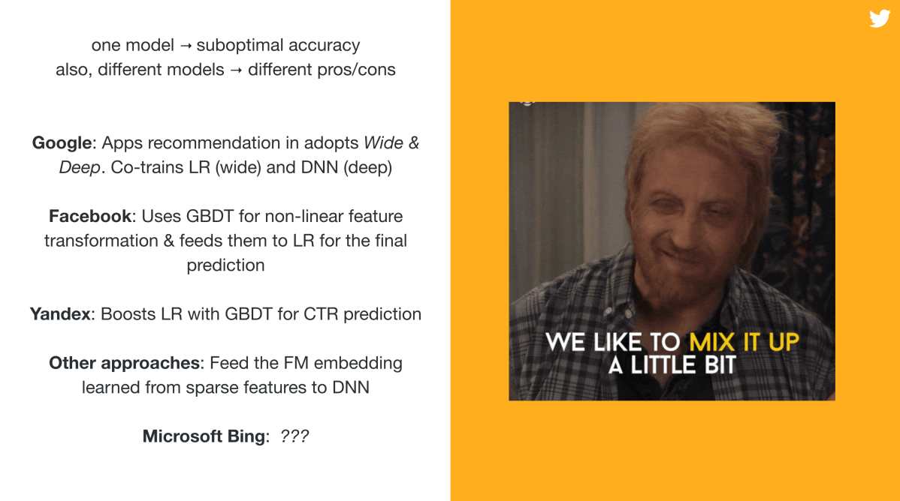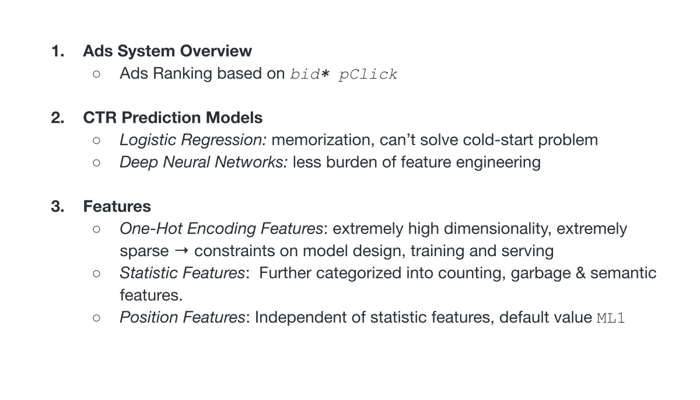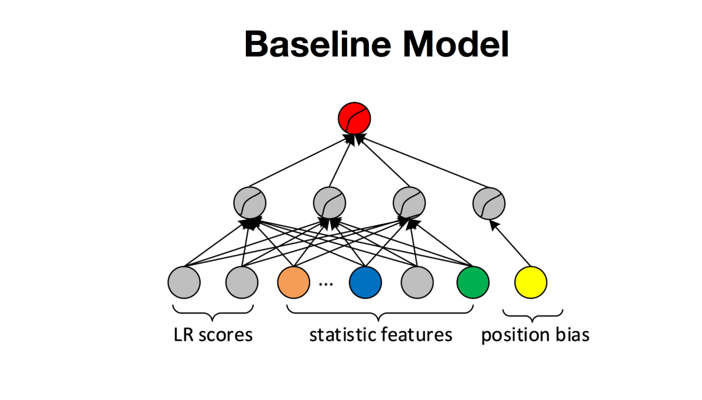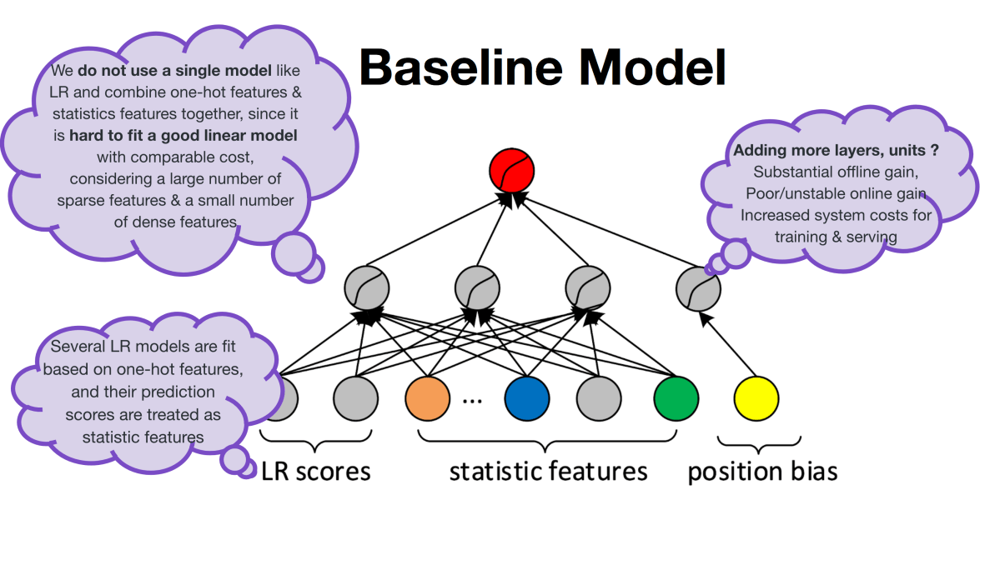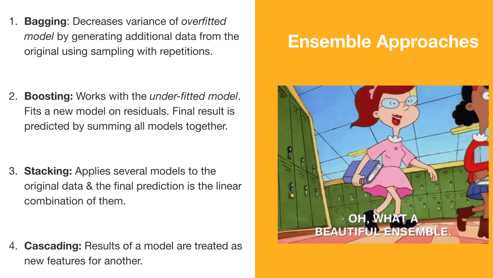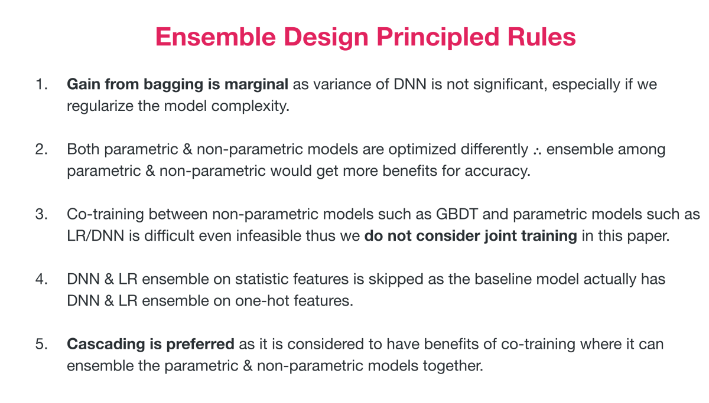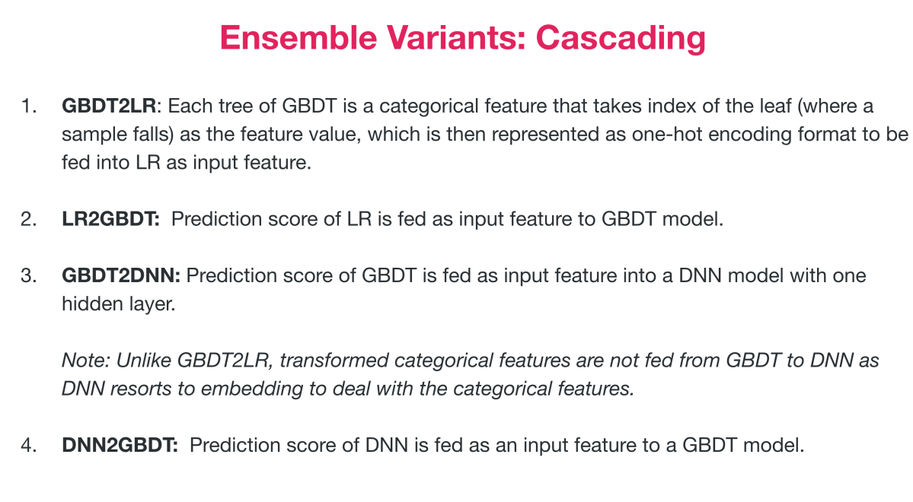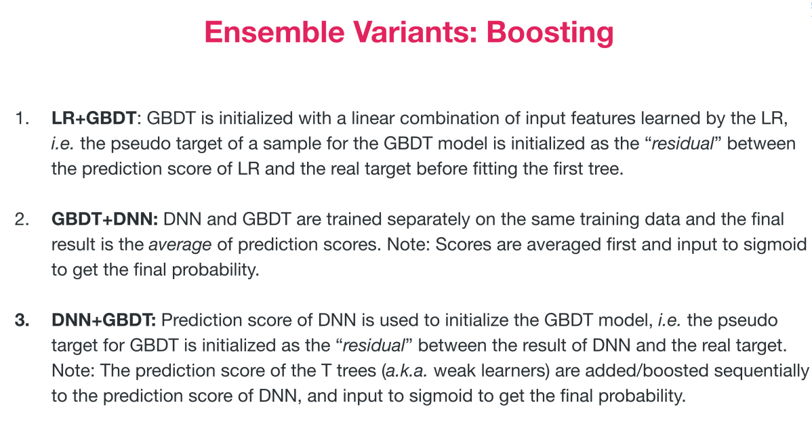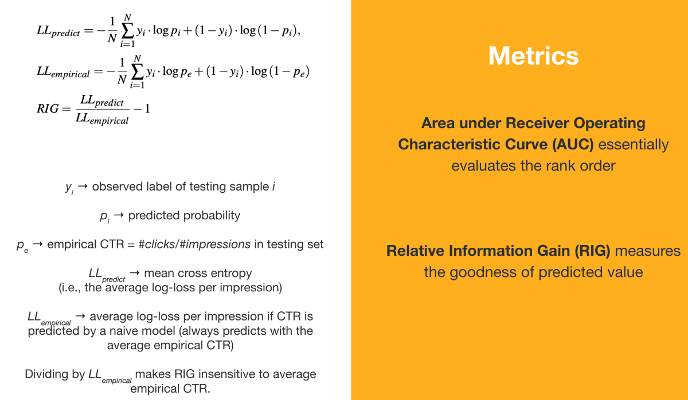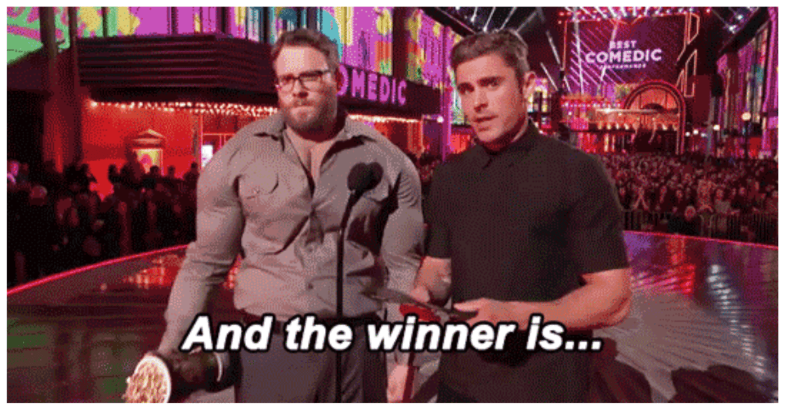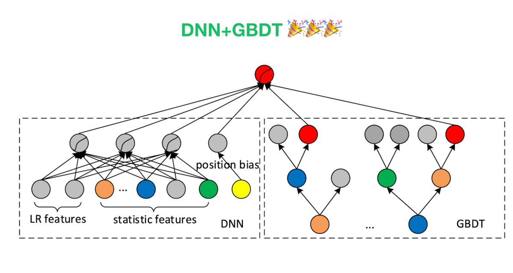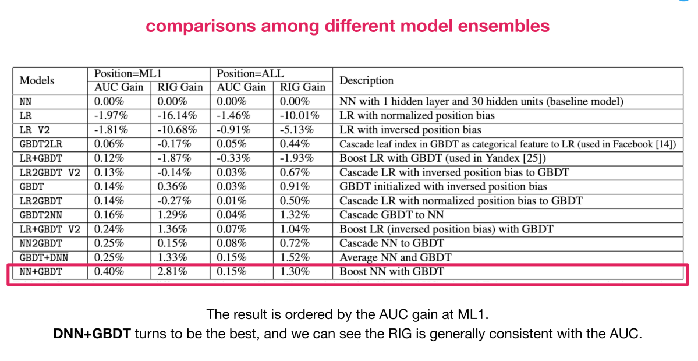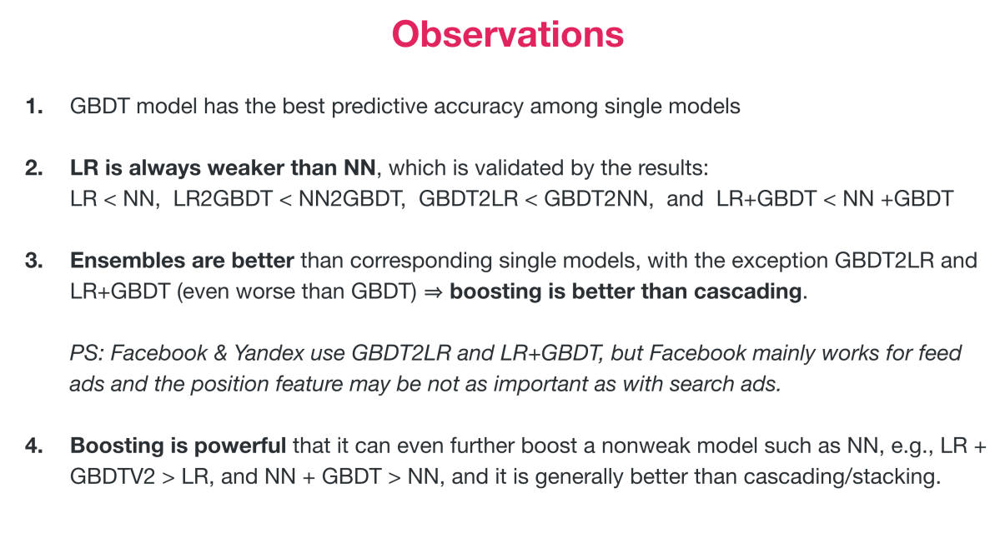

This reading gave me insights into how cascading and boosting methods could be amalgamated to bring out the best from each in the form of ensembles and thus assist the increase in predictive accuracy. Hope this quick overview of the research paper also helps someone out there 👋🏻

<em>PS: Part 2 of this segment with an overview of <a href="https://arxiv.org/pdf/1803.10739.pdf">Deeply Supervised Semantic Model for Click-Through Rate Prediction in Sponsored Search</a> by Yahoo! Research and Temple University coming up soon!</em>

