
Continuing <a href="/research-reading-approaches-to-click-through-rate-estimation-1-x/">part one</a> of this segment, I will share yet another research reading specifically related to click-through rate (CTR) estimation viz. <a href="https://arxiv.org/pdf/1803.10739.pdf">Deeply Supervised Semantic Model for Click-Through Rate Prediction in Sponsored Search</a> by <em>Yahoo! Research</em> and <em>Temple University</em> published in March 2018.

According to <a href="https://support.google.com/google-ads/answer/2615875?hl=en">Google Ads Help</a>, <em><strong>CTR is a ratio showing how often people who see your ad end up clicking it</strong>. It can be used to gauge how well your keywords and ads are performing.</em>

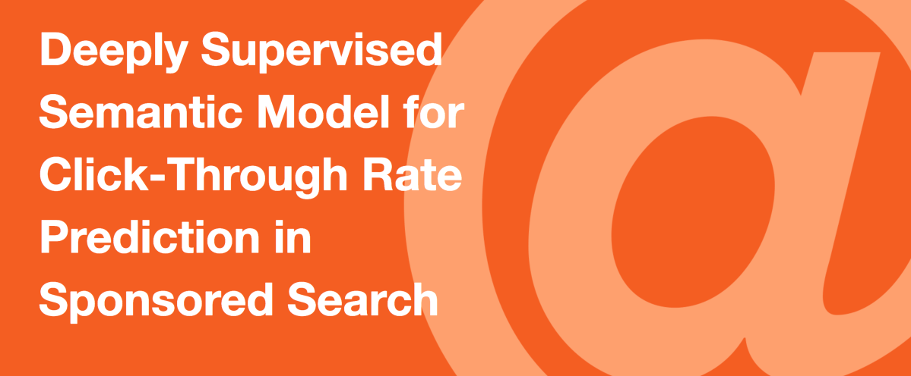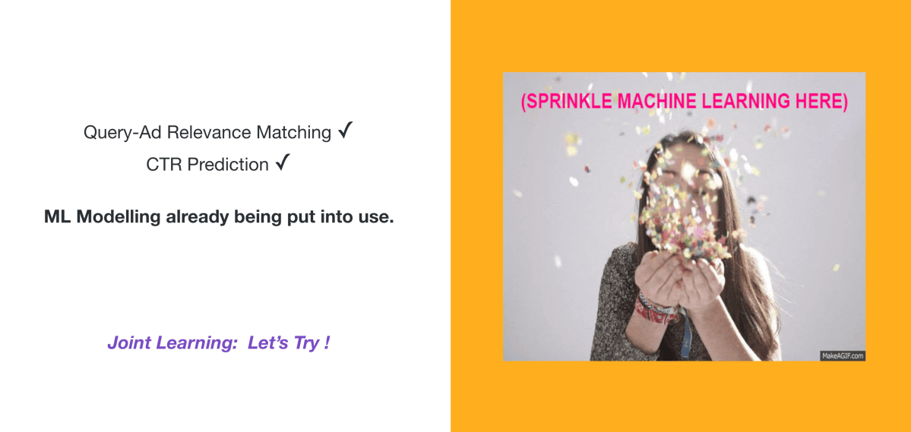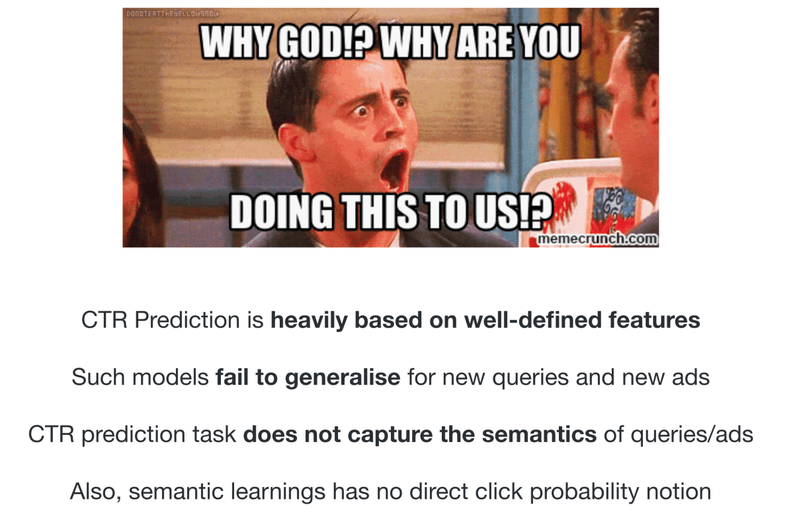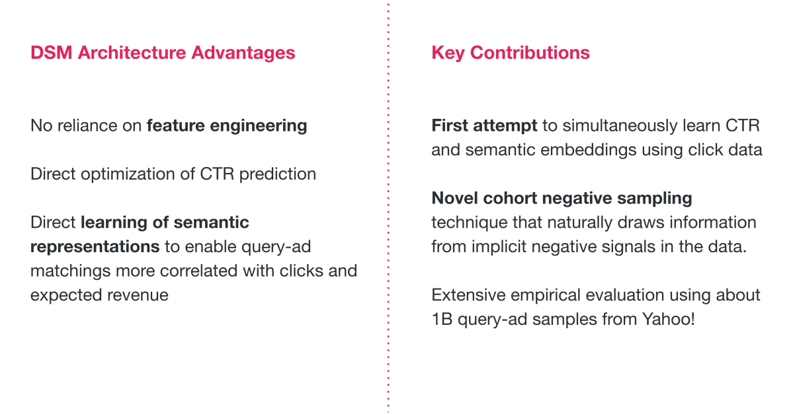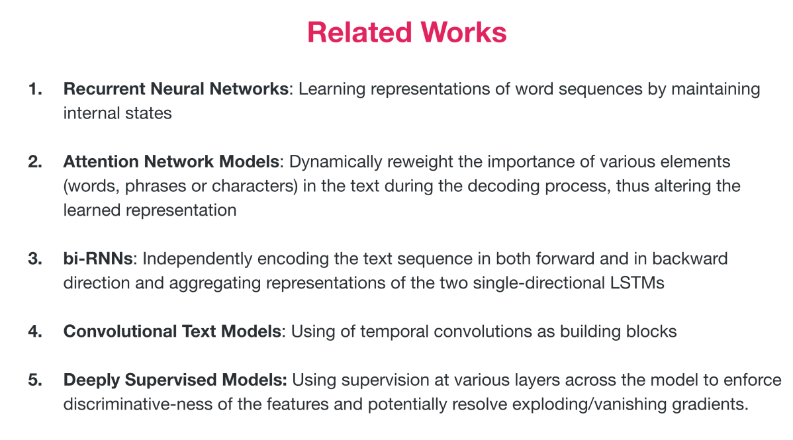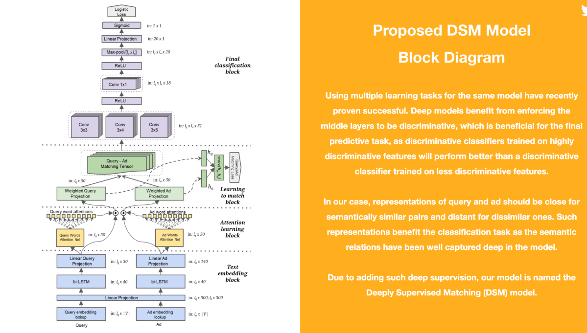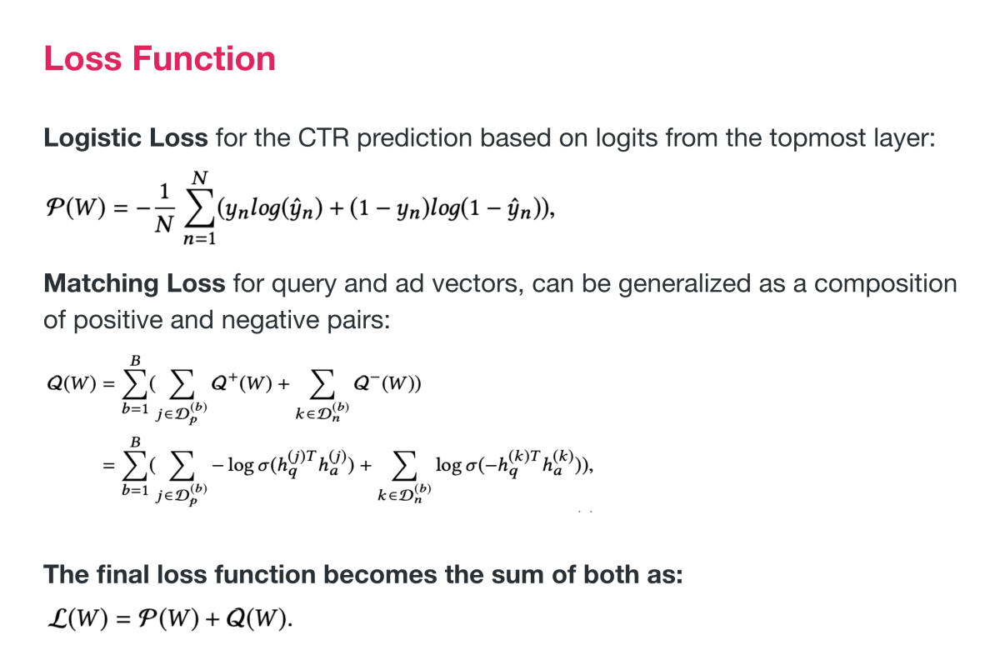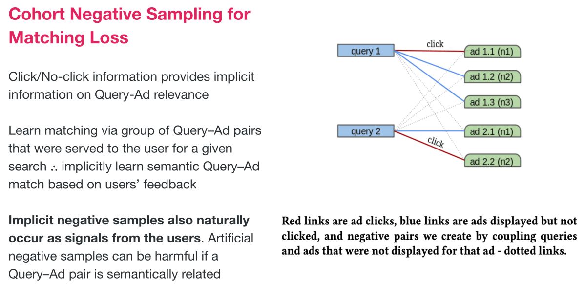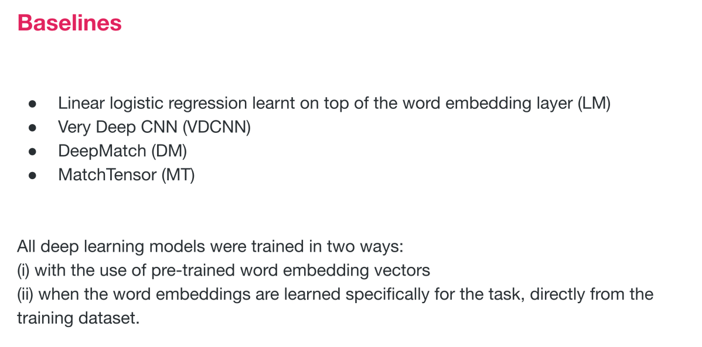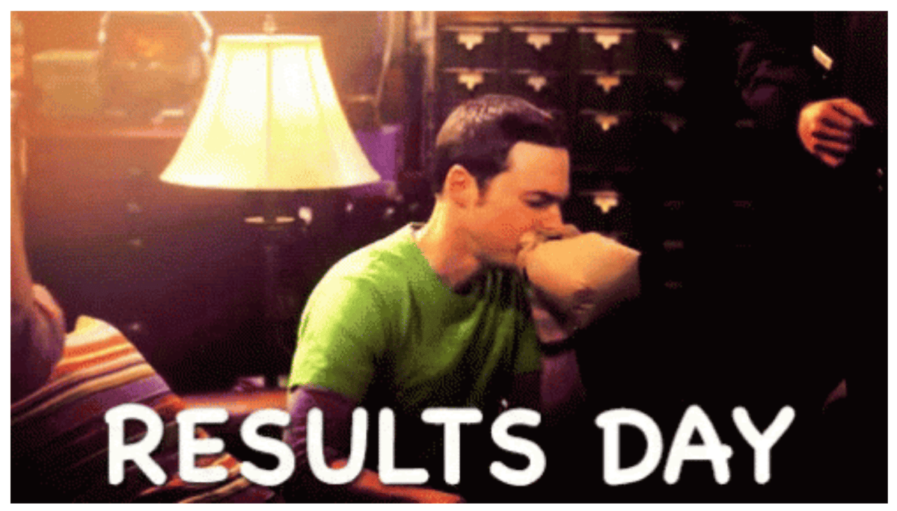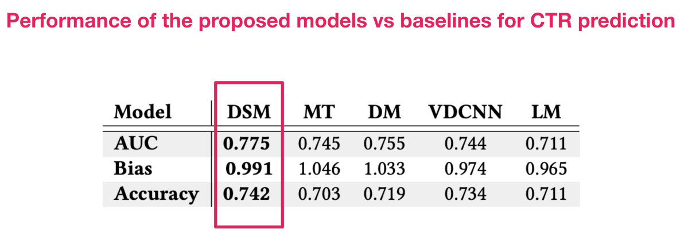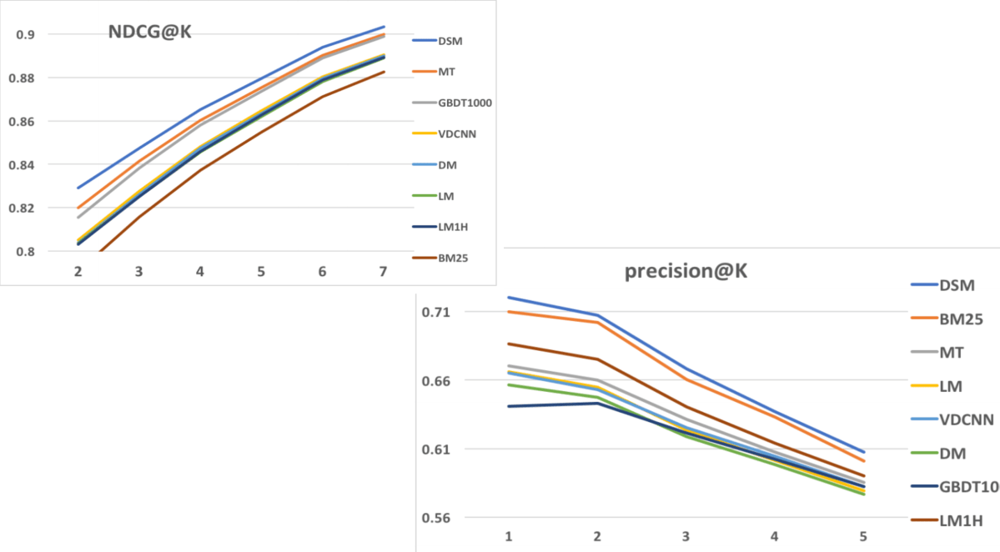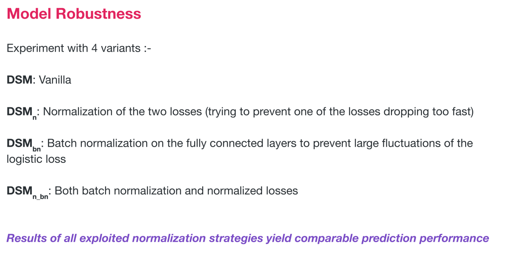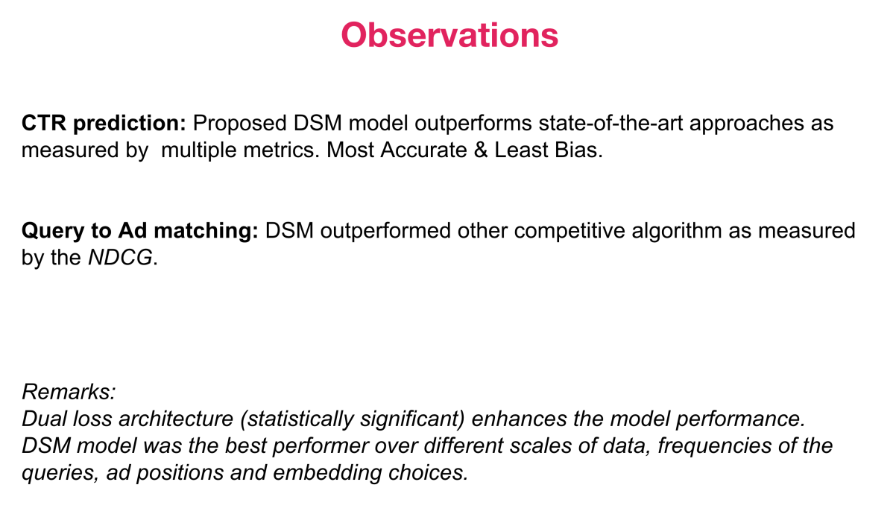

Hope this quick overview of the research paper helps someone out there 👋🏻

<em>PS: Part 3 of this segment with an overview of <a href="https://www.aaai.org/ojs/index.php/AAAI/article/view/4545">Deep Interest Evolution Network for Click-Through Rate Prediction</a> by Alibaba Group coming up soon!</em>

